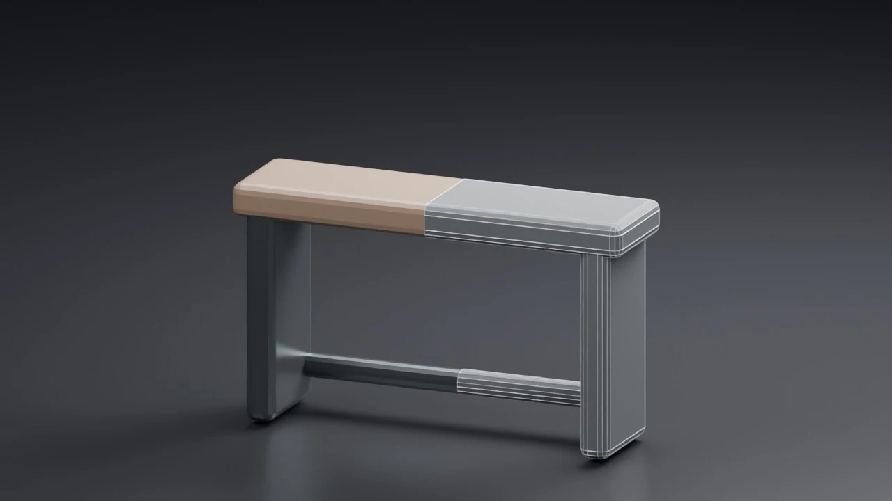
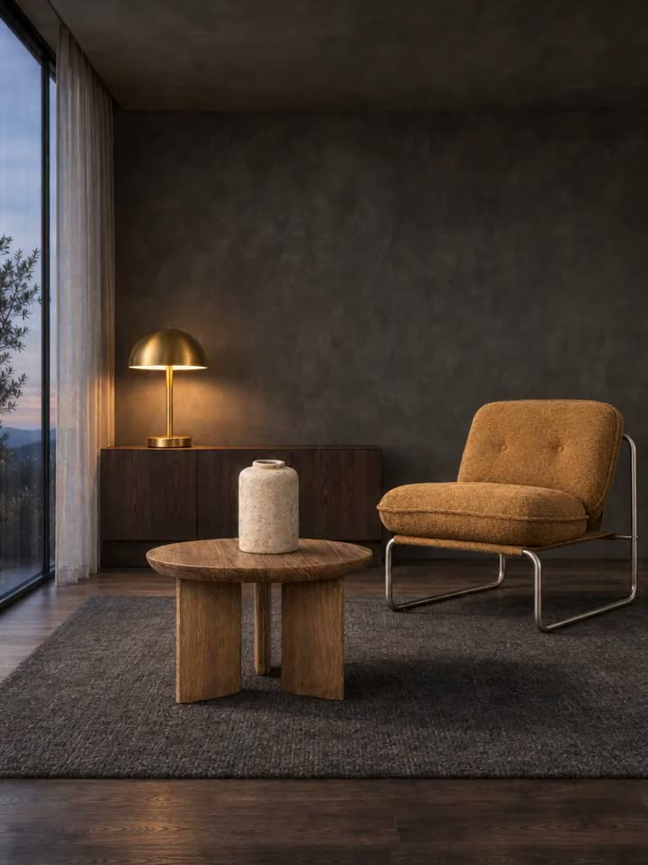

---

group: "3d-furniture-models-home-staging"
title: "3D-Möbel in eine Home-Staging-Szene einfügen"
description: "Plätze ein bestehendes Möbelmodell in eine Raum-Szene und überprüfe anschließend Proportion, Bodenkontakt und Beleuchtung."
date: 2026-12-08
updated: 2026-12-08
keyword: "3D-Möbel Home Staging"
cta: "Prüfe deine Produktansichten in der kostenlosen Vorschau."
---

Ein Möbelmodell in eine bestehende Raum-Szene einfügen, indem du zunächst seine Orientierung und Pivot-Position überprüfst. Nutze unabhängig überprüfte Abmessungen, um es im Editor zu positionieren. Stelle Licht und Position auf dem Boden ein und überprüfe die Szene aus der Endkamera sowie aus einem sekundären Blickwinkel.

## Wie bereitest du das Objekt vor?

Öffne eine Kopie in deinem Szeneneditor. Prüfe, in welche Richtung die Vorderseite zeigt, und ob der Pivot eine vorhersehbare Position ermöglicht. Setze die Einheiten nach dem Projektbrief und verwende gemessene Produktabmessungen, wenn eine genaue Dimensionierung erforderlich ist.

## Wie lässt sich die Position glaubwürdig machen?

Positioniere das Möbel mit einem kleinen neutralen Gegenstand oder Referenz, um das Verhältnis zu beurteilen. Stelle Lichtrichtung und Kontakt aus der Kamera sicher. Dreh die Ansicht, um zu überprüfen, ob es keine Schnittstellen mit Wänden oder benachbarten Möbeln gibt. Speichere das isolierte Objekt als Asset für Varianten.

## Was solltest du vor der Veröffentlichung prüfen?

| Problem                              | Lösung                                                                             |
| ------------------------------------ | ---------------------------------------------------------------------------------- |
| Das Möbel erscheint zu schweben      | Prüfe die Unterseite und den Kontakt-Schatten                                      |
| Das Möbel überlappt eine Wand        | Überprüfe die Position von oben                                                    |
| Die Szene sieht wie ein Showroom aus | Nutze Gegenstände, die die Layout-Struktur unterstützen, ohne Beweise zu verdecken |

<!-- IMAGE PENDING: Photograph or capture the example described in the brief. -->

**Quelle** [Blender · Asset Browser](https://docs.blender.org/manual/en/latest/editors/asset_browser.html), [Blender · Einheiten](https://docs.blender.org/manual/en/latest/scene_layout/scene/properties.html#units), [Khronos · glTF 2.0-Spezifikation](https://registry.khronos.org/glTF/specs/2.0/glTF-2.0.html).

[Modellbibliothek (EN)](/models)

[So erstellst du ein 3D-Modell](/de/ratgeber/3d-modell-erstellen)

## Häufige Fragen

### Kann ich ein Modell aus einer Bibliothek verwenden?

Ja, du kannst ein Modell aus einer Bibliothek verwenden, solange es geeignete Rechte hat und im kompatiblen Format vorliegt. Prüfe das Modell hinsichtlich Detail, Ausrichtung und endgültiger Blickentfernung. Danach überprüfe die Dateiformat und stelle sicher, dass es den Importanforderungen deines Staging-Tools entspricht.

### Brauchst du genaue Quellmaße?

Du benötigst keine genauen Quellmaße, wenn das Möbel nur zur Darstellung verwendet wird. Für eine dimensionsgenaue Darstellung verwende überprüfte Maße und überprüfe die offiziellen Produktmaße, um sicherzustellen, dass die Skalierung des 3D-Modells dem Produktkatalog entspricht. Vergleiche die Skalierung des Modells mit dem Katalog vor der Staging-Phase.

### Wie zeigst du Optionen an einen Kunden?

Zeige Kunden verschiedene Möbel-Modelle 3D in derselben Räumlichkeit mit konsistenter Kamera- und Beleuchtung. Wähl ein Modell pro Zeitpunkt aus und passe ausschließlich das Möbelstück an, um Layout-Vergleiche zu ermöglichen. Danach überprüfe, dass alle 3D-Modelle korrekt skaliert und an die Räumlichkeit angepasst sind, bevor du sie freigibst.
