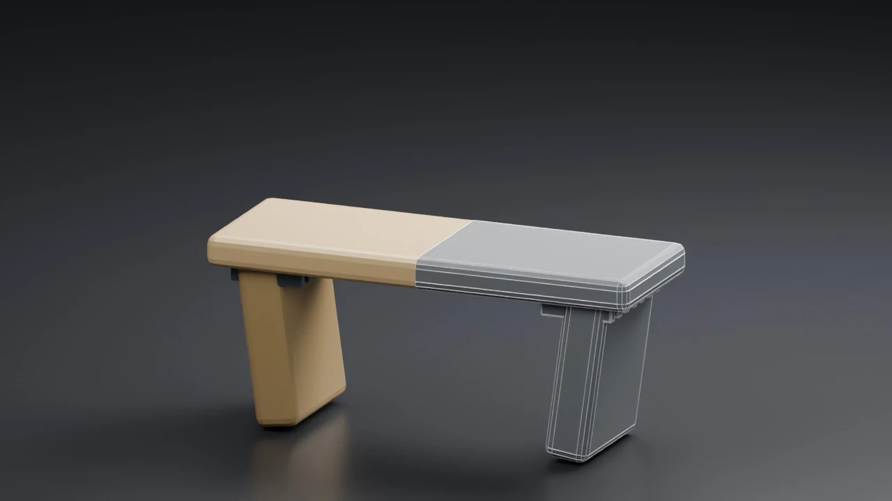
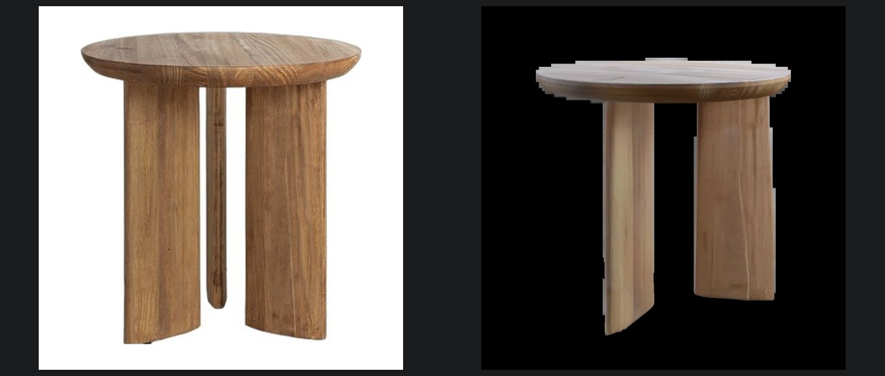

---

group: "furniture-model-from-photo"
title: "Ein 3D-Möbelmodell aus einem Foto erstellen"
description: "Vorbereite ein Möbelfoto, überprüfe die erzeugten Ansichten und prüfe das Modell vor der Verwendung in einem Katalog."
date: 2026-11-27
updated: 2026-11-27
keyword: "3D-Möbelmodell aus Foto"
cta: "Prüfe deine Produktansichten in der kostenlosen Vorschau."
---

Beginne mit einem scharfen Foto, das die Vorderseite, eine Seitenansicht und die Beine des Möbels zeigt. Prüfe die erzeugten Ansichten auf charakteristische Merkmale vor der Modellierung. Nach dem Export öffne das eigentliche GLB separat und überprüfe Silhouette, Oberflächen und Details im Maß, in dem Käufer sie sehen werden.

## Aus welchem Foto sollt ihr starten?

Verwende eine drei Viertelansicht mit isoliertem Möbel. Lasse unten Raum für die Beine und vermeide Gegenstände, die den Umfang verdecken. Fixiere die Belichtung, damit ein helleres Tischplatte Details behält und dunkle Hardware sichtbar bleibt. Halte echte Fotos der anderen Flächen zur Prüfung bereit.

## Wie akzeptierst du das Modell?

Vergleiche die Vorschau mit der Quelle und deinen Referenzansichten. Zähle Beine, Griffe und Öffnungen. Öffne das erzeugte Modell, drehe es herum und überprüfe die Verbindungen und die Unterseite. Unser öffentliches Coffee-Table-GLB besitzt 16,228-Dreiecke und benötigt 322,876 bytes. Messen Sie Ihre Datei gegen das Zielbudget ab.

## Was solltest du vor der Veröffentlichung prüfen?

| Prüfe              | Akzeptiere, wenn                                  |
| ------------------ | ------------------------------------------------- |
| Anzahlen der Teile | Sichtbare Teile stimmen mit der Referenz überein  |
| Finish             | Das Produkt ist im neutralen Licht noch erkennbar |
| Export             | Es öffnet sich im beabsichtigten Viewer           |

**Quelle** [Khronos · glTF 2.0 Spezifikation](https://registry.khronos.org/glTF/specs/2.0/glTF-2.0.html), [Khronos · glTF Validator](https://github.com/KhronosGroup/glTF-Validator), [Shopify · creating 3D models](https://help.shopify.com/en/partners/manage-clients-stores/creating-media/3d-models/creating-3d-models).

[Verwandte Anleitung](/learn/how-to-make-a-3d-model-from-photos)

[Wie man ein 3D-Modell erstellt](/de/ratgeber/3d-modell-erstellen)

## Häufige Fragen

### Sollte ich den Rücken separat fotografieren?

Halte ihn als Referenz bei Bedeutung des hinteren Teils. Ein generiertes Bild ist eine Vorhersage. Verwende physikalische Fotos für Details, die bestätigt werden müssen.

### Was, wenn ein dünner Bein in den Hintergrund blendet?

Wenn ein schmaler Stiel in den Hintergrund verschmilzt, passe den Hintergrund oder die Beleuchtung an, um den Rand des Stieles zu definieren. Halte ausreichende Kameraentfernung, um das gesamte Objekt bei ausgestreckten Beinen zu erfassen. Danach stelle sicher, dass der Rand des Stieles im Foto deutlich sichtbar ist, bevor du das Modell erstellst.

### Welche Datei schicke ich an die Werkstatt?

Beginne mit dem Format, das der Zielplatz akzeptiert. Teste die übertragene Datei selbst und behalte die Referenzfotos sowie die bearbeitbaren Quelldateien. Öffne das Modell und überprüfe, ob alle Beine und Griffe korrekt dargestellt sind, bevor du die Datei an die Werkstatt schickst.
