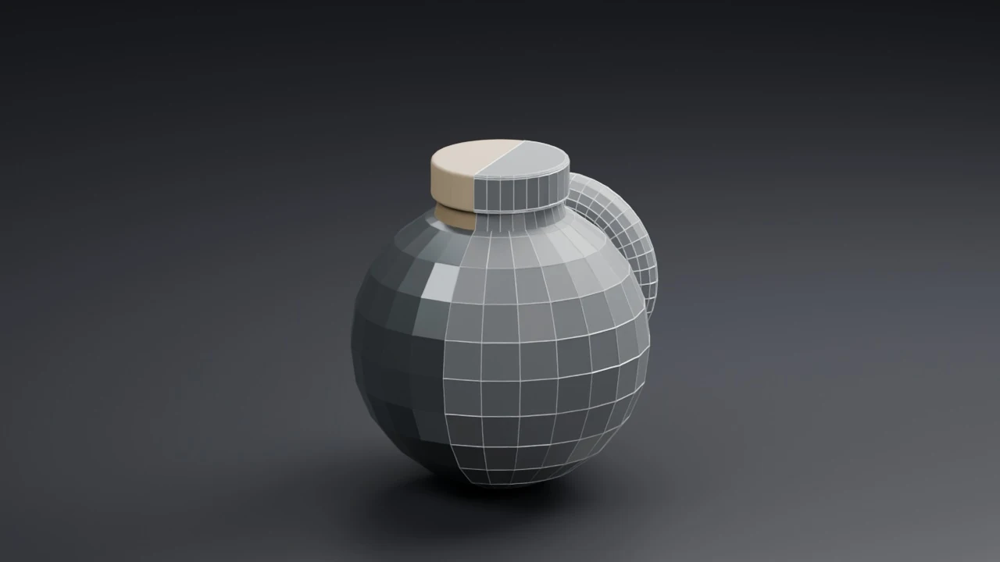

---

group: "product-photography-lighting"
title: "Drei Lichtaufbauten für deine Produktfotografie"
description: "Verwende drei wiederholbare Lichtaufbauten für matte Produkte, reflektierende Oberflächen und texturierte Details."
date: 2026-11-30
updated: 2026-11-30
keyword: "Beleuchtung Produktfotografie"
cta: "Prüfe deine Produktansichten in der kostenlosen Vorschau."
---

Wähl den Lichttyp nach der Oberfläche: Nutze Fensterlicht mit einem weißen Reflektor für matte Produkte, erweitere die Lichtquelle für glatte Artikel und verwende ein Grazing-Licht für Relief, Nahtstellen und Stoffe. Halte Kamera-Position und Belichtung konstant, wenn du Setup-Vergleiche durchführst. Füge den Reflektor nur hinzu, wenn ein spezielles Schattenproblem bei der Produktfotografie auftritt.

## Wie stellst du die Lichtquellen positioniert?

Positioniere das Fenster oder Softbox vorne und seitlich als Basis. Füge eine weiße Karte direkt gegenüber ein und überprüfe, ob der Schatten noch Tiefenwirkung vermittelt. Verschiebe die Karte nach hinten, falls das Bild flach aussieht.

Für Glanz positioniere die Diffusion so nah, dass ein breiter, kontinuierlicher Spiegelreflex entsteht. Für Textur senke das Licht, sodass es die Oberfläche leicht berührt. In beiden Fällen prüfe ein Highlight und ein Schatten im vollen Maß.

## Wie wiederholst du das Ergebnis?

Markiere Kamera, Licht und Gegenstandsposition. Notiere White-Balance und Belichtung. Speichere ein Bild mit einem neutralen Karten, falls Farbgenauigkeit wichtig ist. Vergleiche das Bild mit dem echten Gegenstand unter neutraler Beleuchtung.

## Was solltest du vor der Veröffentlichung überprüfen?

| Oberfläche        | Setup                              | Suchen nach                           |
| ----------------- | ---------------------------------- | ------------------------------------- |
| Matte             | Seitenlicht und Reflektor          | lesbarer Schatten                     |
| Glanz             | große Diffusion und dunkle Flaggen | glatter Spiegelreflex mit klarem Rand |
| Relief oder Stoff | geringes seitliches Licht          | Textur mit intakten Highlights        |

<!-- IMAGE PENDING: Photograph or capture the example described in the brief. -->

**Quelle** [Shopify · Produktfotografie](https://help.shopify.com/en/manual/products/product-media/product-photography), [GIA · Edelstein- und Schmuckfotografie](https://www.gia.edu/gem-photography), [GS1 · Produktbildspezifikation](https://www.gs1.org/standards/gs1-product-image-specification-standard/current-standard).

[Verwandte Anleitung](/de/ratgeber/produktfotografie-onlineshop)

[So erstellst du ein 3D-Modell](/de/ratgeber/3d-modell-erstellen)

## Häufige Fragen

### Wie viele Lichtquellen benötige ich?

Beginne mit einer Lichtquelle und verändere ihre Größe oder Position. Füge einen Reflektor oder eine weitere Lichtquelle nur dann hinzu, wenn du ein separates Schatten- oder Hintergrundproblem identifiziert hast. Markiere die Position der Kamera, des Lichtquellen und des Gegenstands vor der Aufnahme.

### Warum wechseln meine Produkte ihre Farbe?

Mischlichtquellen und automatischer Farbton können das Ergebnis verändern. Deaktiviere Lichtquellen, die du nicht brauchst, speichere eine Referenz und halte die Einstellungen konstant. Füge einen Reflektor nur hinzu, wenn du ein spezielles Schattenproblem erkennst und das Licht direkt auf das Produkt gerichtet ist.

### Was soll ich für eine Setup-Anleitung fotografieren?

Nimm ein breites Bild, das das Produkt und die Lichtquellen enthält. Speichere es mit den endgültigen Dateien, damit die nächste Aufnahme die gleiche Anordnung wiedergibt. Füge den Reflektor nur hinzu, wenn du ein separates Schattenproblem identifiziert hast, und notiere sofort die Position der Lichtquelle.
