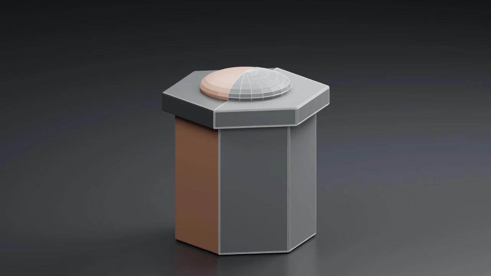
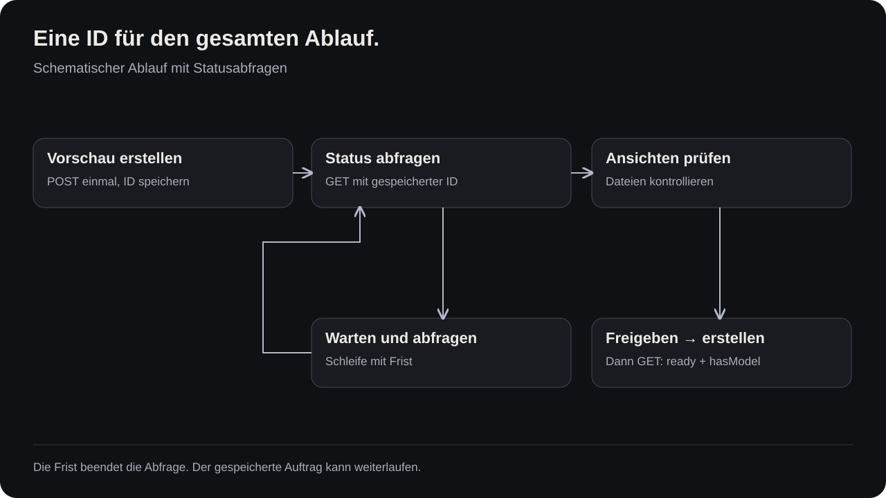

---

group: "n8n-image-to-3d-workflow"
title: "Bild zu 3D in n8n: ein Workflow mit REST-API"
description: "Verbinde n8n mit einer Bild-zu-3D-API. Erstelle einen Vorschau, speichere die Job-ID, genehmige die Erstellung und lade den GLB mit begrenztem Polling…"
date: 2026-11-26
updated: 2026-11-26
keyword: "Bild zu 3D n8n"
cta: "Prüfe deine Produktansichten in der kostenlosen Vorschau."
---

Wenn du in n8n aus einem Bild ein 3D-Modell erstellen willst, lege die Vorschau per HTTP Request an und speichere die Auftrags-ID. Frage den Status ab und prüfe die Ansichten, bevor du die kostenpflichtige Erstellung freigibst. Lade anschließend die GLB-Datei herunter und nimm bei einer Wartefrist den vorhandenen Auftrag wieder auf.

> **Speichere die ID vor der Automatisierung.** Wenn du weißt, welcher Job dem Foto zugeordnet ist, kannst du ihn fortsetzen. Wenn der einzige Eintrag eine leere Ausgabenzelle ist, kann ein Neuladen unnötige Arbeit erzeugen.

## Welche Verbindungsmethode sollst du wählen?

Nutze REST, wenn die Reihenfolge fest ist. Nutze einen Agenten, wenn jemand eine Anfrage interpretieren oder unter Tools wählen muss. Ein Community-Knoten kann die Einrichtung verkürzen, aber er sollte nicht bestimmen, ob du den vollständigen Workflow umsetzen kannst.

| Methode                               | Beste Passform                                         | Prüfe vor der Auswahl                                         |
| ------------------------------------- | ------------------------------------------------------ | ------------------------------------------------------------- |
| Integriertes HTTP Request             | Feste Reihenfolge mit sichtbaren Eingaben und Ausgaben | Anmeldeinformationen, Körperform und Statuszweige             |
| Community-Knoten                      | Unterstützte Operationen mit vereinfachter Einrichtung | Installationsverfügbarkeit und Betriebsabdeckung              |
| MCP-Klient an einem Agenten angehängt | Anfragen, die eine Werkzeugauswahl erfordern           | Transportunterstützung, erlaubte Werkzeuge und Ausgabesteuern |

Dieser Leitfaden verwendet den [HTTP Request-Knoten](https://docs.n8n.io/integrations/builtin/core-nodes/n8n-nodes-base.httprequest/) und easyrender's [REST-Vertrag](/image-to-3d-api). Er erfordert keine Marketplace-Listung. Für konversationelle Auswahl verwende den separaten [n8n-Agent-und-MCP-Leitfaden](/de/ratgeber/n8n-mcp-client).

## Was benötigst du, bevor du den ersten Knoten hinzufügst?

Wähle ein klares Foto eines Tischventilators. Die API akzeptiert JPEG, PNG oder WebP bis zu 4 MiB. Für ein öffentliches HTTPS-Bild verwenden Sie `image_url`. Für ein lokales oder privates Bild laden Sie es über den authentisierten Datei-Endpoint hoch und verwenden dann `upload_id`.

Erstelle ein API-Schlüssel im Connectors. Ein Vorschau-Workflow benötigt `write` zur Erstellung und `read` zur Inspektion. Füge `spend` nur dem Benutzerkonto für eine genehmigte bezahlte Operation hinzu. Speichere den Schlüssel als n8n-Header-Auth-Zugangsdaten: `Authorization` ist der Header-Name und `Bearer YOUR_API_KEY` sein Wert.

| Wert, der gespeichert werden soll | Beispiel                         | Woher stammt der Wert                          |
| --------------------------------- | -------------------------------- | ---------------------------------------------- |
| Quellaufzeichnung                 | `FAN-DESK-01`                    | Dein Katalog                                   |
| Foto-Aktualisierung               | `front-v1`                       | Deine Quellverwaltung                          |
| Erstellungs-Schlüssel             | `FAN-DESK-01-front-v1`           | Stabiler Schlüssel für diese genaue Eingabe    |
| `render_id`                       | Tatsächlich zurückgegebener `id` | Vorschau-Antwort                               |
| Genehmigungsobergrenze            | Eine genehmigte ganze Zahl       | Aktueller Angebotswert plus deine Entscheidung |

Die gleiche Foto-URL muss während eines Retries auf die gleichen Bytes zeigen. Wenn die Quelle geändert wird, erstelle absichtlich eine neue Revision. Vor dem Test des Connectors verwende bitte das [Foto-Vorbereitungsguide](/learn/how-to-make-a-3d-model-from-photos), um unvermeidbare Eingabefehler zu entfernen.

## Schritt 1: Wie erstellst du eine Vorschau?

Füge einen Manual Trigger und ein Edit Fields-Node für dein Quellereignis hinzu. Konfiguriere dann den ersten HTTP Request wie folgt. Mappe deine eigenen erreichbaren Foto-URL in das Feld „image“.

| HTTP Request-Einstellungen | Wert                                                   |
| -------------------------- | ------------------------------------------------------ |
| Methode                    | `POST`                                                 |
| URL                        | `https://easyrender.ai/api/renders`                    |
| Authentifizierung          | Deine Header-Auth-Zugangsdaten                         |
| Header                     | `Idempotency-Key` mit dem gespeicherten Erstellungskey |
| Body Content-Type          | JSON                                                   |
| Body-Feld                  | `image_url` aus dem Quellerecords abgebildet           |
| Body-Feld                  | `name` aus dem Produktname abgebildet                  |
| Body-Feld                  | `isPublic` auf boolean `false` gesetzt                 |
| Antwortformat              | JSON; Body-Only für die folgenden Feldpfade            |

Speichere die zurückgegebene `id` vor der Fortsetzung. Mit deaktivierten Antwortheaders/Status ist es der Outputbody-Value `id`. Falls du die volle Antwort aktivierst, passe die Zuweisungen an `body.id` an. Vermeide die Kombination beider Antwortformate in einem Knoten.

Der Erstellungskey ist 1–128 – druckbare ASCII-Zeichen ohne Leerzeichen. Seine Wiederholung mit identischem Eingang erzeugt die gleiche Ausgabe. Veränderte Eingaben führen zu einem Konflikt. Dieser Idempotenzvertrag gilt für die Vorschauerstellung, nicht für jede POST-Anfrage im Dienst. Halte den Key nach einem verlorenen Antwortstatus stabil.

## Schritt 2: Wie warte ich, ohne erneut zu starten?

Füge einen [Warten-Knoten](https://docs.n8n.io/integrations/builtin/core-nodes/n8n-nodes-base.wait/) mit einem Zeitintervall hinzu, gefolgt von `GET https://easyrender.ai/api/renders/{saved_render_id}`. Ein 15-Sekunden-Intervall und ein 20-Minuten-Workflow-Deadline sind sinnvolle Startwerte, nicht garantierte Erstellungszeiten. Notiere das Deadline vor dem Eintritt in den Loop.

| Zurückgegebener Status                   | Workflow-Ableitung                                       |
| ---------------------------------------- | -------------------------------------------------------- |
| `drafting`                               | Warte, dann die bestehende ID mit GET abrufen            |
| `preview_ready`                          | Stoppe den Vorschaubetrieb und bitte die Prüfung         |
| `rendering`                              | Fortsetze das begrenzte Polling des autorisierten Builds |
| `ready` und `hasModel=true`              | Lade die Modelldatei herunter                            |
| `failed`                                 | Speichere den Fehler und beende diesen Versuch           |
| Frist erreicht oder unerwarteter Zustand | Speichere ID und Status für die Wiedervereinigung        |

Poll die einzelne Renderung, nicht nur den Auflistungsendpoint. Der [API-Vertrag](https://github.com/easyrenderai/easyrender.ai/blob/main/docs/api.md) erklärt, dass Auflisten Aufgaben nicht vorwärtsbringt. Ein im Response auftauchender URL ist keine Garantie, dass das zugehörige Artefakt bereit ist.

## Schritt 3: Was genau soll der Prüfer bestätigen?

Öffne den Owner-Viewer bei `https://easyrender.ai/r/{saved_render_id}`. Prüfe `hasSheet` vor dem Kennzeichnen eines Bildes als Winkelblatt: Die Vorschaubilder können immer noch das Quellfoto sein. Falls du ein bezahltes Blatt oder eine Revision anforderst, autorisiere das separat und behalte die Kosten im gleichen Produktverzeichnis.

Aktualisiere die Renderung und `GET /api/credits`. Binde die Entscheidung an die Render-ID, die Quellrevision und die erlaubten Credits. Der verbleibende Build-Debit beträgt `max(0, renderCredits - credits)`, nicht ein angenommenes festes Preis, das in den Workflow kopiert wurde.

Nach der Genehmigung sende `POST https://easyrender.ai/api/renders/{saved_render_id}/render` mit dem JSON-Feld `maxCredits` auf den autorisierten Integer. Eine Frist oder eine abgelehnte Genehmigung muss in einen Stop-Branch gehen. Lege keine dieser Bedingungen als Standardfortsetzung für die bezahlte Aktion fest.

<!-- IMAGE PENDING: unique screenshot of HTTP Request settings and a credential-free status output from a real n8n run. -->

## Schritt 4: Wie lädst du die GLB-Datei?

Nach `ready` und `hasModel=true`, fordere `/api/renders/{saved_render_id}/model?download=1` mit den Owner-Zugangsdaten an. Wähle eine Dateireaktion und ein Ausgabefeld wie `model`. Leite diesen binären Output an deinen gewünschten Speicher- oder Handelsupload-Schritt weiter.

Die [Referenz zum Khronos-Format](https://www.khronos.org/gltf/) erklärt, warum GLB für die Übermittlung eines Modells geeignet ist. Halte drei Zieladressen klar voneinander getrennt: die Seite des Benutzers, die authentizierte Download-Endpunkt und die Datei, die an deinen Shop gestellt wurde. Sie sind nicht austauschbar.

Private Modell-URLs erfordern Authentifizierung. Für Shopify verwende die [Medien-Upload- und Verarbeitungssequenz](https://shopify.dev/docs/apps/build/product-merchandising/products-and-collections/manage-media) nachdem du die Datei heruntergeladen hast. Legen Sie niemals einen API-Schlüssel in eine URL, um diese öffentlich für den Shop verfügbar zu machen.

## Welche Fehler solltest du explizit behandeln?

| Symptom                               | Ursache zu prüfen                                    | Wiederherstellung                                                                         |
| ------------------------------------- | ---------------------------------------------------- | ----------------------------------------------------------------------------------------- |
| HTTP 401                              | Falsch, abgelaufen oder widerrufen Schlüssel         | Korrigiere die Authentifizierung. Behalte die Job-ID                                      |
| HTTP 403                              | Fehlende Berechtigung oder überschrittene Key-Grenze | Prüfe den Fehlercode und die berechtigten Key-Limits                                      |
| HTTP 402                              | Unzureichende Kontokredits                           | Stoppe den Verbrauch und bitte eine Budgetentscheidung                                    |
| HTTP 409 bei der Erstellung           | Schlüssel wurde mit anderer Eingabe verwendet        | Wiederherstelle den alten Antrag oder versuche die neue Quelle absichtlich zu verschieben |
| HTTP 429                              | Rate-/Concurrency-Limit                              | Lies `Retry-After` und verspäte den nächsten Antrag                                       |
| Bezahlter POST-Request ist abgelaufen | Ergebnis unbekannt                                   | Prüfe die gespeicherte Aufgabe. Wiederhole den Vorgang nicht blind                        |
| Datei enthält JSON                    | Fehlerantwort gespeichert als Modell                 | Prüfe Status und Content-Type vor Speicherung                                             |

Für das Pacing siehe [n8n Dokumentation zu Rate-Limit-Handling](https://docs.n8n.io/integrations/builtin/handle-rate-limits.md). Vermeide blanket Retry On Fail bei kostenpflichtigen Nodes. Safe Reads und unsichere Mutations erfordern unterschiedliche Wiederherstellungswege, selbst wenn beide ein rotes Ausführungsflag anzeigen.

## Wie testest du den Workflow vor der Verwendung eines Katalogs?

Teste zunächst die Authentifizierung und die Vorschaubildgenerierung mit einem Foto. Stelle sicher, dass das Datensatz das zurückgegebene ID enthält und dass ein erneutes Ausführen mit dem gleichen Erstellungsschlüssel kein neues Render erzeugt. Halte an der Prüfung, bis du explizit ein Budget für die Erstellung hast.

Prüfe anschließend die Branchen mit repräsentativen Response-Fixtures: `drafting`, `preview_ready`, `ready`, `failed` und einem Rate-Limit-Fehler. Fixture-Prüfungen validieren deine Routing-Logik, nicht den live Rendering-Dienst. Ein endgültiges authentifiziertes Ausführen bleibt erforderlich, um die vollständige konfigurierte n8n-Workflow-Abwicklung zu bestätigen.

Das bereitgestellte Schema wurde für diese Anleitung überprüft. Kein kostenpflichtiger Lauf wurde zur Bestimmung einer Ausführungszeit oder Erfolgsrate verwendet. Zu den unterliegenden Methodenwahlentscheidungen siehe [wie ein 3D-Modell erstellt wird](/de/ratgeber/3d-modell-erstellen). Erweitere auf Batch-Verarbeitung erst nachdem ein akzeptiertes Modell seinen Zielort erreicht hat.

## Häufige Fragen

### Erstellt ein Render auch den kostenpflichtigen Modellstart?

Die Erstellung eines Renders startet nicht automatisch die kostenpflichtige Modellversion. Die Erstellung eines Vorschaubildes liefert eine Render-ID und beginnt den Vorschaustadium. Die kostenpflichtige 3D-Ausführung ist eine separate Aktion mit eigener Autorisierung. Speichere die ID, überprüfe das verfügbare Ergebnis und bestätige die Kosten vor dem Weitergehen. Halte den Workflow an, ohne den Fortschritt zu verlieren.

### Kann ich ein Foto verwenden, das nicht öffentlich gehostet ist?

Ja. Sende die Datei an den authentifizierten Upload-Endpoint, dann verwende die zurückgegebene Upload-ID als Quelle des Vorschaus. Der Referenzwert ist owner-basiert und ist nach einer Stunde abgelaufen, daher erstelle den Render innerhalb dieser Frist und speichere seine eigene Render-ID für späteres Polling und Wiederherstellen.

### Erhält n8n das fertige Modell sofort?

Nein. Erstellung und Aufbau liefern Jobinformationen, während die Verarbeitung weitergeht. Poll die gespeicherte Render-ID und erfordere sowohl einen bereitgestellten Zustand als auch die Verfügbarkeit des Modells, bevor du das Modell herunterlädst. Falls dein Workflow seinen Fristtermin erreicht, speichere die Aufgabe für spätere Prüfungen, anstatt den Fristtermin als Beweis für einen generierungsfehler zu betrachten.

### Kann ich mit dem gleichen Endpoint USDZ-Downloads automatisieren?

Der Modellendpoint in diesem Rezept liefert GLB. Der REST-Vertrag definiert keinen USDZ-Konvertierungsendpunkt, daher wird durch Hinzufügen einer Dateiendung an der URL kein Konvertierungsergebnis erzeugt. Nutze den Viewer-Exportfluss oder einen separat getesteten Konvertierungsschritt, wenn dein Ziel speziell auf USDZ angewiesen ist.
