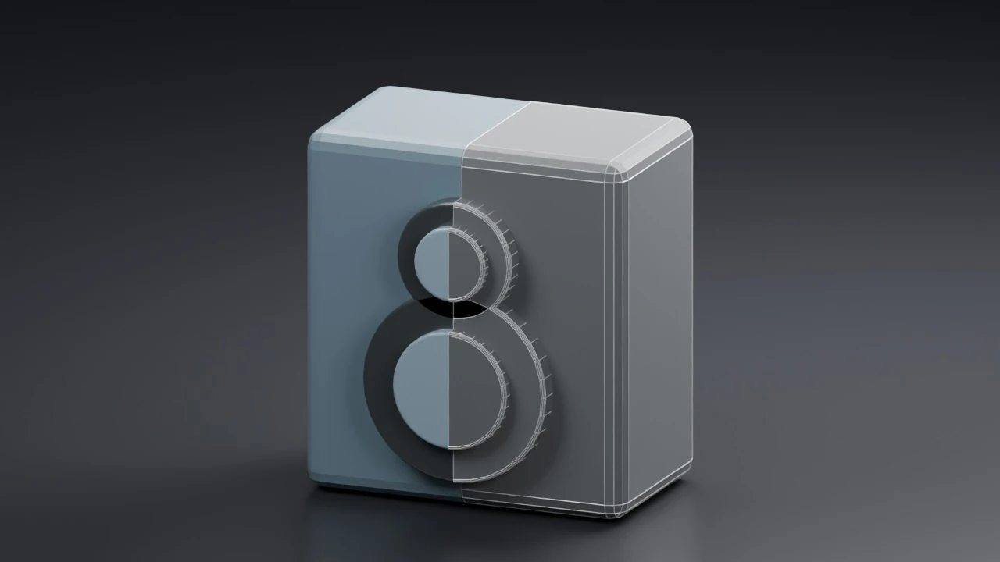

---

group: "blender-export-glb"
title: "GLB mit Texturen aus Blender exportieren"
description: "Vorbereite Materialien und Texturen in Blender, exportiere eine GLB und überprüfe sie in einer sauberen Viewer-Sitzung."
date: 2026-12-04
updated: 2026-12-04
keyword: "Blender GLB exportieren"
cta: "Prüfe deine Produktansichten in der kostenlosen Vorschau."
---

Vorbereite deine Materialien mit Bildtexturen, die an einen unterstützten Shader gebunden sind, dann exportiere den glTF 2.0 im binären GLB-Format von Blender. Verschiebe die Datei in einen neuen Ordner und öffne sie im Ziel-Viewer. Prüfe, ob Farbe, Normale und Texturenplatzierung beim Verschieben erhalten bleiben.

## Was bereitest du vor der Exportierung?

Öffne jede wichtige Materialoberfläche im Shader-Editor. Verwende dort möglichst ein Principled BSDF und überprüfe die Bildknoten. Bake prozedurale Erscheinungen in Karten, falls nötig. Wähle die Objekte aus, die zum Lieferumfang gehören, und überprüfe ihre Transformationen und Ausrichtung.

## Wie exportierst du und validierst du?

Wähle Datei, Export, glTF 2.0,, dann glTF Binary. Nutze den Export für ausgewählte Objekte, wenn du Hilfselemente aus der Szene ausschließen möchtest. Validiere die Datei, lade sie in einen frischen Viewer und vergleiche Front- und Unterseite mit deiner Szene.

## Was solltest du vor der Veröffentlichung überprüfen?

| Problem                                    | Prüfe zuerst                                |
| ------------------------------------------ | ------------------------------------------- |
| Texture fehlt                              | Bildverbindungen und exportierte Ressourcen |
| Die Oberflächenrauhigkeit sieht falsch aus | Kartenkanäle und Farbgebung                 |
| Das Modell ist seitlich gerichtet          | Objekttransformation und Zielorientierung   |

<!-- IMAGE PENDING: Photograph or capture the example described in the brief. -->

**Quelle** [Blender · glTF 2.0 import und export](https://docs.blender.org/manual/en/5.1/addons/import_export/scene_gltf2.html), [Khronos · glTF 2.0 Spezifikation](https://registry.khronos.org/glTF/specs/2.0/glTF-2.0.html), [Khronos · glTF Validator](https://github.com/KhronosGroup/glTF-Validator).

[Verwandte Anleitung](/learn/glb-file)

[So erstellst du ein 3D-Modell](/de/ratgeber/3d-modell-erstellen)

## Häufige Fragen

### Exportiert jedes Blender-Material?

Der Exporter erkennt unterstützte Knotenkombinationen. Einige prozedurale Effekte müssen gebaked werden. Prüfe den Ziel-Viewer mit einem einfachen Material, bevor du ein komplexes Asset einsetzt.

### Wie kann ich überprüfen, ob es selbstsicher ist?

Verschiebe nur die exportierte GLB in einen leeren Ordner und öffne sie im Ziel-Viewer. Prüfe die Materialien unter neutraler Beleuchtung, um sicherzustellen, dass die Texturen ohne Fehler geladen werden. Danach überprüfe, ob die GLB alle Texturen enthält, indem du die eingebetteten Ressourcen des Assets im Metadatensegment des Viewers prüfst.

### Ist die BLEND-Datei nach dem Export relevant?

Halte sie als editierbare Quelle bei. Aktualisiere diese Datei für Änderungen und führe den Export erneut durch, anstatt die Verteilungsdatei als Hauptversion zu betrachten.
