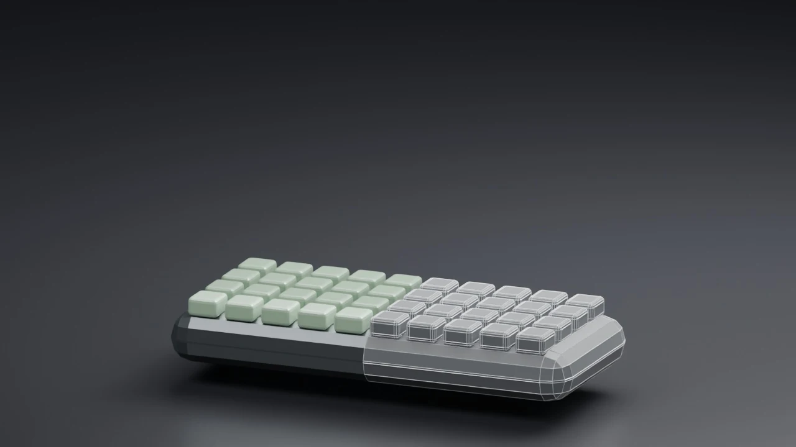

---

group: "compress-glb"
title: "GLB komprimieren und sichtbare Details erhalten"
description: "Finde, was deine GLB vergrößert, reduziere Geometrie oder Texturen und vergleiche das Ergebnis im gleichen Viewer."
date: 2026-11-28
updated: 2026-11-28
keyword: "GLB komprimieren"
cta: "Prüfe deine Produktansichten in der kostenlosen Vorschau."
---

Um einen GLB zu komprimieren und gleichzeitig nützliche Details zu erhalten, verringern Sie die Texturengröße, falls Bilder dominiert sind, oder vereinfachen Sie die Geometrie, falls das Mesh dominiert. Exportieren Sie eine Kopie und vergleichen Sie beide in demselben Viewer. Nur nach Prüfung von Winkeln, Kanten und Oberflächenfeinheiten, die Ihr Publikum sieht, akzeptieren Sie die kleinere Datei.

## Wie hat die Vereinfachung eines Modells die Ergebnisse verändert?

Wir haben unseren Tischbeleuchtung in Blender 5.2.3 importiert und ihn zweimal mit den gleichen GLB-Einstellungen exportiert. Die Anwendung eines Decimate-Verhältnisses von 0.5 verringerte die 16,228 Dreiecke auf 8,114.. Die beiden Exporte änderten sich von 1,687,180 zu 863,068 bytes, etwa 49% weniger.

Hier sind die Größen der beiden Blender-Exporte. Der ursprüngliche GLB des Sites verwendet eine separat vorbereitete Codierung, weshalb es eine andere Baseline darstellt.

## Wie wählen Sie die nächste Optimierung?

Bei einem mesh-basierten Modell probieren Sie eine geometrische Anpassung und prüfen Sie Ecken und Schnittstellen. Bei einem texture-basierten Modell versuchen Sie eine kleinere Karte und prüfen Sie feine Markierungen. Testen Sie komprimierte Texturen mit der Ziel-Viewer-Software vor der Veröffentlichung in der Katalogversion.

## Was sollte man vor der Veröffentlichung prüfen?

| Symptom                          | Nächste Aktion                                                        |
| -------------------------------- | --------------------------------------------------------------------- |
| Beschriftungen verschwimmen      | Erhöhen Sie die Texturenachauflösung vor der Änderung der Geometrie   |
| Kanten ändern sich an den Beinen | Verringern Sie die Stärke der Decimation                              |
| Die neue Datei öffnet sich nicht | Prüfen Sie die erforderlichen Erweiterungen und den Validator-Ausgabe |

<!-- IMAGE PENDING: Photograph or capture the example described in the brief. -->

**Quelle** [Khronos · glTF 2.0 Spezifikation](https://registry.khronos.org/glTF/specs/2.0/glTF-2.0.html), [Khronos · KHR_texture_basisu](https://github.com/KhronosGroup/glTF/tree/main/extensions/2.0/Khronos/KHR_texture_basisu), [Blender · Decimate modifier](https://docs.blender.org/manual/en/latest/modeling/modifiers/generate/decimate.html), [Khronos · glTF Validator](https://github.com/KhronosGroup/glTF-Validator).

[Verwandte Anleitung](/learn/glb-file)

[So erstellen Sie ein 3D-Modell](/de/ratgeber/3d-modell-erstellen)

## Häufige Fragen

### Wie klein sollte eine GLB-Datei sein?

Komprimiere den GLB so klein wie möglich, ohne sichtbare Details oder Leistung zu verlieren. Teste das Ergebnis auf dem tatsächlichen Gerät und der Seite und überprüfe die übertragenen Bytes, die Ladezeit und die Klarheit der wichtigsten Funktionen. Danach prüfe die Dateigröße und die Viewer-Leistung vor der Bereitstellung.

### Meint weniger Dreiecke immer auch weniger Bytes?

Weniger Dreiecke bedeuten nicht immer weniger Bytes, da Texturen, Buffer-Encodings und Attribute die Dateigröße beeinflussen. Optimiere zuerst die Geometrie, dann prüfe die GLB-Dateigröße und die Dreieckanzahl in einem Viewer. Vergleiche vollständige Exporte unter gleichen Einstellungen, um die Komprimierungseffizienz zu überprüfen.

### Sollte ich die Quelle überschreiben?

Halte die Quelle und eine Aufzeichnung der Exporteinstellungen. Teste eine separate Lieferdatei, damit du Details ohne erneute Modellierungswerkzeuge wiederherstellen kannst.
