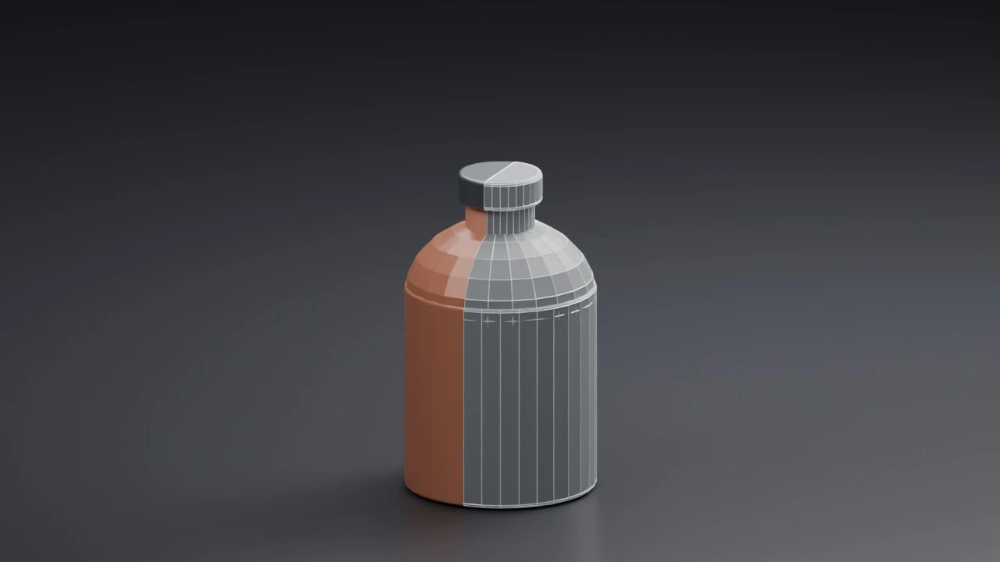

---

group: "ai-product-photography"
title: "KI-Produktfotos erstellen und vorab prüfen"
description: "Nutze KI für geeignete Produktbilder und überprüfe vor der Veröffentlichung Form, Farbe, Label und Variante."
date: 2026-12-11
updated: 2026-12-11
keyword: "KI-Produktfotografie"
cta: "Prüfe deine Produktansichten in der kostenlosen Vorschau."
---

Nutze KI-generierte Produktfotos für verifizierbare Änderungen, wie z. B. Hintergrund oder Präsentation. Halte eine echte Referenz für die Form, Etikett, Oberfläche und Farbe bereit. Vergleiche jedes Kandidatenbild mit dieser Referenz vor der Veröffentlichung, insbesondere wenn es eine unphotografierte Seite zeigt oder eine Funktion hervorhebt.

## Welche Bearbeitungen sind praktikabel zu überprüfen?

Beginne mit einem sauberen Produktfoto und einer spezifischen Änderung, z. B. einem neutralen Hintergrund. Vergleiche das Original und den Kandidaten in der gleichen Größe. Prüfe das Etikett vollständig auf Auflösung und die Silhouette im Thumbnail-Format.

Falls du eine andere Ansicht generierst, vergleiche sichtbare Details mit einem echten Foto, wenn du eines hast. Halte das Ergebnis außerhalb der faktenbasierten Galerie, wenn du eine kritische Funktion nicht überprüfen kannst.

## Wie verhandelst du Varianten?

Verwende eine separate Quellbilder für jede Oberfläche, falls Farbe oder Konstruktion verändert wurde. Kennzeichne die Quell-SKU und die Generationsrevisionsnummer. Prüfe die Bilder neben echten Fotos in einem Kontaktblatt und überprüfe die aktuellen Regeln des Kanals.

## Was solltest du vor der Veröffentlichung prüfen?

| Änderung                      | Akzeptanzprüfung                                    |
| ----------------------------- | --------------------------------------------------- |
| Neuer Hintergrund             | Sauberer Rand und intakter Etikett                  |
| Neuer sichtbarer Winkel       | Sichtbare Merkmale stimmen der Referenz entsprechen |
| Farbe oder Materialbehandlung | Richtiges Varianten- und Oberflächenprofil          |

<!-- IMAGE PENDING: Photograph or capture the example described in the brief. -->

**Quellen** [Google Merchant Center · Product Studio](https://support.google.com/merchants/answer/13708167), [Google Merchant Center · image link](https://support.google.com/merchants/answer/6324350), [Shopify · product photography](https://help.shopify.com/en/manual/products/product-media/product-photography).

[Verwandte Anleitung](/de/ratgeber/produktfotografie-onlineshop)

[So erstellst du ein 3D-Modell](/de/ratgeber/3d-modell-erstellen)

## Häufige Fragen

### Kann ich das Originalfoto als Archiv beibehalten?

Ja. Speichere die Originalfotos neben der veröffentlichten Version und notiere, zu welchem SKU sie gehören. Damit ist eine spätere Prüfung und Korrektur einfacher.

### Sollte ich generierte Labels verwenden?

Halte sachliche, lesbare Informationen aus der echten Produktversion bei. Vergleiche vergrößerte Texte und ersetze das Bild, wenn ein Label falsche Informationen enthält.

### Kann ich nur im Vollmaß beurteilen?

Du musst im Vollmaß für Details urteilen und die Miniaturgröße für die Erkennbarkeit prüfen. Prüfe stets, ob das Bild gut in ein Produktgitter passt und teste das Vollmaß gegen die Gitterlayout, um sicherzustellen, dass Produktmerkmale lesbar bleiben. Stelle sicher, dass Texte und wichtige Features in beiden Größen sichtbar sind.
