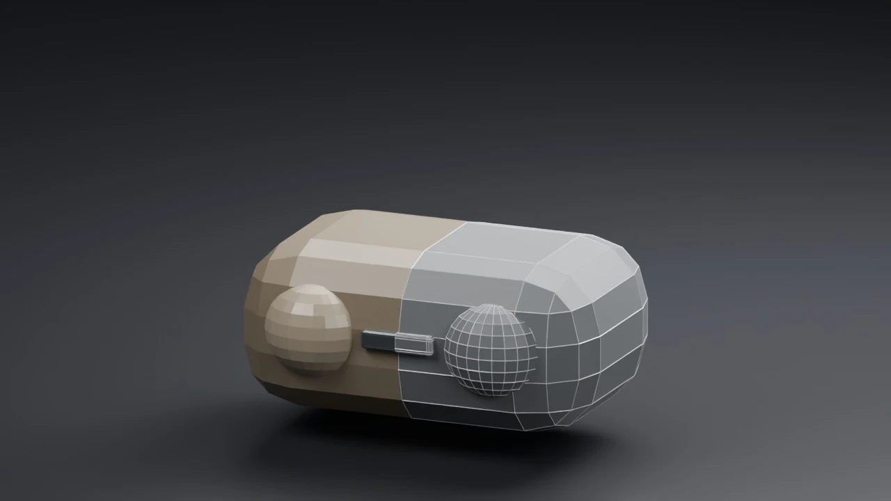

---

group: "3d-modeling-cost"
title: "Was kostet ein 3D-Produktmodell?"
description: "Wie viel kostet ein genehmigtes 3D-Modell, inklusive Versuche, Erkennung, Änderungen und der endgültigen Export?"
date: 2026-12-03
updated: 2026-12-03
keyword: "Kosten 3D-Modell erstellen"
cta: "Prüfe deine Produktansichten in der kostenlosen Vorschau."
---

Schätze den Preis für ein Produktmodell 3D anhand der benötigten Lieferung. Zähle Aufnahme, Modellierung oder Generierung, Korrekturen und die Exportierung, die du tatsächlich nutzen wirst. Vergleiche Methoden anhand des Kosten pro genehmigtem Modell. Ein niedriger Kosten pro Versuch kann teuer werden, wenn mehrere Versuche denselben Akzeptanzcheck nicht bestehen.

## Was legst du in die Angebotsrechnung ein?

Nenne die Zielanwendung, Format, Materialien, die Anzahl der Varianten sowie ob Animation oder bearbeitbare Quelle erforderlich ist. Gib dem Modeller ausreichend Fotos und eine klare Referenz für jede zu prüfende Funktion. Frage nach den umfassten Revisionsrunden und der Lizenzierung.

## Wie vergleichst du Kosten zwischen Methoden?

Teile den Gesamtbetrag für einen kleinen Pilotprojekt durch die Anzahl der Modelle, die du nutzen kannst. Wenn ein hypothetisches Pilotprojekt mit vier Artikeln $120 für die Erstellung und $40 für die Überprüfung und Korrektur kostet und drei Modelle akzeptiert werden, beträgt die Kosten pro akzeptiertem Asset etwa $53.33. Dies ist ein Beispiel, kein fester Satz.

## Was solltest du vor der Veröffentlichung überprüfen?

| Methode                       | Wichtigste Kostenpunkte                             |
| ----------------------------- | --------------------------------------------------- |
| Foto-basierte Generierung     | Versuche, Überprüfung und Korrekturen               |
| Kommissionierte Modellierung  | Auftrag, Stunden oder fester Preis, Revisionsrunden |
| Bestehendes Lieferantensystem | Lizenz, Reinigung und erneute Exportierung          |

<!-- IMAGE PENDING: Photograph or capture the example described in the brief. -->

**Quelle** [Upwork · 3D Modelliererpreise](https://www.upwork.com/hire/3d-modelers/cost/), [Shopify · Erstellen von 3D Modellen](https://help.shopify.com/en/partners/manage-clients-stores/creating-media/3d-models/creating-3d-models), [Khronos · glTF 2.0 Spezifikation](https://registry.khronos.org/glTF/specs/2.0/glTF-2.0.html).

[Verwandte Anleitung](/de/vergleich/vergleich-3d-modellierer-oder-ki)

[So erstellst du ein 3D Modell](/de/ratgeber/3d-modell-erstellen)

## Häufige Fragen

### Sollte ich für Revisionsarbeiten planen?

Ja. Vereinbare die Anzahl der Runden und was als Korrektur gilt. Einklammere auch die Bearbeitungszeit deines Teams im Pilotprojekt, selbst wenn sie nicht auf der Rechnung erscheint.

### Kann ich einen einzigen Angebot für das gesamte Katalog verwenden?

Beginne mit repräsentativen einfachen und komplexen Artikeln. Erstelle Schätzungen pro Gruppe, nachdem du gesehen hast, wie viele Assets durchlaufen und welche Korrekturen typischerweise erforderlich sind. Vereinbare die Anzahl der Revisionsrunden und die Bearbeitungszeit deines Teams im Pilotprojekt, bevor du das Endangebot für den gesamten Katalog festlegst.

### Was, wenn wir bereits CAD-Dateien haben?

Falls du bereits CAD-Dateien hast, überprüfe die Nutzungsrechte und bestätige, welche Details benötigt werden. Vorbereite den CAD für einen Web-Viewer, indem Geometrie bereinigt, Materialien zugewiesen und separat exportiert werden. Stelle sicher, dass der Format und die Exporteinstellungen deiner CAD-Datei den Anforderungen des Web-Viewers entsprechen.
