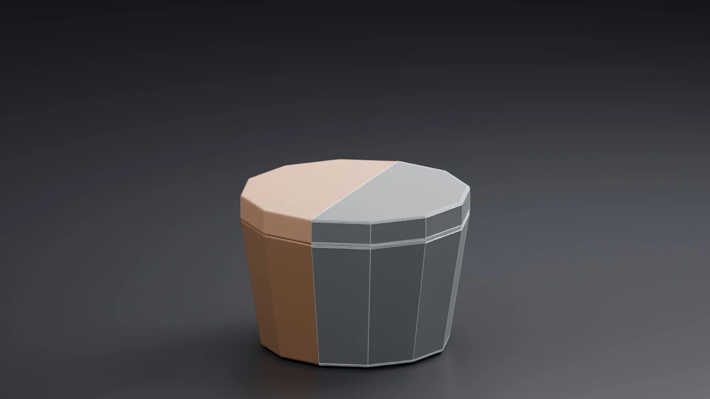

---

group: "low-poly-vs-high-poly"
title: "Low Poly oder High Poly im 3D-Produktviewer"
description: "Wähl die Mesh-Detail aus der Kamerastrecke, der Silhouette und dem Zielgerät, nicht aus einer Dreiecksgrenze."
date: 2026-12-16
updated: 2026-12-16
keyword: "Low Poly vs High Poly"
cta: "Prüfe deine Produktansichten in der kostenlosen Vorschau."
---

Wähl die Mesh-Detailstufe, die der Käufer tatsächlich sieht. Halte die Geometrie an den Konturen, Kurven und Löchern fest, die beim Produktumdrehen relevant sind. Verwende Texturen für feine Oberflächenstrukturen, sofern möglich. Vergleiche zwei Versionen im tatsächlichen Galerie-Größe und bei der nähesten Zoomstufe, die der Viewer erlaubt.

## Welche Details sollten als Geometrie erhalten bleiben?

Halte Kanten von Stühlen, Öffnungen von Grifffunktionen und die Lippe eines Gefäßes, falls sie die Silhouette oder Parallax-Effekte beeinflussen. Mal oder bake feine Oberflächenstrukturen, wo diese die Kontur nicht verändern. Prüfe auch Schattenkanten, Reflexionen sowie die Mesh-Struktur.

## Wie wählt man das Ziel?

Unser öffentlicher Tisch hat 16,228 Dreiecke und unser Nachttisch hat 69,910.. Beide verfügen über ein Material. Es handelt sich um zwei unterschiedliche Produkte, weshalb keines dieser Zahlen ein universelles Budget darstellt. Entscheiden sollst du dich, indem du zwei Exporte des gleichen Objekts mit derselben Rahmung, Material und Ausrüstung vergleichst.

## Was solltest du vor der Veröffentlichung prüfen?

| Wo es relevant ist     | Behalte oder teste                             |
| ---------------------- | ---------------------------------------------- |
| Äußere Silhouette      | Prüfe die Kontur von Vorder- und Profilansicht |
| Hardware und Öffnungen | Retain echte Lücken und Schnittstellen         |
| Oberflächenstruktur    | Teste Texturendetail bei hoher Zoomstufe       |

<!-- IMAGE PENDING: Photograph or capture the example described in the brief. -->

**Quelle** [Blender · Decimate-Modifier](https://docs.blender.org/manual/en/latest/modeling/modifiers/generate/decimate.html), [Khronos · glTF 2.0-Spezifikation](https://registry.khronos.org/glTF/specs/2.0/glTF-2.0.html), [model-viewer · Dokumentation](https://modelviewer.dev/docs/).

[Verwandte Anleitung](/learn/glb-file)

[So erstellst du ein 3D-Modell](/de/ratgeber/3d-modell-erstellen)

## Häufige Fragen

### Gibt es ein Standardlimit für Low-Poly?

Legge eine Grenze für den Low-Poly-Anteil basierend auf deiner Zielseite, Kamera und Geräte-Spezifikationen fest. Teste die Lade- und Drehgeschwindigkeit auf unterstützten Geräten. Prüfe Frame-Rate und Texture-Ladezeit für reibungslose Interaktion. Stelle sicher, dass die Leistung auf dem niedrigsten-End-Gerät deines Zielpublikums funktioniert.

### Was soll ich zuerst vereinfachen?

Beginne mit Bereichen, die aus der Sicht nicht sichtbar sind oder mit flachen Flächen, die zusätzliche Geometrie benötigen. Reduziere ein Bereich für ein Mal und vergleiche das Ergebnis. Beginne mit dem Bereich, der am wenigsten visuell relevant ist, und teste die Leistung auf dem Zielgerät.

### Speichert ein Normalmap die Silhouetten-Details?

Verwende eine Normalmap für flache Oberflächen-Details. Sie speichert keine Silhouetten-Details. Halte die Basisgeometrie bei Formänderungen, die die Kontur verändern oder ein sichtbares Öffnung erzeugen. Prüfe, dass die Silhouette des Low-Poly-Modells in dem 3D-Viewer schärfer und sichtbar bleibt.
