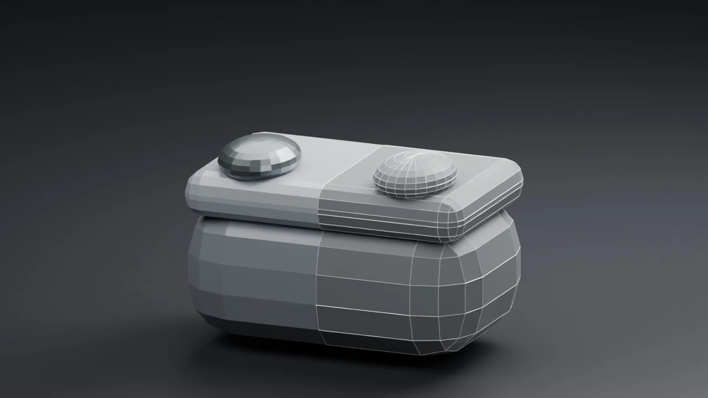
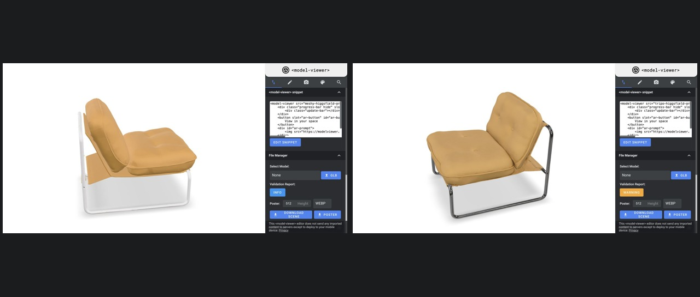

---

group: "meshy-vs-tripo"
title: "Meshy oder Tripo: 3D aus demselben Produktfoto"
description: "Vergleiche Meshy und Tripo an der gleichen Produktfotografie. Prüfe Silhouetten, Details, Materialien und was du exportieren kannst."
date: 2026-11-23
updated: 2026-11-23
keyword: "Meshy vs Tripo"
cta: "Prüfe deine Produktansichten in der kostenlosen Vorschau."
publishAt: "2026-11-23"
---

Vergleiche Meshy und Tripo mit dem gleichen, nicht abgeschnittenen Produktfoto und urteile danach anhand der Ansicht, die du tatsächlich brauchst. Für ein Ladenmodell prüfe vor allem die Silhouette und die Rückseite, bevor du die Polierung bewertest. Die Entscheidung hängt vom exportierten Datei ab, falls dein nächster Schritt Shopify, Blender oder ein anderes Viewer ist.

## Wann lohnt sich Meshy und wann Tripo?

- **Teste zuerst Meshy**, wenn du ein einzelnes Foto und mehrere Ansichten direkt in der Web-App vergleichen möchtest. Lege die Vorderansicht zuerst ab und ergänze bis zu drei Fotos derselben Produktvariante. [Anleitung zu Eingabebildern von Meshy](https://docs.meshy.ai/en/webapp/image-to-3d).
- **Teste zuerst Tripo**, wenn dein Workflow Vorderseite, Rückseite und Seiten bereits kennzeichnet oder du ein Mesh aus Vierecken bearbeiten willst. Die API unterstützt benannte Ansichten und bietet ein Modell mit nativer Quad-Topologie. [Multi-View-API von Tripo](https://developers.tripo3d.com/en/docs/generation-multiview-to-model/standard), [Modell Tripo P2](https://developers.tripo3d.com/en/models/p2).

Wenn du aus einem Foto eine GLB-Datei erstellen willst, öffne vor der Entscheidung beide Dateien im gleichen Viewer. Prüfe zuerst die Rückseite, dünne Teile und Materialien.

## Was würde ein Tool zu einem besseren Wahl machen?

| Falls die Aufgabe ist…                       | Entscheide mit…                                                      |
| -------------------------------------------- | -------------------------------------------------------------------- |
| Zeige das Produkt aus einem anderen Winkel   | erkennbare Silhouette, Öffnungen und Füße                            |
| passe ein Katalogfinish ab                   | Texturen und Details, die im Foto sichtbar sind                      |
| ein Modell an eine andere App zu übergeben   | tatsächlicher Export, Dateigröße und erneute Öffnung des Ergebnisses |
| produktionsspezifische Kosten niedrig halten | Credits und Bearbeitungszeit pro angenommenem Modell                 |

## Was haben wir aus dem gleichen Foto gemessen?

Wir haben das gleiche Sofafoto an beide Modelle auf 15 im November gesendet und beide Dateien im gleichen externen Viewer geöffnet. Die Ausführungen nutzten bereits vorhandene Higgsfield Credits auf dem Konto. Die eingesetzten Einstellungen unterschieden sich hinsichtlich PBR und Texturenhandlung.

| Speicherter MB |     Bytes | Dreiecke | PBR aktiviert |
| -------------- | --------: | -------: | ------------- |
| Meshy 7        | 2,824,116 |   27,415 | Nein          |
| Tripo H3.1     | 3,846,052 |   27,067 | Ja            |

Behandeln Sie die Tabelle als Aufzeichnung dieser beiden Dateien. Für eine Kaufentscheidung basierend auf Mesh, Materialtreue oder Geschwindigkeit führen Sie beide mit identischen Einstellungen und derselben Kamera aus. [Öffnen Sie das Messprotokoll](/benchmarks/2026-11-15/measurements.json).

## Wie wird der Vergleich reproduziert?

Verwenden Sie ein Foto mit einem Hintergrund- oder Seitenbezug, der für die Prüfung sichtbar ist. Notieren Sie Datum, Modus, Revision und Anzahl der Eingabebilder für beide Tools. Fassen Sie die gleichen Front-, Rücksicht und Seitenwinkel auf.

Markieren Sie jedes Kriterium als bestätigt, ungewiss oder falsch. Falls ein Export verfügbar ist, öffnen Sie ihn in einem separaten Viewer und notieren Sie die Viewer-Einstellungen. Behandeln Sie den Zugriff auf die Datei als eigenes Kriterium.

## Was sollte vor der Veröffentlichung überprüft werden?

| Sehen Sie                   | Notieren Sie                                          |
| --------------------------- | ----------------------------------------------------- |
| Front- und Seitensilhouette | Wo die Kontur abweicht                                |
| Hinterseite und Unterseite  | Welche sichtbaren Strukturen konnten bestätigt werden |
| Export                      | Ob die Datei mit Texturen geöffnet wurde              |

**Quelle** [Meshy · Bild zu 3D](https://docs.meshy.ai/en/webapp/image-to-3d), [Tripo · Bild zu 3D](https://developers.tripo3d.com/en/docs/generation-image-to-model/standard), [Khronos · glTF 2.0 Spezifikation](https://registry.khronos.org/glTF/specs/2.0/glTF-2.0.html).

[Verwandte Anleitung](/de/vergleich/vergleich-meshy)

[So erstellen Sie ein 3D-Modell](/de/ratgeber/3d-modell-erstellen)

## Häufige Fragen

### Welches Tool sollte ich zuerst ausprobieren?

Beginnen Sie mit dem, das Ihren benötigten Eingabemodus und die geplante Ausgabe bietet. Danach entscheiden Sie basierend auf dem gleichen Objekt, nicht auf unverwandten Beispielen aus den jeweiligen Präsentationen. Öffnen Sie das Messprotokoll und notieren Sie Datum, Modus und Anzahl der Eingabebilder für beide Tools.

### Kann ich einen Screenshot mit einem exportierten Modell vergleichen?

Verwenden Sie Screenshot für das, was in jedem Dienst sichtbar ist. Reservieren Sie Bewertungen zu Mesh-Struktur, Materialmappen und der nachfolgenden Kompatibilität für Dateien, die getrennt überprüft werden können. Öffnen Sie das Messprotokoll und vergleichen Sie die Einstellungen und Kamerawinkel der beiden Modelle genau.

### Was ist ein fairer Eingabebild?

Gebe beiden Tools das gleiche Bild in der gleichen Größe. Speichere einen Referenzansicht für die Rückseite, sobald du diese hast. Führe einen separaten Test durch, wenn du auch mehrseitige Eingaben vergleichen möchtest.
