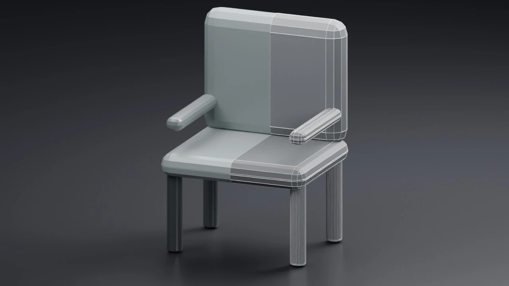

---

group: "augmented-reality-furniture"
title: "Möbel in Augmented Reality am Handy prüfen"
description: "Prüfe die Position, Erscheinung und den Mobilweg zurück zu einer Möbel-Produktseite."
date: 2026-12-01
updated: 2026-12-01
keyword: "Möbel Augmented Reality"
cta: "Prüfe deine Produktansichten in der kostenlosen Vorschau."
---

Prüfe ein Möbelmodell in der Augmented Reality auf einem kompatiblen Smartphone vor dem Linken aus einer Produktseite. Teste den Eintrittspunkt, die Ausrichtung, die Position auf dem Boden und den Rückkehrprozess zum Browser. Halte die verifizierten Abmessungen in den Produktangaben fest und nutze die AR-Sitzung zur visuellen Bewertung.

## Welchen Weg testest du?

Öffne die für den Kunden sichtbare Seite auf dem Ziel-Handy und tippe auf die gleiche Steuerung, die der Kunde nutzen wird. Auf Apple-Geräten überprüfe, ob das Asset im Quick Look geladen wird, falls unterstützt. Für andere Wege prüfe die dokumentierten AR-Modus und die Geräteanforderungen des Viewers.

## Was solltest du aufzeichnen?

Nutze eine ungestörte Fläche und gute Beleuchtung. Stelle das Modell auf, bewege dich um es herum und notiere, ob es in die vorgesehene Richtung zeigt und visuell auf dem Boden sitzt. Gehe zurück zur Produktseite und bestätige, dass die aktive Variante korrekt ist.

## Was solltest du vor der Veröffentlichung überprüfen?

| Problem                       | Diagnose                                                |
| ----------------------------- | ------------------------------------------------------- |
| Das Objekt zeigt sich rotiert | Prüfe die exportierte Ausrichtung und die Startposition |
| Die AR-Aktion ist fehlend     | Gerät, Browser und Viewer-Modus                         |
| Falsches Stück öffnet sich    | Überprüfe die Quell-URL der aktiven Variante            |

<!-- IMAGE PENDING: Photograph or capture the example described in the brief. -->

**Quelle** [Apple · Quick Look](https://developer.apple.com/quick-look-gallery/), [model-viewer · Dokumentation](https://modelviewer.dev/docs/), [Apple · Vorbereitung von 3D-Inhalten für RealityKit](https://developer.apple.com/documentation/arkit/previewing-a-model-with-ar-quick-look).

[Verwandte Anleitung](/de/ratgeber/usdz-datei)

[So erstellst du ein 3D-Modell](/de/ratgeber/3d-modell-erstellen)

## Häufige Fragen

### Brauchen Käufer dennoch die Produktmaße?

Ja. Gib die von Hersteller verifizierten Maße und überprüfe, ob sie der ausgewählten Version entsprechen. Nutze die AR-Funktion für den visuellen Kontext.

### Was sollte bei nicht unterstützten Smartphones angezeigt werden?

Halte die Produktfotos und, wo möglich, den Web-Viewer verfügbar. Stelle sicher, dass die Seite weiterhin die Produktinformationen und die Bestellkontrollen bietet. Halte die Produktfotos und den Web-Viewer bereit, falls verfügbar, und stelle sicher, dass die Produktinformationen und die Bestellmöglichkeit sichtbar bleiben.

### Kann ich nur auf einem Desktop testen?

Nein, du musst das Möbelmodell auf einem Smartphone testen. Öffne die Kundenseite auf dem Ziel-Handy und tippe auf die gleiche Steuerung wie der Kunde. Prüfe, ob das Objekt rotiert oder falsch geladen wird – besonders auf Apple-Geräten mit Quick Look.
