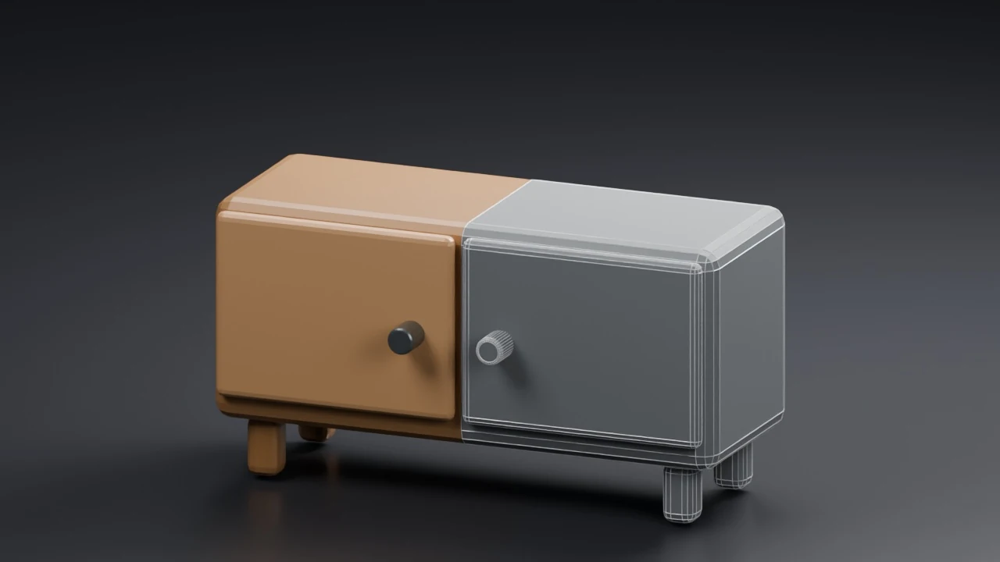

---

group: "furniture-photography"
title: "So fotografierst du Möbel für deinen Onlineshop"
description: "Planen und fotografieren Sie eine Möbelgalerie, die die Form, die Materialien und den Aufbau zeigt, die Käufer sehen müssen."
date: 2026-11-19
updated: 2026-11-19
keyword: "Möbelfotografie Onlineshop"
cta: "Prüfe deine Produktansichten in der kostenlosen Vorschau."
---

Beginne mit einem drei Viertel-Aufnahme, die den Vorderseite und der Tiefen des Möbels zeigt. Füge eine direkte Vorderansicht, eine Seiten- oder Rückansicht sowie Detailaufnahmen der Oberfläche und des Hardware-Teils hinzu. Nutze die gleiche Aufstellung bei allen Varianten, damit die Käufer erkennen können, wo sich Holz, Polsterung oder Konstruktion unterscheiden.

## Wie leuchtet man ein großes Möbelstück aus?

Stelle ein Fenster oder eine große, diffusierte Lichtquelle auf einer Seite, etwas vor dem Möbelstück ein. Schalte die Zimmerbeleuchtung aus, falls die Farbtemperatur abweicht. Nutze eine weiße Wand gegenüber dem Licht, um dunkle Bereiche zu heben, ohne die Holzstruktur zu flachzulösen.

Stelle den Kameraabstand so weit zurück, dass das gesamte Möbelstück sichtbar ist, dann passe die Höhe an, bis die vertikalen Kanten gerade wirken. Markiere die Position des Stativs und des Möbels an der Bodenfläche. Verwende diese Markierungen für jede Farbe oder Stoffvariante.

## Welche Fotos solltest du vor dem Verschieben des Setups aufnehmen?

Nutze das Hauptfoto, um die Silhouette zu zeigen. Eine direkte Ansicht erklärt die Vorderseite, eine Seitenansicht zeigt die Tiefe und die Form der Beine oder Arme. Fotografiere Türen und Schubladen offen, wenn sie den Nutzungsraum verändern.

Nimm nach den Vollansichten Aufnahmen von Hardware und Material. Fotografiere eine Verbindung oder Verlängerung sowie Stoff oder Holzstruktur. Füge gemessene Abmessungen in ein beschriftetes Diagramm oder die Spezifikationen ein.

## Was solltest du vor der Veröffentlichung überprüfen?

| Problem                                               | Lösung                                                        |
| ----------------------------------------------------- | ------------------------------------------------------------- |
| Die Oberseite sieht breiter als die Basis             | Ziehe die Kamera weiter zurück und halte sie senkrecht        |
| Oak sieht in dem Seitenfoto gelb                      | Schalte gemischtes Licht aus und stelle den Weißabgleich fest |
| Der Hintergrund erscheint nur in einem Zimmeraufnahme | Füge eine vollständige, unbehinderte Hinteransicht hinzu      |

<!-- IMAGE PENDING: Photograph or capture the example described in the brief. -->

**Quelle** [Shopify · Produktfotografie](https://help.shopify.com/en/manual/products/product-media/product-photography), [Google Merchant Center · Bildlink](https://support.google.com/merchants/answer/6324350), [GS1 · Produktbildspezifikation](https://www.gs1.org/standards/gs1-product-image-specification-standard/current-standard)

[Verwandte Anleitung](/de/ratgeber/produktfotografie-onlineshop)

[So erstellst du das Modell 3D](/de/ratgeber/3d-modell-erstellen)

## Häufige Fragen

### Kann man Möbel mit einem Smartphone fotografieren?

Ja, du kannst Möbel mit einem Smartphone fotografieren, indem du die Hauptlinsen in guter Beleuchtung verwendest und das Smartphone so positionierst, dass die Winkel wiederholt werden. Stelle vor dem Wechsel zu einer Ultra-Weitwinkellens sicher, dass der erste Bildausschnitt vergrößert wird, um gestreckte Ecken und verschwommene Texturen zu überprüfen. Verwende einen Stativ oder eine stabile Oberfläche, um Konsistenz zu gewährleisten.

### Sollte ich den Raum um das Möbelstück zeigen?

Nutze ein Zimmerfoto, um eine mögliche Einrichtung zu zeigen. Achte darauf, dass ein separates Produktfoto vorhanden ist, bei dem die Kontur, der Grund und die Oberfläche klar sind. Die Spezifikations-Tabelle sollte die Maße enthalten.

### Brauchen alle Varianten die gleiche Galerie?

Wiederhole den Hauptwinkel, wenn die Oberfläche oder der Aufbau sich ändert. Nutze Detailbilder nur dann, wenn der fotografierte Teil tatsächlich identisch ist. Kennzeichne klar, welche Farbe oder Zusammenbau das Bild zeigt.
