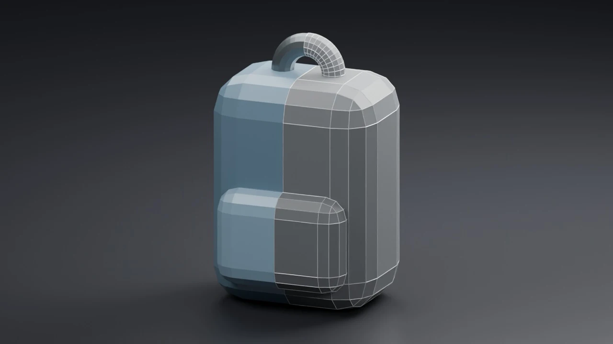

---

group: "product-photography-angles"
title: "Welche Perspektiven braucht ein Produktfoto?"
description: "Wählen Sie eine Hauptansicht und sekundäre Ansichten, die Fragen zum Sitz, der Konstruktion und der Nutzung beantworten."
date: 2026-11-21
updated: 2026-11-21
keyword: "Perspektiven Produktfotografie"
cta: "Prüfe deine Produktansichten in der kostenlosen Vorschau."
---

Wähl jede Produktfotografie, um eine Frage zu beantworten. Beginne mit einer Ansicht, die die Form erklärt, dann füge Winkel hinzu, die zeigen, wie das Produkt zusammenpasst oder funktioniert. Ein Hinteransicht, ein Close-up oder ein Bild mit offenem Produkt beantwortet oft mehr als ein anderes, fast identisches Vorderansicht.

## Welchen Winkel sollte man zuerst zeigen?

Beginne mit drei Viertel für ein Objekt, dessen Tiefe wichtig ist, wie beispielsweise eine Tasche oder ein Stuhl. Nutze die Vorderansicht, wenn Gesicht, Form oder gedruckte Informationen das Produkt am schnellsten identifizieren. Prüfe die Ausschnitte bei Thumbnail-Größe.

Lasse genügend Raum um das Produkt für die Krop der Webseite. Halte die Hauptansicht und die Komposition bei den Varianten konstant, und füge Detailfotos hinzu, wenn Materialien oder Bauteile tatsächlich anders sind.

## Welche Lücken sollten die nächsten Fotos schließen?

Stelle drei Fragen, die ein Käufer ohne das Produkt halten könnte. Gib jeder Frage eine Ansicht. Für eine Tasche zeige die Rückseite, Öffnung und Riemenbefestigung. Für ein Schuh: die Sohle. Für Möbel: die Rückseite oder die Unterseite, falls die Konstruktion wichtig ist.

Platziere die Antworten in Reihenfolge der Wichtigkeit. Ein Close-up ist nützlicher, wenn eine breitere Ansicht dem Leser sagt, wo das Detail sitzt.

## Was sollte man vor der Veröffentlichung überprüfen?

| Ansicht                                      | Frage, die sie beantwortet                               |
| -------------------------------------------- | -------------------------------------------------------- |
| Vorderansicht oder drei Viertel              | Was ist dieses Produkt und welche Form hat es?           |
| Hinteransicht, Seitenansicht oder Unterseite | Wie ist der Teil, den ich nicht sehen kann, konstruiert? |
| Offen oder im Einsatz                        | Was kann ich damit machen?                               |
| Detail                                       | Wie sieht das Material oder die Mechanik im Detail aus?  |

<!-- IMAGE PENDING: Photograph or capture the example described in the brief. -->

**Quellen** [Shopify · Produktfotografie](https://help.shopify.com/en/manual/products/product-media/product-photography), [Google Merchant Center · Bildlink](https://support.google.com/merchants/answer/6324350), [GS1 · Produktfotografie-Spezifikation](https://www.gs1.org/standards/gs1-product-image-specification-standard/current-standard).

[Verwandte Anleitung](/de/ratgeber/produktfotografie-onlineshop)

[So erstellen Sie ein 3D-Modell](/de/ratgeber/3d-modell-erstellen)

## Häufige Fragen

### Wie viele Fotos sollte ich verwenden?

Beginne mit einer Hauptansicht und drei weiteren Ansichten, um Lücken zu schließen. Füge die Vorderansicht, Rückseite und Öffnung für Produkte wie Taschen oder Schuhe hinzu. Prüfe, ob die Thumbnails die Details korrekt darstellen – viele verlieren Details durch zu kleine Ansichten.

### Wann ist ein gerader Frontansicht besser?

Verwende eine gerade Frontansicht, wenn sie hilft, Konturen, Gesichter oder Farbvarianten zu vergleichen. Ein flacher Kasten mit lesbaren Etiketten könnte von einer klaren Frontansicht mehr profitieren als von einer dramatischen Einstellung. Füge für jede Frage eine spezifische Ansicht hinzu, um dem Käufer das Produkt besser zu erklären.

### Kann ein 3D-Modell die Rückansicht ersetzen?

Ein 3D-Modell kann die Rückansicht nicht ersetzen, wenn sie Features enthält, die der Käufer überprüfen muss. Verwende beide, wenn die echte Fotografie Details bestätigt und das Modell Kontext bietet. Stelle sicher, dass die Rückansicht alle wichtigen Merkmale klar zeigt und unter konstanter Beleuchtung aufgenommen wurde.
