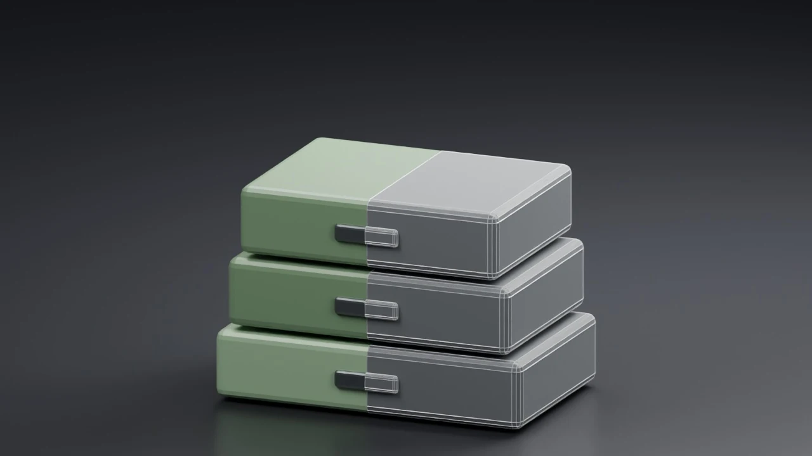
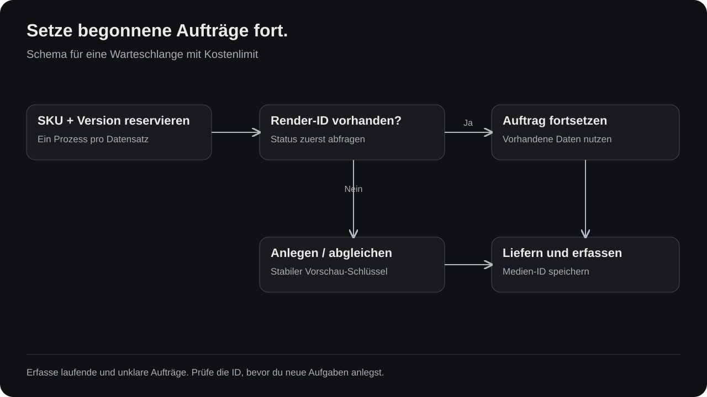

---

group: "n8n-batch-3d-catalog"
title: "Einen 3D-Produktkatalog mit n8n automatisieren"
description: "Wandele Katalogzeilen in überprüfte 3D-Modelle mit n8n um. Verfolge SKU-Versionen, starte Aufgaben wieder, binden Ausgaben und liefern Dateien ohne…"
date: 2026-12-09
updated: 2026-12-09
keyword: "Produktkatalog automatisieren n8n"
cta: "Prüfe deine Produktansichten in der kostenlosen Vorschau."
---

Nutze den Katalog-Endpoint, um 3D-Modelle in einem Batch zu verarbeiten. Füge die Auftrags-ID und die Freigabelizenz als Parameter in die Katalog-API-Anfrage ein. Ein leeres Ergebnis bedeutet nicht, dass nichts gestartet wurde – überprüfe den letzten Status vor der nächsten Anfrage.

> **Ein leeres Ergebnis bedeutet nicht, dass nichts gestartet wurde.** Die Aufgabe könnte weiterlaufen, auf eine Prüfung warten oder den letzten Antwortstatus fehlen. Erhole den aktuellen Zustand, bevor du eine weitere kostenpflichtige Anfrage stellst.

## Solltest du eine Tabellen-Schleife oder den Katalog-Endpoint verwenden?

Verwende die pro-Produkt-Verarbeitung, wenn jeder Modell eine individuelle Vorschauentscheidung benötigt. Nutze den Katalog-Endpoint, wenn der Inhaber einen definierten Batch mit vorab genehmigtem Gesamtbetrag und der erforderlichen Freigabelizenz für den Store-Media bestätigt hat. Diese Entscheidungen schaffen unterschiedliche Prüf- und Datenschutzgrenzen.

| Route                           | Wähle es, wenn                                                       | Genehmigung zur Aufbewahrung                                           |
| ------------------------------- | -------------------------------------------------------------------- | ---------------------------------------------------------------------- |
| Einzelne SKU-Vorschau und Build | Eine Person prüft jedes Produkt zuerst                               | Quellrevision, Render-ID und Build-Obergrenze                          |
| Übermittlung per Katalog-API    | Ein definiertes Batch kann nach vorab genehmigter Ausführung starten | Genau aufgeführte Artikelliste, Store, Gesamtbetrag und Freigabelizenz |
| Abgabe bestehender Modelle      | Modelle existieren bereits und benötigen nur eine Übertragung        | Ziel und Publikationsentscheidung                                      |

Der [einfache Produkt-Workflow für n8n](/de/ratgeber/bild-zu-3d-n8n) dient als Ausgangspunkt für die erste Route. Der [Katalog-API-Vertrag](https://github.com/easyrenderai/easyrender.ai/blob/main/docs/api.md) dokumentiert die zweite. Rufe den Batch-Endpoint nicht auf und erwarte, dass er an der gleichen manuellen Vorschau-Sperre pausiert.

## Was sollte in jeder Quellzeile enthalten sein?

Für eine Serie keramischer Vase soll die Produktidentität getrennt von dem Automatisierungsstatus gehalten werden. Ein neuer Foto eines bestehenden Vases ist eine neue Quellrevision, nicht unbedingt ein neues Produkt. Halte die alte Render-ID, bis du absichtlich die genehmigte Medien ersetzt.

| Feld                   | Rolle                          | Beispiel oder Regel                                   |
| ---------------------- | ------------------------------ | ----------------------------------------------------- |
| `sku`                  | Produktidentität               | `VASE-ROUND-01`                                       |
| `source_version`       | Genau erwarteter Eingang       | `photo-v3`                                            |
| `image_url`            | Stabiler Quellwert             | Öffentliche HTTPS-Bild-URL, bei URL-Eingabe           |
| `creation_key`         | Vorschau-Neuidentität erneuern | Stabil pro SKU und Quellrevision                      |
| `render_id`            | Dienstaufgabe                  | Sofort nach Erstellung persistieren                   |
| `workflow_state`       | Deine Warteschlangenstatus     | Neu, im Überprüfung, eingereicht, ungewiss, geliefert |
| `approved_credits`     | Genehmigter Build-Höchstwert   | Verifizierte nicht-negative ganze Zahl                |
| `destination_media_id` | Lieferungsrecovery             | Speichert nachdem der Shop die Datei akzeptiert       |

Diese Warteschlangenfelder gehören zu deinem System. Sie sind keine zusätzlichen Felder, die an `/api/renders` gesendet werden. Halte den Dienststatus separat, da `preview_ready` und dein Geschäftsstatus „Überprüfung abgelehnt“ unterschiedliche Dinge beschreiben.

## Wie verarbeitest du Zeilen, ohne Doppelungen zu starten?

1. Wähle geeignete Quellaufzeichnungen, dann nimm ein SKU/Revision vor der Arbeitserstellung. Ein Datenbank-Unique-Regel ist vorzuziehen, wenn mehrere Worker laufen. Ein einfaches Spaltenstatus-Zell ist kein atomarer Lock.
2. Falls `render_id` existiert, liest du den Render und fährst von seinem Status fort. Erstelle ihn nicht neu, weil `destination_media_id` leer ist.
3. Wenn kein ID existiert, aber eine Erstellung versucht wurde, versuche den Vorschau-Generierungsprozess erneut mit dem gleichen gespeicherten `Idempotency-Key` und unveränderten Eingaben. Speichere die zurückgegebene ID vor der Fortsetzung.
4. Warte auf die Vorschau und speichere die Genehmigungsentscheidung. Nur der genehmigte Zweig kann den bezahlten Build starten, mithilfe seines autorisierten `maxCredits`.
5. Polliere die gleiche Aufgabe, bis zum Abschluss, Fehler oder dem Workflow-Deadline. Ein Deadline speichert das Protokoll für die Abrechnung. Er erzeugt nicht automatisch einen neuen Versuch.
6. Lade das Modell herunter und übergebe es. Speichere die Zielmedien-Identifikator vor der Markierung der Quellzeile als geliefert.

Bei der ersten Bereitstellung verwende einen einzigen Worker und verarbeite ein Element pro Mal. Der n8n-[Loop Over Items](https://docs.n8n.io/integrations/builtin/core-nodes/n8n-nodes-base.splitinbatches/) unterstützt explizite Batchverarbeitung. Halte die Zeitpläne so, dass sie nicht überschneiden, bevor du die Konkurrenz erhöhen, nachdem du die Dienstleistungsbeschränkungen und dein eigenes Wiederherstellverhalten gemessen hast.

## Wie soll der Aufwand über den Batch kontrolliert werden?

Ein genehmigter pro-Aufruf-Schwellenwert ist allein nicht ausreichend, um einen Gesamtkampf-Budget über mehrere Worker zu kontrollieren. Halte für jede laufende bezahlte Operation eine atomare Reservierung, und inkludiere ungeklärte Einreichungen im bereits verplanten Betrag. Andernfalls können zwei Worker den gleichen verbleibenden Limit sehen.

| Budgetkomponente                            | Zähle es, wenn                                            | Freigebe oder rechne es ein, wenn                 |
| ------------------------------------------- | --------------------------------------------------------- | ------------------------------------------------- |
| Gesamtbetrag genehmigt                      | Der Owner genehmigt den Batch                             | Der Umfang oder der Budget wird explizit geändert |
| Ein Worker beansprucht eine bezahlte Aktion | Der endgültige Ausgang ist abgerechnet                    | Bestätigte Ausgabe                                |
| Der Dienst speichert die Debit              | Ein überprüfter Rückerstattung wird separat protokolliert | Ein bestätigter Rabatt wird separat erfasst       |
| Antwort ist nach der Einreichung verloren   | Ein bestehender Job oder Supportnachweis löst es          | Bestehende Job- oder Supportnachweise lösen es    |

Lies den Live-Preis und den verbleibenden Ladungswert des Renders vor der Erstellung. Stopp bei unzureichenden Mitteln oder überschrittenem Schlüsselobergrenze. Ein Wallet-Refund und der Lebensdauer-Grossabzug des Schlüssels verhalten sich unterschiedlich. Setze deine Schlüsselbudgetannahmen nicht einfach zurück, nur weil der Balancewert gesteigert wurde.

Nutze die [Ratenbegrenzungsrichtlinien von n8n](https://docs.n8n.io/integrations/builtin/handle-rate-limits.md), um sichere Lesen zu steuern. Für ein 429, respektiere den Wert des Antworten-`Retry-After`. Bei einem zeitgesteuerten, bezahlten Mutationstyp muss der Ressource vor dem Wiederholen abgeglichen werden. Ein Backoff allein macht eine doppelte Einreichung nicht sicher.

## Was ändert sich, wenn du die Catalog-API nutzt?

Bitte `GET /api/catalog/quote?items=N` für die exakte vorgesehene Anzahl an Artikeln. Zeige dem Benutzer die Artikelliste, den Preis, den Zielshop und die Auswirkungen der Freigabe. Die Einreichung erfordert `write`, `spend` und `share`, nicht nur die Lesen/Schreibrechte, die für die Vorschau verwendet werden.

| Feld der Einreichung | Erforderter Wert                                    |
| -------------------- | --------------------------------------------------- |
| `platform`           | `shopify`, `woocommerce`, `prestashop` oder `other` |
| `store`              | Stabile Identifikation für den Zielshop             |
| `maxCredits`         | Genehmigter Gesamtbetrag für diese Einreichung      |
| `items`              | Maximal 100 Artikel pro Anfrage im aktuellen Schema |
| Jeder Artikel        | `externalId`, `title`, `imageUrl`. Optional `note`  |

Einmalig an `POST /api/catalog` einreichen, dann mit `GET /api/catalog?platform=...&store=...` die bereits genehmigte Warteschlange prüfen und vorwärtsarbeiten. Behandle `needs_credits`, `needs_info` und `failed` explizit. Halte Plattform- und Shopwerte bei der Wiederherstellung des gleichen Pakets identisch.

Die Einreichung teilt beim Catalog-Modelllinks für den Shop. Wähle den pro-Produkt-Route, falls dies nicht autorisiert ist. Unterscheide auch zwischen der Generierung der Catalog-Modelle und der Schreibaktion von Produktseiten in ein Handels-Content-Management-System: der Shop-Connector benötigt immer einen getesteten Lieferweg.

<!-- IMAGE PENDING: unique real screenshot of catalog rows with saved job IDs and a recovered execution. Use synthetic SKUs and no customer data. -->

## Wie weiß man, dass ein Produkt korrekt geliefert wurde?

Die Quellrevisionsnummer, die Render-ID, die Zielprodukt-ID und die Medien-ID müssen übereinstimmen. Lade die private GLB-Datei mit den API-Zugangsdaten herunter und upload sie über den von dem Store unterstützten Workflow. Die Verfügbarkeit eines Modells im Generator ist nicht gleichbedeutend mit seiner Verfügbarkeit auf der Produktseite.

Für Shopify folge der [Dokumentation zur Medienverarbeitung und Anhängen](https://shopify.dev/docs/apps/build/product-merchandising/products-and-collections/manage-media). Prüfe den tatsächlichen Shop-Store nach der Verarbeitung. Falls nur die Lieferung fehlschlägt, versuche diesen Schritt mit der bestehenden Datei, ohne ein neues Modell zu generieren.

Der übermittelte GLB sollte in einem kompatiblen Viewer geöffnet werden; [Khronos beschreibt das Format](https://www.khronos.org/gltf/). Notiere die Dateigröße und den Zustand des Ziels für deine eigenen akzeptierten Ausgaben. Leite keine Geschwindegewinne oder Vorteile der Umwandlung aus der Anzahl der abgeschlossenen Aufträge ab.

## Welche Batch-Fehler benötigen eine eigene Wiederherstellungsstrategie?

| Symptom                                          | Wahrscheinlicher Grund                                                        | Lösung                                                                      |
| ------------------------------------------------ | ----------------------------------------------------------------------------- | --------------------------------------------------------------------------- |
| Das gleiche SKU wird zweimal ausgeführt          | Überschneidende Zeitpläne oder keine Ansprache                                | Serie das Arbeitsverhalten oder verwende eine atomare Ansprache             |
| Bestehende Vorschau wurde ersetzt                | Leere Endzelle wurde als einzige Voraussetzung für die Zulässigkeit verwendet | Prüfe zunächst die gespeicherte ID und den Workflow-Zustand                 |
| Falsches Produkt wurde aktualisiert              | Reihenfolge der Zeile wurde geändert                                          | Verwende stabile externe IDs zur Abgleichung                                |
| Gesamter Aufwand übersteigt Erwartungen          | Gleichzeitige Reservierungen werden ignoriert                                 | Verfolge den vertraglich festgelegten und den unbekannten Aufwand gemeinsam |
| Jeder Tick versucht einen Fehler erneut          | Ein handlungsbedarfs-Status wird als vorübergehend behandelt                  | Stopp und löse Kredite, Eingaben oder Berechtigungen auf                    |
| Modell bereit, Seite leer                        | Medienverarbeitung oder -lieferung fehlgeschlagen                             | Upload/Anhang wiederherstellen, Render beibehalten                          |
| Neuer Quellwert wiederverwendet alte Genehmigung | Revision ist nicht Teil der Entscheidung                                      | Genehmigung erforderlich für die aktuelle Quellversion                      |

## Welche Inhalte sollte der erste Akzeptanztest abdecken?

Verwende ein kleines Beispiel: ein gültiges Produkt, ein absichtlich ungültiges Bild und ein Datensatz mit bestehender Render-ID. Stelle sicher, dass der ungültige Eintrag gestoppt wird, die bestehende Aufgabe fortgesetzt und der gültige Datensatz in die Prüfung gelangt. Dadurch wird das Verhalten der Warteschlange vor der Genehmigung eines bezahlten Batch-Verlaufs getestet.

Simuliere anschließend einen verlorenen Erstellungsauftrag und eine Lieferunterbrechung mit Fixtures. Führe dann einen autorisierten End-to-End-Test durch, bevor unbetreute Planung aktiviert wird. Die öffentliche Schema- und Repository-Verträge wurden für diese Anleitung überprüft. Keine Live-Batch-Resultate oder Kostenersparnisse werden behauptet.

Meistere die pro eindeutigen SKU/Revision überprüften Modelle, manuelle Eingriffe, offene Aufgaben und Netto-Kreditwerte pro anerkanntem Modell. Für den Asset-Workflow siehe [wie ein 3D-Modell erstellt wird](/de/ratgeber/3d-modell-erstellen) und das [Produktseite-Paketleitfaden](/de/ratgeber/produktseiten-mit-n8n).

## Häufige Fragen

### Ist eine leere Modell-Link-Zelle ausreichend, um neue Arbeit zu starten?

Nein. Das Modell könnte weiterverarbeitet, in Prüfung oder nach der Generierung abgewartet sein. Speichere eine Job-ID und Workflow-Status vor Beginn neuer Arbeit. Nur ein Datensatz ohne bestehende oder unsichere Versuche sollte einen neuen Erstellungsprozess starten, wobei die stabile Quellrevision und der Schlüssel verwendet werden.

### Kann ich den gesamten Katalog parallel verarbeiten?

Beginne mit begrenzter Parallelität und einem genehmigten Budget. Parallele Worker benötigen atomare Ansprüche und gemeinsame Kreditreservierungen, einschließlich ungewisser Einreichungen, deren Ergebnis noch nicht bekannt ist. Das Erhöhen der Worker ohne diese Kontrollmechanismen kann zu doppelten Aufgaben führen oder das vorgesehene Gesamtvolumen überschreiten, selbst wenn jeder einzelne Antrag seine eigene Obergrenze hat.

### Erfordert der Katalog-API-Endpunkt öffentliche Sichtbarkeit?

Der Share-Scope ist erforderlich, da der Katalog-Workflow Model-Links für den Store-Use bereitstellt. Dazu werden explizite Berechtigungen benötigt, zusammen mit der Liste der Artikel und dem Budget. Verwende bei Bedarf private Vorschauen pro Produkt, um eine individuelle Prüfung vor der Entscheidung, welche Assets gebaut, geliefert oder geteilt werden sollen, zu ermöglichen.

### Sollte ein Modell nach einem fehlgeschlagenen Upload in den Store neu generiert werden?

Meistens ist der Generierungsprozess bereits abgeschlossen. Halte die Render-ID und erhole den Download oder die Zielübertragung stattdessen. Speichere die von dem Store zurückgegebene Medien-ID und den Verarbeitungsstatus, um zwischen einem fehlgeschlagenen Übertragungsprozess, einem pendenden Anhang und einem fehlenden Modell zu unterscheiden – ohne unnötig weitere Generierungen zu bezahlen.
