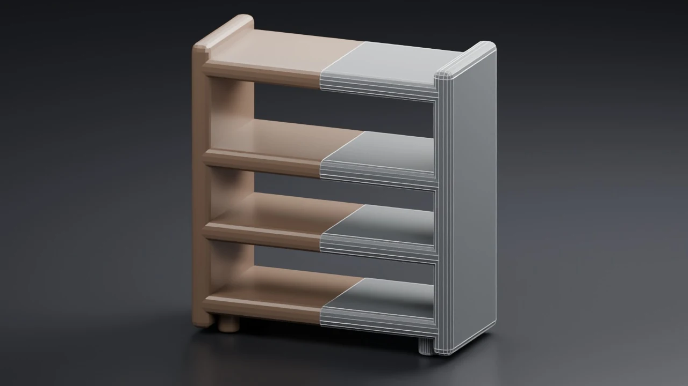

---

group: "furniture-product-page-best-practices"
title: "Was gehört auf eine Produktseite für Möbel?"
description: "Erstelle eine Möbel-Produktseite mit überprüften Abmessungen, klaren Varianten, Lieferdetails und einer nützlichen Galerie."
date: 2026-12-05
updated: 2026-12-05
keyword: "Produktseite Möbel"
cta: "Prüfe deine Produktansichten in der kostenlosen Vorschau."
---

Gib den Käufern die Informationen, die sie brauchen, um zu wählen und das Möbelstück zu erhalten. Stelle die ausgewählte Variante, den Preis, die Abmessungen und die Lieferung direkt neben den Bestellkontrollen bereit. Nutze die Galerie, um Material und Bauweise zu zeigen. Füge einen 3D-Aufbau hinzu, wo eine schwer sichtbare Funktion besser verstanden werden kann.

## Was sollte ein Käufer vor dem Hinzufügen zum Warenkorb sehen?

Zeige den Namen, die gewählte Oberfläche, die Verfügbarkeit und die Lieferzeit zusammen. Stelle die Gesamtbreite, Tiefe und Höhe in einem leicht zugänglichen Block bereit. Füge praktische Maße wie Sitzhöhe oder den Fußabdruck mit offenem Schrankraum hinzu, sofern diese überprüft wurden.

## Wie überprüfst du eine Variante?

Wähle die Oberfläche auf Mobilgeräten und überprüfe das Hauptbild, den Preis, die Verfügbarkeit, die Lieferung und das Modell – alle müssen auf die jeweilige SKU zeigen. Teste eine ausverkaufte Variante und eine, die anders geliefert wird. Stelle Informationen zu Montage und Versand leicht zugänglich.

## Was soll vor der Veröffentlichung geprüft werden?

| Frage                                     | Stelle die Antwort auf der Produktseite für Möbel platziert? |
| ----------------------------------------- | ------------------------------------------------------------ |
| Was genau kaufe ich?                      | Variante-Selektor und aktuelles Foto                         |
| Welche verifizierten Abmessungen gibt es? | Spezifikationsblock und beschriftete Skizze                  |
| Wie wird es geliefert?                    | Lieferung, Verpackung und Montagehinweise                    |

<!-- IMAGE PENDING: Photograph or capture the example described in the brief. -->

**Quelle** [Shopify · Produktmedien](https://help.shopify.com/en/manual/products/product-media), [Google Merchant Center · Produktinformationen](https://support.google.com/merchants/answer/7052112), [GS1 · Produktbildspezifikation](https://www.gs1.org/standards/gs1-product-image-specification-standard/current-standard).

[Zugehöriger Leitfaden](/de/ratgeber/3d-modelle-fuer-onlineshops)

[So erstellst du ein 3D-Modell](/de/ratgeber/3d-modell-erstellen)

## Häufige Fragen

### Sollte jedes Produkt ein 3D-Modell haben?

Beginne mit Artikeln, bei denen eine Drehung eine verborgene Seite oder Konstruktion erklärt. Halte die Bilder und Spezifikationen unabhängig vom Viewer-Unterstützung verfügbar. Füge die Sitzhöhe oder den Fußabdruck mit offenem Schrankraum sofort hinzu, sobald diese überprüft wurden und relevant sind.

### Soll ich die Verpackungsabmessungen mit einbeziehen?

Füge sie ein, sobald sich der Zugriff, die Lieferung oder die Montage ändert. Trenne die Paketgrößen von den überprüften Abmessungen des zusammengebauten Artikels.

### Welche Seite teste ich zuerst?

Wählen Sie ein Produkt mit mehreren Oberflächen und einer Lieferungsaußenseite. Es wird Varianten- und Erfüllungsprobleme aufzeigen, die bei einem einzelnen SKU-Produkt verdeckt bleiben.
