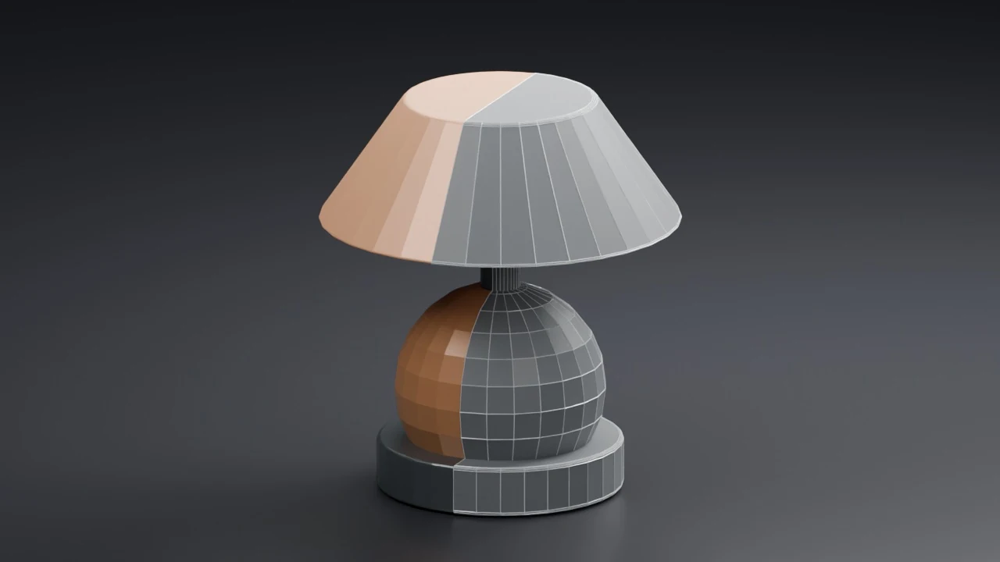
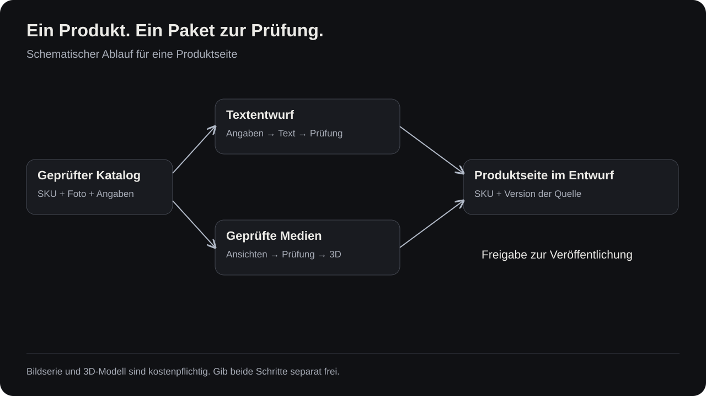
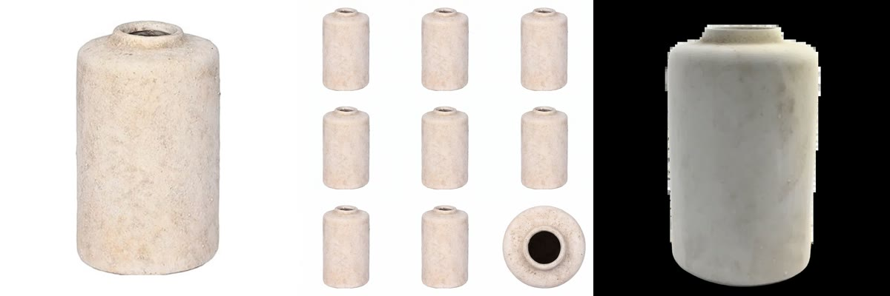

---

group: "n8n-product-pages-images-3d"
title: "Produktseiten mit n8n: Texte, Bilder und 3D"
description: "Erstelle mit n8n Produktseiten als Shop-Entwurf. Führe Produktdaten, Bilder und ein 3D-Modell zusammen und gib die Veröffentlichung separat frei."
date: 2026-11-18
updated: 2026-11-19
keyword: "Produktseiten mit n8n"
cta: "Prüfe deine Produktansichten in der kostenlosen Vorschau."
---

Erstelle mit n8n eine Produktseite, deren Texte, Bilder und 3D-Modell zum selben Artikel gehören. Führe die Ergebnisse anhand der SKU und der Version der Quelldaten zusammen. Speichere die Produktseite dann als Entwurf im Shop und halte die Freigaben für Ausgaben und Veröffentlichung getrennt fest.

> **Ein fertiger Eintrag erfordert mehr als nur eine Beschreibung.** Halte Produktdaten, Bilddateien, 3D-Modell und den Publikationsstatus zusammen. Ein erfolgreicher Erstellung der Inhalte ist ein Schritt hin zu einer genehmigten Produktseite.

## Was sollte dieser Workflow liefern?

Für eine keramische Tischlampe ist die Ausgabe ein überprüfbares Paket: genaue Texte, ausgewählte Produktansichten, eine GLB-Datei und die ID eines Entwurfs im CMS. GLB ist ein binärer Container für ein 3D-Modell, wie es in der [Khronos glTF-Dokumentation](https://www.khronos.org/gltf/) beschrieben wird. Ein rotierendes Video ist ein anderes Endprodukt.

| Lieferbar              | Quelle der Wahrheit                         | Akzeptanzprüfung                                               |
| ---------------------- | ------------------------------------------- | -------------------------------------------------------------- |
| Titel und Beschreibung | Lieferantenfakten plus redaktionelle Regeln | Keine erfundene Materialien, Abmessungen oder Zertifizierungen |
| Produktbilder          | Akzeptierte visuelle Ansicht                | Gleiches Produkt, Finish und Variante überall                  |
| Interaktive 3D-Datei   | Genehmigter Build                           | Die Datei öffnet, dreht sich und passt dem akzeptierten Stück  |
| CMS-Draft              | SKU-zu-Produkt-Abbildung                    | Richtiges Produkt und Variante, noch nicht veröffentlicht      |
| Verarbeitungsprotokoll | Gespeicherte IDs und Genehmigungsvermerk    | Ein weiterer Ablauf kann die Arbeit wieder aufnehmen           |

Das [Bild-zu-Shopify-Vorlage](https://n8n.io/workflows/11695-generate-product-descriptions-from-images-and-publish-to-shopify-using-ai/) zeigt den Textteil. Die Hinzufügung von 3D erfordert einen eigenen Job-Status, eine Prüfung und die Dateilieferung. Diese Anleitung beschreibt die Architektur. Es handelt sich nicht um einen Bericht über eine durchgeführte Store-Deployment.

## Wie sollte das Produktangebot aussehen?

Beginne mit einem bekannten Objekt, um zu überprüfen, welche Art von Datei jede Stufe liefern soll. Diese Vase aus der easyrender Galerie zeigt das Originalbild, die generierte Ansichtsmappe und das exportierte Modell. Verwende diese Dateien als Referenz, wenn du den Workflow einrichtest.

| Feld zur Prüfung           | Beispiel-Eingabe                                                |
| -------------------------- | --------------------------------------------------------------- |
| Beispiel-Identifikator     | `VASE-DEMO-01`                                                  |
| Referenzbild               | [Öffne das Quellbild](/showcase/vase.jpg)                       |
| Ansichten zur Prüfung      | [Öffne die generierte Ansichtsmappe](/showcase/vase-angles.jpg) |
| Modell für die Galerie     | [Öffne das Beispiel-GLB](/showcase/vase.glb)                    |
| Status des Produktangebots | Beispielentwurf                                                 |

**Stelle sicher, dass alle drei Assets dem gleichen SKU zugewiesen sind.** Öffne das Modell separat und halte das Quellbild bereit, um Form und Oberfläche zu überprüfen. Dieses Beispiel verwendet bestehende Assets, um zu zeigen, was ein Prüfer erhalten sollte.

## Was lief im lokalen n8n-Test?

In n8n 2.48.5 haben wir die Reihenfolge der Mediendaten für drei Beispiel-SKUs absichtlich vertauscht. Der Workflow führte die Daten anhand der SKU und der Quellversion zusammen, lud beide freigegebenen öffentlichen GLB-Dateien und prüfte ihre Binärheader und Dateigrößen. Der Sessel blieb zur Prüfung zurück, weil das Modell aus einer älteren Version stammte.

| SKU           | Quellversion     | Ergebnis                               |
| ------------- | ---------------- | -------------------------------------- |
| VASE-DEMO-01  | v2               | Entwurf mit GLB-Datei von 400.792 Byte |
| TABLE-DEMO-01 | v3               | Entwurf mit GLB-Datei von 326.872 Byte |
| CHAIR-DEMO-01 | v3 mit Modell v2 | Prüfung ausstehend                     |

Der Test umfasst das Zusammenführen und Prüfen vorhandener Dateien. Bilderzeugung, kostenpflichtige 3D-Erstellung und Veröffentlichung im Shop brauchen einen eigenen Test. [Beispiel-Workflow importieren](../evidence/n8n-local-draft-workflow.json), [Testergebnis ansehen](../evidence/n8n-local-draft-result.json).

## Welche Informationen müssen aus dem Katalog stammen?

Lege einen Datensatz mit SKU, Quellversion und geprüften Produktdaten an. Lass unbekannte Angaben leer und erfasse getrennt, ob die Bilder freigegeben sind, ob die 3D-Kosten genehmigt wurden und ob die Seite veröffentlicht werden darf. Verwende diese Felder: `sku`, `source_version`, `name`, `material`, `dimensions`, `image_url` und `locale`.

| Feld                 | Beispielwert                       | Warum es wichtig ist                                        |
| -------------------- | ---------------------------------- | ----------------------------------------------------------- |
| `sku`                | `LAMP-CERAMIC-01`                  | Verbindet Text, Bilder und 3D-Modelle                       |
| `source_version`     | `photo-v2`                         | Unterscheidet ein neues Foto von einem Wiederholungsversuch |
| `material`           | Lieferantenbestätigte Keramik      | Verhindert, dass visuelle Vermutungen zu Aussagen werden    |
| `dimensions`         | Bestätigte Lieferantenaufzeichnung | Behält Messwerte unabhängig von dem generierten Modell      |
| `publication_status` | `draft`                            | Trennt die Datei-Erstellung von der Live-Veröffentlichung   |

Für den Text-Branch fragt deine gewählte Sprachmodell-Anwendung nach Titel, Beschreibung, Aufzählungen, Bild-Alt-Text und `missing_facts`. Lasse es ausschließlich die bereitgestellten fakten-basierten Felder für Spezifikationen verwenden. Leite fehlende erforderliche Fakten an die Prüfung weiter, statt von der Modellierung erfasst zu werden.

### Was sollte der Text-Aufforderung und der Ausgabe enthalten?

Übergib die geprüften Produktdaten an den n8n-Knoten für die Textgenerierung. Halte die API-Authentifizierung des Nodes getrennt von der Authentifizierung des visuellen Dienstes. Falls das Ergebnis nicht parsbar ist oder die erforderlichen Felder nicht erfüllt, leite es an eine Bearbeitungsstufe weiter, bevor es an das CMS gelangt.

> Schreibe einen Entwurf für eine Produktseite in der gewünschten Sprache. Verwende dafür nur die bereitgestellten Angaben. Gib die Felder title, description, bullets, alt_text und missing_facts zurück. Leite aus dem Foto keine Materialien, Maße, Kompatibilitäten oder Zertifizierungen ab. Lass unbekannte Angaben aus dem Text weg und führe sie unter missing_facts auf. Veröffentliche nichts.

| Ausgabefeld     | Typ              | Beispiel aus dem Lampen-Record                               |
| --------------- | ---------------- | ------------------------------------------------------------ |
| `title`         | Text             | Keramische Tischlampe                                        |
| `description`   | Text             | Keramische Tischlampe für einen Tisch oder eine Seitenplatte |
| `bullets`       | Liste aus Text   | Keramischer Körper, nur bei Lieferantenbestätigung           |
| `alt_text`      | Text             | Vorderansicht der keramischen Tischleuchte                   |
| `missing_facts` | Liste der Felder | `dimensions`, `bulb_compatibility` falls nicht vorhanden     |

Behandle dies als Schema zur Validierung, nicht als Versprechen, dass das Modell immer konform ist. Für diesen illustrativen Eingang bleibt die Kompatibilität unbekannter Glühbirnen außer Betracht. Alle fünf Felder, Arrays für die beiden Listen und ein unverändertes Quell-SKU müssen vor dem Zusammenführen des Textzweiges mit visuellen Ergebnissen vorhanden sein.

## Wie erzeugst du Bilder und 3D aus demselben Produkt?

Nutze den integrierten [HTTP Request Node](https://docs.n8n.io/integrations/builtin/core-nodes/n8n-nodes-base.httprequest/) von n8n für die API-Aufrufe. Speichere den Schlüssel in einem Kennwort mit Header-Namen `Authorization` und Wert `Bearer YOUR_API_KEY`. Der Platzhalter wird innerhalb des Kennworts ersetzt, nie innerhalb eines gemeinsamen Workflow-Exports oder Produktaufzeichnungs-Formats.

1. Lese `GET https://easyrender.ai/api/credits`. Zeige den aktuellen Kostenwert der Bildmenge, der Kontostand und das angeforderte Produkt vor der Genehmigung. Die Erstellung der Bildmenge ist kostenpflichtig. Sie ist von der kostenlosen Vorschauroute getrennt.
2. Nach der Genehmigung rufe `POST /api/product-views` mit JSON mit `image_url`, `name` und optional `prompt` auf. Speichere die zurückgegebene `id` sofort als `view_set_id`.
3. Polliere `GET /api/product-views/{id}` mit dem gespeicherten Identifikator. Eine Startkonfiguration ist ein Warten von 15 Sekunden mit fester Frist. Respektiere Antworten mit Rate-Limit. Beende bei `failed` und überprüfe die einzelnen Ansichten vor der Akzeptierung der Menge.
4. Lade die angenommenen Bilder von `GET /api/product-views/{id}/views/{view}` herunter, wobei jeweils die zurückgegebene Ansichts-ID verwendet wird. Nutze das gleiche API-Kennwort und speichere die Antworten als Dateien.
5. Rufe `POST /api/product-views/{id}/render` nur nach der Bereitschaft und Akzeptierung der Menge auf. Speichere dessen `renderId`. Dadurch wird ein Entwurf erstellt oder wiederverwendet. Die Erstellung des kostenpflichtigen 3D-Builds wird nicht gestartet.
6. Rufe den Renderstatus ab und prüfe, wie viele Credits noch abzubuchen sind. Der Betrag ist `max(0, renderCredits - credits)`. Sende `POST /api/renders/{id}/render` mit dem genehmigten ganzzahligen Betrag in `maxCredits`.
7. Polliere, bis `status` `ready` ist und `hasModel` `true` ist, dann lade `GET /api/renders/{id}/model?download=1` als Datei herunter.

Das [API-Schema](https://easyrender.ai/api/openapi.json) dokumentiert die Pfade und Felder. Die REST-Anfrage für Produktansichten hat kein eigenes Feld `maxCredits`. Prüfe im Workflow, ob die Ausgabe genehmigt ist, und verwende einen separaten API-Schlüssel mit einem Credit-Limit.

Wenn du zunächst ein Produkt ohne kostenpflichtigen Bildsatz prüfen möchtest, starte mit der kostenlosen Vorschau aus der [API-Dokumentation](https://easyrender.ai/api/openapi.json). Der Workflow ruft `POST /api/renders` auf, wartet auf die Prüfung und trennt die spätere 3D-Erstellung davon.

<!-- IMAGE PENDING: unique real screenshot of product-view review and generated files, captured without credentials or customer data. -->

## Wie halten die Text- und Visuellen Zweige synchron?

Nutze die gleichen `sku` und `source_version` in beiden Zweigen. Speichere `view_set_id`, `render_id` und die Textrevisionsversion mit ihnen. Führe die Zusammenführung über diese Identifikatoren durch, nicht über die Position in einer Liste: ein langsames Bildanfrage muss kein Lampenmodell der nächsten Produktbeschreibung zuordnen.

| Kopiervorlage                     | Visuelle Vorlage      | Nächste Aktion                                           |
| --------------------------------- | --------------------- | -------------------------------------------------------- |
| Bereit                            | Noch verarbeitet      | Speichere die Kopie und warte auf die bestehende Aufgabe |
| Fehlende Lieferanteninformationen | Bereit                | Bitte die Informationen erfragen. Behalte die Dateien    |
| Genehmigt                         | Genehmigt             | Erstelle einen CMS-Entwurf                               |
| Genehmigt                         | Abgelehnt             | Halte den Text. Ändere nur die visuelle Aufgabe          |
| Vorherige Quellversion            | Aktuelle Quellversion | Prüfe den Missmatch vor der Kombination                  |

Beschreibe erzeugte Ansichten nicht als zusätzliche Fotos der physikalischen Lampe. Halte das ursprüngliche Foto für den Rezensenten bereit und füge passende Beschriftungen für jedes Asset hinzu. Für die Vorbereitung der Quelle folge dem [Fotografie-zu-3D-Guide](/learn/how-to-make-a-3d-model-from-photos).

## Wie erreichen die Dateien Shopify oder einen anderen CMS?

Ein privater Modellendpoint ist keine öffentliche Medien-URL. Lade die Datei über authentizierte n8n herunter und upload sie dann über den von der Zielplattform unterstützten Medienfluss. Halte die easyrender-Kennung auf separaten Anfragen. Sie gehört nicht in den Shop, die Dateiendung oder die Shopify-Anfrage.

[Shopify-Medienleitfaden](https://shopify.dev/docs/apps/build/product-merchandising/products-and-collections/manage-media) trennt Upload, Verarbeitung und Anhängen an ein Produkt. Folge dieser Reihenfolge für die API-Version, die deinem Shop verwendet wird. Speichere die zurückgegebene Datei und die Produktidentifikatoren, und bestätige, dass die Verarbeitung abgeschlossen ist, bevor du den Paketversand als abgeschlossen markierst.

Beginne mit einem Entwurf oder einer nicht veröffentlichten Änderung. Prüfe die Bilder, die Modellladung und die Variantezuordnung im tatsächlichen Theme. Eine Plattform, die eine Datei akzeptiert, weist nicht darauf hin, dass die Produktseite sie korrekt anzeigt. Der [E-Commerce-3D-Leitfaden](/de/ratgeber/3d-modelle-fuer-onlineshops) deckt diese Shop-Prüfung ab.

## Was bricht diese Automatisierung normalerweise?

| Symptom                                       | Wahrscheinlicher Grund                                                    | Lösung                                                                                      |
| --------------------------------------------- | ------------------------------------------------------------------------- | ------------------------------------------------------------------------------------------- |
| Kopie erfindet ein Material                   | Vision-Ausgabe behandelt als Lieferanten-Daten                            | Beschränke Spezifikationen auf überprüfte Felder                                            |
| Bildmenge beginnt zweimal                     | Bezahlter POST wird nach einem verlorenen Antwortversuch erneut versendet | Prüfe, ob der Auftrag bereits besteht, bevor du die kostenpflichtige Anfrage erneut sendest |
| Falsches Modell auf einem Produkt             | Zweige werden durch Listenposition verbunden                              | Verbinde durch SKU und Quellversion                                                         |
| Shopify kann das Modell nicht abrufen         | Privater Endpunkt als öffentlicher Medieninhalt angegeben                 | Datei mit Authentifizierung herunterladen und dann hochladen                                |
| Build startet nie                             | View-Set Draft wird als abgeschlossener Build verwechselt                 | Genehmigen und die separate Build-Aktion aufrufen                                           |
| Polling stoppt, aber die Aufgabe läuft weiter | Workflow-Frist wird als Aufgabenfehler verstanden                         | Speichere die ID und führe später Statusabfragen fort                                       |
| Ein altes Bild überlebt einen Neulauf         | Kein Medienrevisionstracking                                              | Speichere die Zielmedien-ID und Quellversion                                                |

## Wie weiß man, dass der Workflow ausgeweitet werden sollte?

Führe ein einzelnes Lampenmodell durch beide Workflow-Zweige und vergleiche das finale Draft mit dem Eingangsrecord. Notiere die Zeit für die Prüfung, die Anzahl der manuellen Korrekturen und den Netto-Kreditverbrauch. Danach verarbeite eine kleine Menge verschiedener Produkte, bevor ein Plan das Workflow-System ohne menschliche Eingriffe übernimmt.

Unsere Umsetzung trennt die View-Set-ID, die Render-ID und die endgültige Modellverfügbarkeit. Damit bietet dieses Rezept drei Kontrollpunkte anstatt eines allgemeinen Erfolgszeichens. Die angesprochene Anzahl der überprüften, gelieferten Produktpakete ist das Ergebnis. Ein grüner HTTP-Node ist lediglich ein intermedieller Hinweis.

Für eine umfassendere Produktionsmethode siehe das [3D-Erstellungsguide](/de/ratgeber/3d-modell-erstellen). Speichere bei größeren Katalogen die Vorgangs-ID und den genehmigten Betrag je SKU, damit ein neuer Durchlauf den Auftrag fortsetzen kann.

## Häufige Fragen

### Kann n8n aus einem einzigen Foto eine vollständige Produktseite erstellen?

Es kann die Arbeit koordinieren, aber das Foto allein reicht nicht aus, um Produktmerkmale zu überprüfen. Stelle zuverlässige Katalogfakten bereit, wähle deine Text- und Visual-Dienste, überprüfe die Ausgaben und erstelle einen CMS-Entwurf. Halte Maße, Materialien und die Publikationsgenehmigung getrennt von allem, was ein Bildmodell über das Objekt errät.

### Sind die Bilder und das 3D-Modell kostenlos?

Die Vorschau ist kostenlos. Für einen Satz Produktansichten fallen Credits an, und die anschließende 3D-Erstellung kostet weitere Credits. Prüfe den für dein Konto berechneten Betrag vor jeder Freigabe und berücksichtige auch die Kosten für das Sprachmodell und den Betrieb von n8n.

### Brauchst du einen eigenen EasyRender-Knoten in n8n?

Nein, du brauchst keinen nativen EasyRender-Node in n8n. Der HTTP Request-Node nutzt die integrierte Funktionalität und den veröffentlichten REST-Vertrag. Beginne mit dem integrierten Node, dann überprüfe einen dedizierten EasyRender-Node für deine genauen Operationen und die aktuelle Installation.

### Wird der Workflow Produkte automatisch veröffentlichen?

Nur, wenn du diesen Schritt hinzufügst und authorisiert. Dieses Rezept endet mit einem überprüften CMS-Entwurf und gespeicherten Medien-Identifikatoren. Die Trennung der Publikation ermöglicht, die Produktvariation, den Text und die Dateien zusammen zu überprüfen, bevor ein Live-Listings geändert wird, und ermöglicht es, die Versendung zu wiederholen, ohne das visuelle Werk neu zu generieren.
