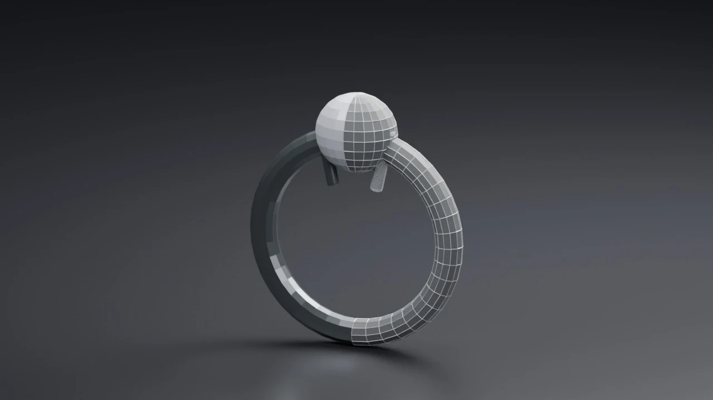

---

group: "jewelry-photography"
title: "Schmuck fotografieren: Reflexe gezielt kontrollieren"
description: "Fotografiere Schmuck mit lesbaren Kanten, kontrollierten Metallreflexen und einer wiederholbaren Detailaufnahme."
date: 2026-12-07
updated: 2026-12-07
keyword: "Schmuck fotografieren"
cta: "Prüfe deine Produktansichten in der kostenlosen Vorschau."
---

Bei der Fotografie von polierten Schmuckstücken formst du, was das Metall reflektiert. Setze eine Diffusion zwischen Licht und Objekt für eine breite Highlight-Fläche und verwende eine kleine dunkle Karte, um die Kanten zu definieren. Prüfe Steine, Prongs und Gravuren im Vollmaß vor dem Übergang zum nächsten Stück.

## Wie erreichst du eine gleichmäßige Reflexion?

Beginne mit einem neutralen Hintergrund. Erweitere die Lichtquelle im Verhältnis zum Objekt mit einem Diffusor, dann verschiebe sie, bis die Reflexion die Form des Metalls umrahmt. Verwende eine kleine dunkle Karte, wo zwei polierte Kanten sich treffen.

Stelle den Stativ ein und prüfe die Schärfe an dem nächsten Stein oder der Befestigung. Wenn du den Blendenwert änderst, um Tiefenschärfe zu gewährleisten, überprüfe die feinen Gravuren erneut, bevor du alle Varianten fotografierst.

## Welche Details sollten du in einem Rahmen reservieren?

Halte eine Hauptansicht, eine Ansicht der Befestigung und eine Vergrößerung des Einstellungs- oder Markierungsabschnitts bereit. Fixiere Farbe und Rahmen für Varianten und vergleiche die Dateien nebeneinander.

## Was solltest du vor der Veröffentlichung prüfen?

| Symptom                                | Einstellung                                                            |
| -------------------------------------- | ---------------------------------------------------------------------- |
| Weißer Glanz verdeckt Gravuren         | Verschiebe Diffusor oder senke die Belichtung leicht                   |
| Silber sieht wie eine weiße Form aus   | Füge eine dunkle Kantenreflexion hinzu                                 |
| Der Einstellungsabschnitt ist unscharf | Passiere den Schärfeplan an oder verwende eine geeignete Tiefenschärfe |

<!-- IMAGE PENDING: Photograph or capture the example described in the brief. -->

**Quelle** [GIA · gem and jewelry photography](https://www.gia.edu/gem-photography), [Shopify · product photography](https://help.shopify.com/en/manual/products/product-media/product-photography), [GS1 · product image specification](https://www.gs1.org/standards/gs1-product-image-specification-standard/current-standard).

[Verwandte Anleitung](/de/ratgeber/produktfotografie-onlineshop)

[So erstellst du ein 3D-Modell](/de/ratgeber/3d-modell-erstellen)

## Häufige Fragen

### Sollte ich einen Lichttuch verwenden?

Es kann Reflexe vereinfachen. Füge eine dunkle Karte hinzu oder verschiebe einen Teil der Diffusion, wenn der Zeltteil das Stück verlässt, ohne lesbare Kanten. Füge eine dunkle Karte hinzu, um Reflexe an polierten Kanten zu reduzieren und lesbare Details bei der Schmuckfotografie zu gewährleisten.

### Wie sollte ich die Farbe der Edelsteinfarbe überprüfen?

Halte Licht und Weißabstimmung konstant und vergleiche mit dem echten Artikel. Unterschiedliche Anzeigemöglichkeiten können immer noch Abweichungen zeigen.

### Welcher ist der beste Hero-Winkel?

Wählen Sie die Ansicht, die Form und den Stein oder das Hauptmerkmal zeigt. Füge ein zweites Foto für den Clasp oder die Rückseite hinzu. Füge eine dunkle Karte hinzu, um Reflexe zu reduzieren, besonders an den polierten Kanten des Schmucks.
