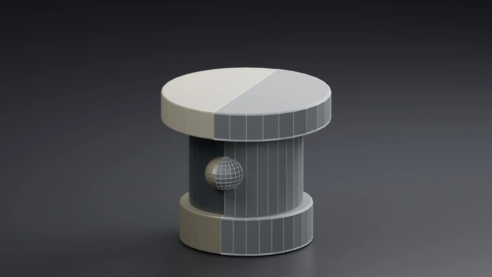

---

group: "woocommerce-3d-models"
title: "Einen 3D-Produktviewer in WooCommerce einrichten"
description: "Stelle einen WooCommerce-3D-Produktviewer mit einem GLB, einem Fallback-Bild und einem Mobil-Test für Akzeptanz ein."
date: 2026-11-29
updated: 2026-11-29
keyword: "WooCommerce 3D-Produktviewer"
cta: "Prüfe deine Produktansichten in der kostenlosen Vorschau."
---

Füge einen Viewer 3D zu einem WooCommerce-Produkt auf einer Staging-Website hinzu. Verwende eine Erweiterung, wenn du eine Admin-Arbeitsabläufe benötigst, sonst füge einen Web-Viewer hinzu, falls du die Vorlage selbst verwaltet. Stelle sicher, dass ein Produktfoto verfügbar ist und teste die Galerie an den Themen und Geräten, die deine Kunden nutzen.

## Wie wählt man die Integration?

Prüfe, ob die Erweiterung deine Datei- und Platzierungsspezifikationen unterstützt, bevor du sie kaufst oder installierst. Ein kundenspezifischer Vorlage kann einen Komponenten wie model-viewer verwenden, der mit deinem GLB- und Poster-Datei hostet. Stelle sicher, dass die Variante-Auswahl und Einkaufssteuerung weiterhin funktionieren.

## Was testet man mit einem Produkt?

Lade zunächst ein kleines Modell hoch. Öffne das Produkt in einer Incognito-Sitzung, überprüfe den Poster, interagiere mit dem Viewer und füge die richtige Variante in den Warenkorb. Bei einer langsamen Mobilverbindung bestätige, dass das Foto und die Produktinformationen weiterhin nutzbar sind.

## Was sollte man vor der Veröffentlichung überprüfen?

| Fehler                               | Prüfe                                                          |
| ------------------------------------ | -------------------------------------------------------------- |
| Das Modell gibt 403 zurück           | Öffentliche URL oder Hosting-Rechte                            |
| Der Viewer ersetzt die ganze Galerie | Erweiterungsplatzierung und Theme                              |
| Die Seite springt beim Laden         | Gib dem Poster und dem Viewer ein definiertes Seitenverhältnis |

<!-- IMAGE PENDING: Photograph or capture the example described in the brief. -->

**Quelle** [WooCommerce · Arty 3D Viewer](https://woocommerce.com/document/arty-3dmodelviewer/), [Woo C-commerce · Produkte hinzufügen](https://woocommerce.com/document/managing-products/add-product/), [model-viewer · Dokumentation](https://modelviewer.dev/docs/).

[Verwandte Anleitung](/de/ratgeber/3d-modelle-fuer-onlineshops)

[So erstellst du ein 3D-Modell](/de/ratgeber/3d-modell-erstellen)

## Häufige Fragen

### Brauche ich ein Plugin?

Nutze ein Plugin für eine von Admin verwaltete Galerie, oder wähle eine Komponente, wenn du die Vorlage und Hosting selbst kontrollierst. Teste auch die Wartung sowie den ersten Upload. Lade zunächst ein kleines Modell hoch und öffne es in einer Incognito-Sitzung, um die Interaktion zu testen.

### Ist GLB ausreichend für jede AR-Modus?

Prüfe die dokumentierten Modi und die Gerätekompatibilität des gewählten Viewers. Teste ein repräsentatives Gerät, bevor du AR-Aktionen an Kunden vorstellst.

### Wo sollte der 3D erscheinen?

Stelle ihn an einer klaren Stelle neben den Bildern ein. Priorisiere das Foto und die Kaufkontrollen auf schmalen Bildschirmen und aktiviere die Drehfunktion optional. Lade zunächst ein kleines Modell hoch und öffne es in einer Incognito-Sitzung, um die Interaktion zu testen.
