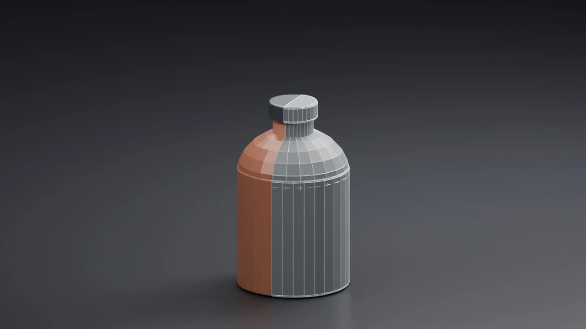

---

group: "ai-product-photography"
title: "AI product photography: what to make and check"
description: "Use AI for suitable product imagery and check the shape, colour, label and variant before publishing."
date: 2026-12-11
updated: 2026-12-11
keyword: "ai product photography"
cta: "Try an angle preview from a product photo."
---

Use AI product photography for changes you can verify, such as a background or presentation. Keep a real reference for the product’s shape, label, finish and colour. Compare each candidate with that reference before publishing, particularly when it shows an unphotographed side or suggests a feature.

## What edits are practical to review?

Start with one clean product photo and a specific change, such as a neutral background. Compare the original and the candidate at the same size. Check the label at full resolution and the silhouette at thumbnail size.

If you generate another view, compare visible details with an actual photograph when you have one. Keep the result out of the factual gallery if you cannot verify a critical feature.

## How do you handle variants?

Use a separate source image for each finish if colour or construction changes. Label the source SKU and generation revision. Review beside the real photos in a contact sheet and check the channel’s current rules.

## What should you check before publishing?

| Change                       | Acceptance check                 |
| ---------------------------- | -------------------------------- |
| New background               | Clean edge and intact label      |
| New apparent angle           | Visible features match reference |
| Colour or material treatment | Correct variant and finish       |

<!-- IMAGE PENDING: Photograph or capture the example described in the brief. -->

**Source** [Google Merchant Center · Product Studio](https://support.google.com/merchants/answer/13708167), [Google Merchant Center · image link](https://support.google.com/merchants/answer/6324350), [Shopify · product photography](https://help.shopify.com/en/manual/products/product-media/product-photography).

[Related guide](/learn/product-photography-for-ecommerce)

[How to make a 3D model](/learn/how-to-make-a-3d-model)

## FAQ

### Can I keep the original image as a record?

Yes. Store the original next to the published version and record which SKU it belongs to. That makes later reviews and corrections easier. Save the edit date and the approved output together so the team can trace a changed finish or remove the affected image.

### Should I use generated labels?

Keep readable factual information grounded in the real product. Compare enlarged lettering and replace the image if a label introduces wrong information. Store the original photo next to the published version and record the SKU for easy future review and correction.

### Can I judge only at full size?

You must judge at full size for details and check thumbnail size for recognition. Always verify the image crops well in a product grid and test the full-size image against grid layout to ensure product details remain legible. Check that text and key features are visible in both sizes.
