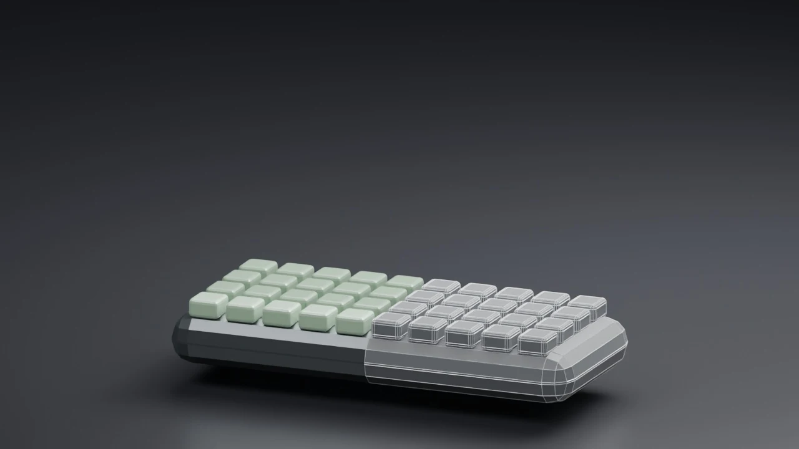
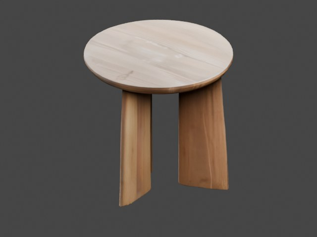

---

group: "compress-glb"
title: "How to compress a GLB and preserve useful detail"
description: "Find what makes your GLB large, reduce geometry or textures and compare the result in the same viewer."
date: 2026-11-28
updated: 2026-11-28
keyword: "compress glb"
cta: "Try an angle preview from a product photo."
---

To compress a GLB and preserve useful detail, reduce texture size if images dominate or simplify geometry if the mesh dominates. Export a copy and compare the two in the same viewer. Accept the smaller file only after checking angles, edges, and surface details your audience will see.

## What did simplifying one model change?

We imported our coffee table in Blender 5.2.3 and exported it twice with the same GLB settings. Applying a Decimate ratio of 0.5 reduced 16,228 triangles to 8,114. The two exports changed from 1,687,180 to 863,068 bytes, about 49% less.

These are the sizes of the two Blender exports. The site’s original GLB uses a separately prepared encoding, so it is a different baseline.

## How do you choose the next optimisation?

For a mesh-heavy model, try one geometry adjustment and check corners and intersections. For a texture-heavy model, try a smaller map and inspect fine markings. Test compressed texture extensions in the destination viewer before committing a catalogue.

## What should you check before publishing?

| Symptom                | Next action                                         |
| ---------------------- | --------------------------------------------------- |
| Labels blur            | Restore texture resolution before changing geometry |
| Edges change near legs | Reduce the strength of decimation                   |
| New file fails to open | Check required extensions and validator output      |

<!-- IMAGE PENDING: Photograph or capture the example described in the brief. -->

**Source** [Khronos · glTF 2.0 specification](https://registry.khronos.org/glTF/specs/2.0/glTF-2.0.html), [Khronos · KHR_texture_basisu](https://github.com/KhronosGroup/glTF/tree/main/extensions/2.0/Khronos/KHR_texture_basisu), [Blender · Decimate modifier](https://docs.blender.org/manual/en/latest/modeling/modifiers/generate/decimate.html), [Khronos · glTF Validator](https://github.com/KhronosGroup/glTF-Validator).

[Related guide](/learn/glb-file)

[How to make a 3D model](/learn/how-to-make-a-3d-model)

## FAQ

### How small should a GLB be?

Make the GLB as small as possible without losing visible detail or performance. Test on the actual device and page, checking transferred bytes, load time, and clarity of essential features. Next, verify the file size and viewer performance before deployment.

### Does fewer triangles always mean fewer bytes?

Fewer triangles don’t always mean fewer bytes, as textures, buffer encoding, and attributes impact file size. Optimize geometry first, then check GLB file size and triangle count in a viewer. Compare full exports with same settings to verify compression efficiency.

### Should I overwrite the source?

Keep the source and a record of export settings. Test a separate delivery file so you can restore detail without repeating the original modelling work. Test the compressed GLB in the actual destination viewer to confirm textures and details appear clear and intact.
