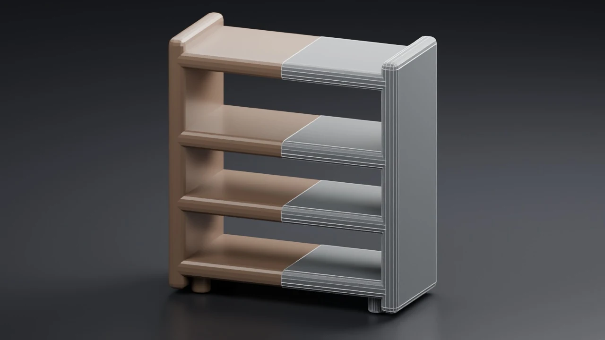

---

group: "furniture-product-page-best-practices"
title: "What to include on a furniture product page"
description: "Build a furniture product page with verified dimensions, clear variants, delivery details and a useful gallery."
date: 2026-12-05
updated: 2026-12-05
keyword: "furniture product page best practices"
cta: "Try an angle preview from a product photo."
---

Give shoppers the information they need to choose and receive the furniture. Put the selected variant, price, dimensions and delivery close to the buying controls. Use the gallery to show the material and construction. Add a 3D view where it makes a hard-to-see feature easier to understand.

## What should a buyer see before adding to basket?

Show the name, chosen finish, availability and delivery estimate together. Put overall width, depth and height in an accessible block. Include practical measurements, such as seat height or the footprint with drawers open, where you have verified them.

## How do you check a variant?

Select the finish on mobile and verify the lead image, price, availability, delivery and model all refer to that SKU. Test one out-of-stock variant and one that ships differently. Keep assembly and transport information easy to find.

## What should you check before publishing?

| Question                          | Place the answer                         |
| --------------------------------- | ---------------------------------------- |
| What exactly am I buying?         | Variant selector and current photo       |
| What are the verified dimensions? | Specification block and labelled diagram |
| How will it arrive?               | Delivery, packaging and assembly notes   |

<!-- IMAGE PENDING: Photograph or capture the example described in the brief. -->

**Source** [Shopify · product media](https://help.shopify.com/en/manual/products/product-media), [Google Merchant Center · product data](https://support.google.com/merchants/answer/7052112), [GS1 · product image specification](https://www.gs1.org/standards/gs1-product-image-specification-standard/current-standard).

[Related guide](/learn/3d-models-for-ecommerce)

[How to make a 3D model](/learn/how-to-make-a-3d-model)

## FAQ

### Should every product have a 3D model?

Not every product needs a 3D model. Select the finish on mobile and verify the lead image, price, and availability match the selected SKU. Common mistake: assuming all variants are identical—always confirm dimensions and delivery details in the specification block.

### Do I include package dimensions?

Include them when they change access, delivery or assembly. Distinguish package sizes from the verified dimensions of the assembled piece. List the dimensions of each box when an item ships in multiple cartons so a buyer can plan the route through a doorway or staircase.

### Which page do I test first?

Test a product with multiple finishes and delivery exceptions first. Select a finish on mobile and verify the lead image, price, and delivery match the selected SKU. Common mistake: assuming all variants share the same delivery—always confirm shipping details per finish.
