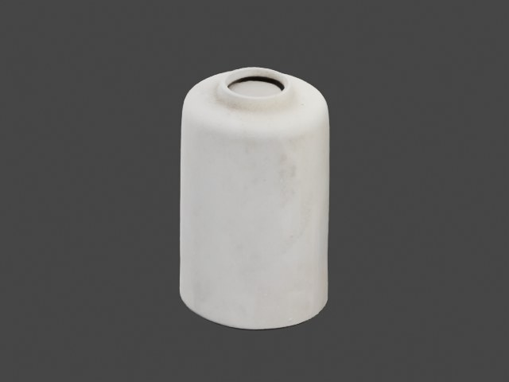

---

group: glb-vs-gltf
title: "GLB vs glTF: which package should you use?"
description: "Compare the same model as GLB and separate glTF files, including packaging, external textures and deployment."
date: 2026-11-25
updated: 2026-11-25
keyword: "glb vs gltf"
cta: "Try an angle preview from a product photo."
---

Use a GLB if you want to hand the model off as one file. Use separate glTF when you need to inspect or manage individual resources. Both can describe the same scene. The practical difference is how you deliver the JSON scene, geometry buffers and image textures.

<!-- ILLUSTRATION PENDING: /blog/illustrations/glb-vs-gltf/hero.webp; Prepare the editorial cover described in the brief. -->

## What changed when we exported the same vase?

We exported the same vase twice in Blender 5.2.3. The GLB was 1,732,772 bytes. The separate package had a 2,124-byte JSON file, a 1,702,680-byte buffer and a 28,466-byte WebP image.

The total was nearly identical for these settings. The small JSON alone was not the whole model. Other exporter settings or texture formats can change the totals.

## How do you test delivery?

For a single-file handoff, copy only the GLB to a new folder and open it. For separate glTF, move the whole export directory together. If a texture fails, compare its URI in the JSON with its deployed filename and path.

## What should you check before publishing?

| Destination                            | Packaging choice                                 |
| -------------------------------------- | ------------------------------------------------ |
| Email or catalogue CMS                 | Self-contained GLB, verified on its own          |
| Debugging a material resource          | Separate glTF with the image and buffer retained |
| Web server with separate caching needs | Test distinct assets and required requests       |

<!-- IMAGE PENDING: Photograph or capture the example described in the brief. -->

**Source** [Khronos · glTF 2.0 specification](https://registry.khronos.org/glTF/specs/2.0/glTF-2.0.html), [Khronos · glTF Validator](https://github.com/KhronosGroup/glTF-Validator), [Blender · glTF 2.0 import and export](https://docs.blender.org/manual/en/5.1/addons/import_export/scene_gltf2.html).

[Related guide](/learn/glb-file)

## FAQ

### Is one format always smaller?

No. Compare the total payload for the same model, including its dependencies. Geometry, image encodings and exporter settings can matter much more than the container.

### Can a GLB still refer to external files?

It can. Test that the export opens in an otherwise empty folder when your workflow requires a self-contained file.

### Why does the same model look different in two viewers?

Check lighting, colour management and extension support before blaming the package. Use the same destination viewer when comparing your exports.
