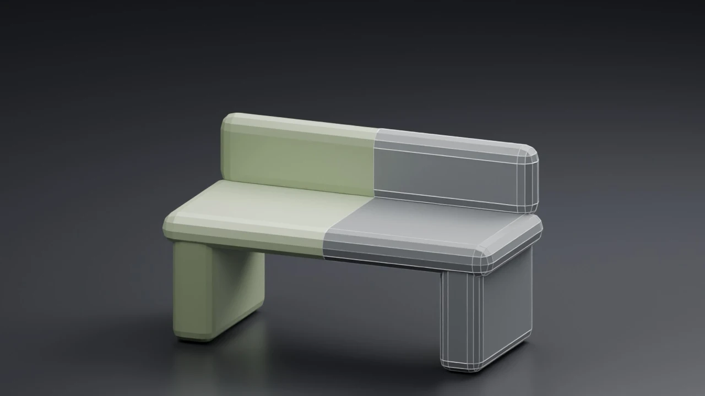

---

group: "import-furniture-models-into-sketchup"
title: "Import a 3D furniture model into SketchUp"
description: "Bring a furniture GLB into a compatible SketchUp edition and check materials, placement and the component."
date: 2026-12-15
updated: 2026-12-15
keyword: "import furniture models into SketchUp"
cta: "Try an angle preview from a product photo."
---

Import a 3D furniture model into SketchUp by using the File > Import menu. Check your SketchUp edition supports the file type, then verify orientation, faces, and texture placement before converting it to a component. Set project dimensions from verified specifications.

## How do you import a GLB?

Check SketchUp’s supported formats for your edition. If GLB is available under File, Import, select it and review the import options. Use a small file first and save a copy before bringing it into a client scene.

## What do you check after import?

Inspect it in a neutral style and look at the model from the front and top. Check the floor contact and expected material assignments. Group the item or create a component, place its origin where insertion is useful and review the scene again.

## What should you check before publishing?

| Symptom                  | Where to look                       |
| ------------------------ | ----------------------------------- |
| File type missing        | Version, plan and supported formats |
| Texture differs          | Material mapping and visual style   |
| Hard to position repeats | Grouping and component origin       |

<!-- IMAGE PENDING: Photograph or capture the example described in the brief. -->

**Source** [SketchUp · working with glTF](https://help.sketchup.com/en/sketchup/working-gltf-files), [SketchUp · importing models](https://help.sketchup.com/en/sketchup-education/importing-models-components-and-images), [Khronos · glTF 2.0 specification](https://registry.khronos.org/glTF/specs/2.0/glTF-2.0.html).

[Related guide](/models)

[How to make a 3D model](/learn/how-to-make-a-3d-model)

## FAQ

### Can every SketchUp edition import GLB?

You can import GLB files into SketchUp only if your edition supports it. Check the official list for your version and device. Use a supported path if the importer isn't available. Next, verify your SketchUp version and device compatibility before importing.

### Can I use a furniture library model?

You can use a furniture library model if it’s licensed for commercial use and compatible with SketchUp. Import the model alone first to test scale, orientation, and performance before adding it to a large project. Check the asset’s file format and SketchUp version support.

### What if a texture changes?

If a texture changes, compare it with the source file in a separate viewer and verify material settings. Before copying the component, ensure the material is correctly assigned in SketchUp. Check the texture’s UV layout and file path for mismatches.
