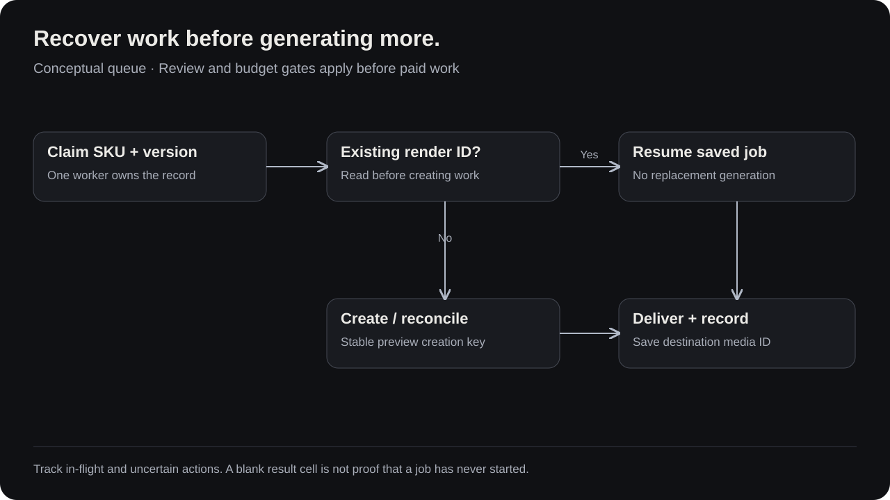

---

group: n8n-batch-3d-catalog
title: "Automate a 3D product catalog in n8n without duplicates"
description: "Turn catalog rows into reviewed 3D models with n8n. Track SKU versions, resume jobs, bound spending and deliver files without duplicating paid work."
date: 2026-11-21
updated: 2026-11-17
keyword: n8n batch 3d product catalog
cta: Validate one catalog photo with the free preview before authorizing the products you want to build in 3D.
---

To automate a 3D catalog in n8n, process product records through a saved state machine rather than generating whenever a result cell is blank. Track the SKU, photo revision, creation key, render ID and approval. Resume unfinished jobs, bound concurrent work and deliver only reviewed models to the matching products.

<!-- ILLUSTRATION PENDING: /blog/illustrations/n8n-batch-3d-catalog/hero.webp; prompt in the research brief. -->

> **An empty result does not mean nothing has started.** The job may still be running, waiting for review or missing its last response. Recover that state before making another paid request.

## Should you use a sheet loop or the catalog endpoint?

Use per-product processing when each model needs an individual preview decision. Use the catalog API when the owner has approved a defined batch, its total spend and the sharing required for store media. These choices create different review and privacy boundaries.

| Route                     | Choose it when                                 | Approval to retain                                |
| ------------------------- | ---------------------------------------------- | ------------------------------------------------- |
| Per-SKU preview and build | A person reviews each product first            | Source revision, render ID and build ceiling      |
| Catalog API submission    | A defined batch can run after upfront approval | Exact item list, store, total ceiling and sharing |
| Existing-model delivery   | Models already exist and only need transfer    | Destination and publication decision              |

The [single-product n8n guide](/learn/n8n-image-to-3d-workflow) is the starting point for the first route. The [catalog API contract](https://github.com/easyrenderai/easyrender.ai/blob/main/docs/api.md) documents the second. Do not call the batch endpoint and expect it to pause at the same manual preview checkpoint.

## What should each source row contain?

For a series of ceramic vases, keep the product identity separate from the automation state. A new photo of an existing vase is a new source revision, not necessarily a new product. Retain the old render ID until you intentionally replace the approved media.

| Field                  | Role                     | Example or rule                                       |
| ---------------------- | ------------------------ | ----------------------------------------------------- |
| `sku`                  | Product identity         | `VASE-ROUND-01`                                       |
| `source_version`       | Exact intended input     | `photo-v3`                                            |
| `image_url`            | Stable source            | Public HTTPS image, when using URL input              |
| `creation_key`         | Preview retry identity   | Stable per SKU and source revision                    |
| `render_id`            | Service job              | Persist immediately after creation                    |
| `workflow_state`       | Your queue state         | New, awaiting review, submitted, uncertain, delivered |
| `approved_credits`     | Authorized build ceiling | Verified non-negative integer                         |
| `destination_media_id` | Delivery recovery        | Saved after the store accepts the file                |

These queue fields belong to your system. They are not extra fields to send to `/api/renders`. Keep service status separately, because `preview_ready` and your business state “review rejected” describe different things.

## How do you process rows without starting duplicates?

1. Select eligible source records, then claim one SKU/revision before creating work. A database uniqueness rule is preferable when multiple workers can run; a plain spreadsheet status cell is not an atomic lock.
2. If `render_id` exists, read that render and resume from its status. Do not recreate it because `destination_media_id` is empty.
3. If no ID exists but creation was attempted, retry preview creation with the same saved `Idempotency-Key` and unchanged input. Persist the returned ID before moving on.
4. Wait for the preview and store the review decision. Only the approved branch can start the paid build, using its authorized `maxCredits`.
5. Poll the same job until completion, failure or the workflow deadline. A deadline saves the record for reconciliation; it does not automatically create another attempt.
6. Download and deliver the model. Save the destination media identifier before marking the source row delivered.

For the first deployment, use a single worker and process one item at a time. n8n's [Loop Over Items](https://docs.n8n.io/integrations/builtin/core-nodes/n8n-nodes-base.splitinbatches/) supports explicit batching. Keep schedules from overlapping, then increase concurrency only after measuring service limits and your own recovery behavior.

## How should you control spending across the batch?

An approved per-call ceiling does not by itself enforce a total campaign budget across several workers. Keep an atomic reservation for every in-flight paid operation, and include unresolved submissions in the amount already committed. Otherwise two workers can both see the same remaining allowance.

| Budget component | Count it when                     | Release or reconcile it when                 |
| ---------------- | --------------------------------- | -------------------------------------------- |
| Approved total   | Owner approves the batch          | Scope or budget is explicitly changed        |
| Reserved credits | Worker claims a paid action       | Definitive outcome is reconciled             |
| Confirmed spend  | Service records the debit         | A verified refund is recorded separately     |
| Unknown outcome  | Response is lost after submission | Existing job or support evidence resolves it |

Read the live quote and the render's remaining charge before building. Stop on insufficient funds or an exceeded key ceiling. A wallet refund and a key's lifetime gross-debit limit behave differently; do not reset your key-budget assumptions just because the balance increased.

Use [n8n's rate-limit guidance](https://docs.n8n.io/integrations/builtin/handle-rate-limits.md) to pace safe reads. For a 429, honor the response's `Retry-After` value. For a timed-out paid mutation, reconcile the resource before retrying; backoff alone does not make a duplicate submission safe.

## What changes when you use the catalog API?

Request `GET /api/catalog/quote?items=N` for the exact proposed item count. Show the user the item list, quote, destination store and sharing implications. The submission requires `write`, `spend` and `share`, rather than only the read/write scopes used for preview work.

| Submission field | Required value                                      |
| ---------------- | --------------------------------------------------- |
| `platform`       | `shopify`, `woocommerce`, `prestashop` or `other`   |
| `store`          | Stable identifier for the destination store         |
| `maxCredits`     | Approved total ceiling for this submission          |
| `items`          | At most 100 items per request in the current schema |
| Each item        | `externalId`, `title`, `imageUrl`; optional `note`  |

Submit once to `POST /api/catalog`, then use `GET /api/catalog?platform=...&store=...` to inspect and advance the already authorized queue. Handle `needs_credits`, `needs_info` and `failed` explicitly. Keep the platform and store values identical when recovering the same batch.

Catalog submission shares model links for store use. Choose the per-product route if that is not authorized. Also distinguish generating the catalog's models from writing product pages to a merchant's CMS: the store connector still needs a tested delivery step.

<!-- IMAGE PENDING: unique real screenshot of catalog rows with saved job IDs and a recovered execution; use synthetic SKUs and no customer data. -->

## How do you know a product was delivered correctly?

Require the source revision, render ID, destination product ID and media ID to agree. Download the private GLB with the API credential, then upload it using the store's supported flow. A model's availability in the generator is not the same as its availability on the product page.

For Shopify, follow the [media processing and attachment documentation](https://shopify.dev/docs/apps/build/product-merchandising/products-and-collections/manage-media). Check the actual storefront after processing. If only delivery fails, retry that step with the existing file instead of generating another model.

The delivered GLB should open in a compatible viewer; [Khronos describes the format](https://www.khronos.org/gltf/). Record the file size and destination status for your own accepted outputs. Do not infer a speed or conversion benefit from the number of jobs that completed.

## Which batch failures need their own recovery path?

| Symptom                         | Likely cause                                       | Fix                                             |
| ------------------------------- | -------------------------------------------------- | ----------------------------------------------- |
| Same SKU runs twice             | Overlapping schedules or no claim                  | Serialize work or use an atomic claim           |
| Existing preview replaced       | Blank final cell used as the only eligibility rule | Check saved ID and workflow state first         |
| Wrong product updated           | Row order changed                                  | Match stable external IDs                       |
| Total spend exceeds expectation | Concurrent reservations ignored                    | Track committed and unknown spend together      |
| Every tick retries an error     | Actionable state treated as transient              | Stop and resolve credits, input or permission   |
| Model ready but page empty      | Media processing or delivery failed                | Resume upload/attachment, keep the render       |
| New source reuses old approval  | Revision not part of the decision                  | Require approval for the current source version |

## What should the first acceptance test cover?

Use a small sample: one valid product, one intentionally invalid image and one record with an existing render ID. Verify that the invalid row stops, the existing job is resumed and the valid record reaches review. This tests queue behavior before authorizing a paid batch.

Next simulate a lost creation response and a delivery interruption with fixtures. Then perform one authorized end-to-end run before enabling unattended scheduling. The public schema and repository contract were checked for this guide; no live batch result or cost saving is claimed.

Measure reviewed models delivered per unique SKU/revision, manual interventions, unresolved jobs and net credits per accepted model. For the asset workflow itself, use [how to make a 3D model](/learn/how-to-make-a-3d-model) and the [product-page package guide](/learn/n8n-product-pages-images-3d).

## FAQ

### Is a blank model-link cell enough to select new work?

No. The model may still be processing, awaiting review or waiting for delivery after generation succeeded. Store a job ID and workflow state before starting more work. Only a record with no existing or uncertain attempt should enter a new creation path, using its stable source revision and key.

### Can I process the whole catalog in parallel?

Start with limited concurrency and an approved budget. Parallel workers need atomic claims and shared credit reservations, including uncertain submissions whose result is not yet known. Increasing workers without those controls can duplicate jobs or exceed the intended total even if every individual request carries its own ceiling.

### Does the catalog API require public sharing?

It requires the share scope because the catalog workflow makes model links available for store use. That needs explicit authorization along with the item list and spending ceiling. Use per-product private previews when you want individual review before deciding which assets may be built, delivered or shared.

### Should I regenerate a model after a store upload fails?

Usually the generation step is already complete. Keep its render ID and recover the download or destination upload instead. Save the store's returned media identifier and processing state so you can distinguish a failed transfer, a pending attachment and a missing model without paying for another generation unnecessarily.
