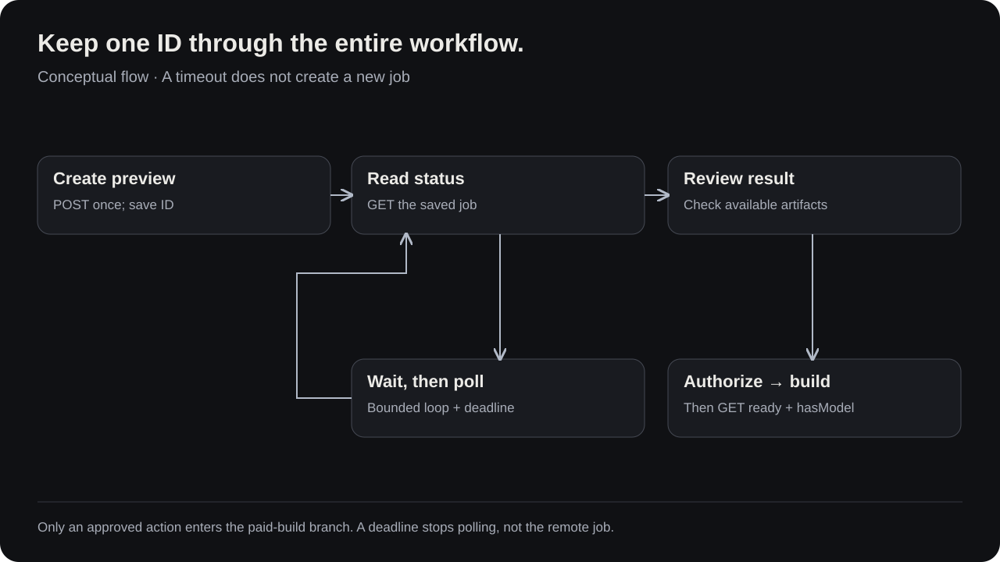

---

group: n8n-image-to-3d-workflow
title: "Image to 3D in n8n: build a workflow with the API"
description: "Connect n8n to an image-to-3D API. Create a preview, save the job ID, approve the build and download the GLB with bounded polling and safe retries."
date: 2026-11-26
updated: 2026-11-26
keyword: n8n image to 3d workflow
cta: Test one product photo with the free preview, then connect the reviewed result to your n8n workflow.
---

To integrate image-to-3D generation into n8n, create a preview through an HTTP Request node, save its job ID and poll that same job. After review, authorize the paid build and download the finished GLB. Separate creation, waiting, approval and delivery so a timeout does not restart work or spend credits twice.

<!-- ILLUSTRATION PENDING: /blog/illustrations/n8n-image-to-3d-workflow/hero.webp; prompt in the research brief. -->

> **Persist the ID before adding automation.** If you know which job belongs to the photo, you can resume it. If the only record is a blank output cell, a rerun can create unnecessary work.

## Which connection method should you choose?

Use REST when the sequence is fixed. Use an agent when someone needs to interpret a request or choose among tools. A community node can shorten setup, but it should not determine whether you can implement the complete workflow.

| Method                          | Best fit                                          | Check before choosing                                  |
| ------------------------------- | ------------------------------------------------- | ------------------------------------------------------ |
| Built-in HTTP Request           | Explicit sequence with visible inputs and outputs | Credential, body shape and status branches             |
| Community node                  | Supported operations with simpler setup           | Installation availability and operation coverage       |
| MCP client attached to an agent | Requests that need tool selection                 | Transport support, allowed tools and spending controls |

This guide uses the [HTTP Request node](https://docs.n8n.io/integrations/builtin/core-nodes/n8n-nodes-base.httprequest/) and easyrender's [REST contract](/image-to-3d-api). It does not require a marketplace listing. For conversational selection, use the separate [n8n agent and MCP guide](/learn/n8n-ai-agent-3d-mcp).

## What do you need before adding the first node?

Choose one clear photo of a desk fan. The API accepts JPEG, PNG or WebP up to 4 MiB. For a public HTTPS image, use `image_url`; for a local or private file, upload it through the authenticated file endpoint and use its `upload_id` instead.

Create an API key in Connectors. A preview workflow needs `write` to create and `read` to inspect. Add `spend` only to the credential used for an approved paid operation. Store the key as an n8n Header Auth credential: `Authorization` is the header name and `Bearer YOUR_API_KEY` is its value.

| Value to save    | Example                | Where it comes from                      |
| ---------------- | ---------------------- | ---------------------------------------- |
| Source record    | `FAN-DESK-01`          | Your catalog                             |
| Photo revision   | `front-v1`             | Your source management                   |
| Creation key     | `FAN-DESK-01-front-v1` | Stable key for this exact intended input |
| `render_id`      | Actual returned `id`   | Preview response                         |
| Approval ceiling | An approved integer    | Current quote plus your decision         |

The same photo URL must keep pointing to the same bytes during a retry. If the source changes, create a new revision deliberately. Before testing the connector, use the [photo preparation guide](/learn/how-to-make-a-3d-model-from-photos) to remove avoidable input problems.

## Step 1: how do you create a preview?

Add a Manual Trigger and an Edit Fields node for your source record. Then configure the first HTTP Request as follows. Map your own accessible photo URL into the image field.

| HTTP Request setting | Value                                         |
| -------------------- | --------------------------------------------- |
| Method               | `POST`                                        |
| URL                  | `https://easyrender.ai/api/renders`           |
| Authentication       | Your Header Auth credential                   |
| Header               | `Idempotency-Key` with the saved creation key |
| Body content type    | JSON                                          |
| Body field           | `image_url` mapped from your source record    |
| Body field           | `name` mapped from the product name           |
| Body field           | `isPublic` set to boolean `false`             |
| Response format      | JSON; body only for the field paths below     |

Save the returned `id` before continuing. With response headers/status disabled, it is the output body's `id`. If you enable the full response option, adapt mappings to `body.id`; do not mix the two response shapes across nodes.

The creation key is 1–128 printable ASCII characters without spaces. Reusing it with identical input recovers the same render; changed input produces a conflict. This idempotency contract applies to preview creation, not every POST in the service. Keep it stable after a lost response.

## Step 2: how do you wait without starting again?

Add a [Wait node](https://docs.n8n.io/integrations/builtin/core-nodes/n8n-nodes-base.wait/) with a time interval, followed by `GET https://easyrender.ai/api/renders/{saved_render_id}`. A 15-second interval and a 20-minute workflow deadline are reasonable initial settings to test, not promised generation times. Record the deadline before entering the loop.

| Returned state                       | Workflow branch                                  |
| ------------------------------------ | ------------------------------------------------ |
| `drafting`                           | Wait, then GET the existing ID                   |
| `preview_ready`                      | Stop the preview loop and request review         |
| `rendering`                          | Continue bounded polling of the authorized build |
| `ready` and `hasModel=true`          | Download the model                               |
| `failed`                             | Save the error and stop this attempt             |
| Deadline reached or unexpected state | Save ID and status for reconciliation            |

Poll the individual render, not just the listing endpoint. The [API contract](https://github.com/easyrenderai/easyrender.ai/blob/main/docs/api.md) explains that listing does not advance jobs. A URL appearing in a response is also not proof that the corresponding artifact is ready.

## Step 3: what exactly should the reviewer approve?

Open the owner viewer at `https://easyrender.ai/r/{saved_render_id}`. Check `hasSheet` before labeling an image an angle sheet: the preview asset can still be the source photo. If you request a paid sheet or revision, authorize that separately and retain its cost in the same product record.

Refresh the render and `GET /api/credits`. Bind the decision to the render ID, source revision and permitted credits. The remaining build debit is `max(0, renderCredits - credits)`, rather than an assumed fixed price copied into the workflow.

After approval, send `POST https://easyrender.ai/api/renders/{saved_render_id}/render` with JSON field `maxCredits` set to the authorized integer. A deadline or rejected approval must go to a stop branch. Do not wire either condition into the paid action as a default continuation.

<!-- IMAGE PENDING: unique screenshot of HTTP Request settings and a credential-free status output from a real n8n run. -->

## Step 4: how do you download the GLB?

After `ready` and `hasModel=true`, request `/api/renders/{saved_render_id}/model?download=1` with the owner credential. Select a file response and an output field such as `model`. Send that binary output to your chosen storage or commerce upload step.

The [Khronos format reference](https://www.khronos.org/gltf/) explains why GLB is suitable for delivering a model. Keep three destinations distinct: the owner viewer page, the authenticated download endpoint and the file uploaded to your store. They are not interchangeable links.

Private model URLs require authentication. For Shopify, use its [media upload and processing sequence](https://shopify.dev/docs/apps/build/product-merchandising/products-and-collections/manage-media) after downloading the file. Never put an API key in a URL to make that URL accessible to the store.

## Which failures should you handle explicitly?

| Symptom              | Cause to check                         | Recovery                                                       |
| -------------------- | -------------------------------------- | -------------------------------------------------------------- |
| HTTP 401             | Wrong, expired or revoked key          | Correct the credential; retain the job ID                      |
| HTTP 403             | Missing scope or exhausted key ceiling | Inspect the error code and authorized key limits               |
| HTTP 402             | Insufficient account credits           | Stop spending and request a budget decision                    |
| HTTP 409 on creation | Key reused with different input        | Recover the old request or version the new source deliberately |
| HTTP 429             | Rate/concurrency limit                 | Read `Retry-After` and delay the next request                  |
| Paid POST times out  | Outcome unknown                        | Inspect the saved job; do not blindly repeat the action        |
| File contains JSON   | Error response saved as a model        | Check status and content type before storage                   |

For pacing, [n8n documents rate-limit handling](https://docs.n8n.io/integrations/builtin/handle-rate-limits.md). Avoid blanket Retry On Fail on paid nodes. Safe reads and uncertain mutations require different recovery paths, even when both show a red execution marker.

## How do you test the flow before using a catalog?

First test credential reading and preview creation with one photo. Verify that the record contains the returned ID and that rerunning with the same creation key does not create another render. Stop at review until you have an explicit budget for the build.

Next check the branches using representative response fixtures: `drafting`, `preview_ready`, `ready`, `failed` and a rate-limit error. Fixture checks validate your routing, not the live rendering service. A final authenticated run is still needed to prove the complete configured n8n workflow works.

The deployed schema was checked for this guide; no paid run was used to claim a completion time or success rate. For the underlying method choices, see [how to make a 3D model](/learn/how-to-make-a-3d-model). Expand to batches only after one accepted model reaches its intended destination.

## FAQ

### Does creating a render also start the paid model?

No. Preview creation returns a render ID and starts the preview stage. The paid 3D build is a separate action with its own authorization. Save the ID, inspect the available result and refresh the cost before proceeding, so the workflow can pause without losing the work already created.

### Can I use a photo that is not publicly hosted?

Yes. Send the file to the authenticated upload endpoint, then use the returned upload ID as the preview source. The reference is owner-scoped and expires after one hour, so create the render within that window and save its separate render ID for later polling and recovery.

### Does n8n receive a finished model immediately?

No. Creation and building return job information while processing continues. Poll the saved render ID and require both a ready state and model availability before downloading. If your workflow reaches its deadline, preserve the job for later checks instead of treating the deadline as proof that generation failed.

### Can I automate USDZ downloads with the same endpoint?

The model endpoint in this recipe returns GLB. The REST contract does not define a USDZ conversion endpoint, so adding a file extension to the URL will not create one. Use the viewer's supported export flow or a separately tested conversion step when your destination specifically needs USDZ.
