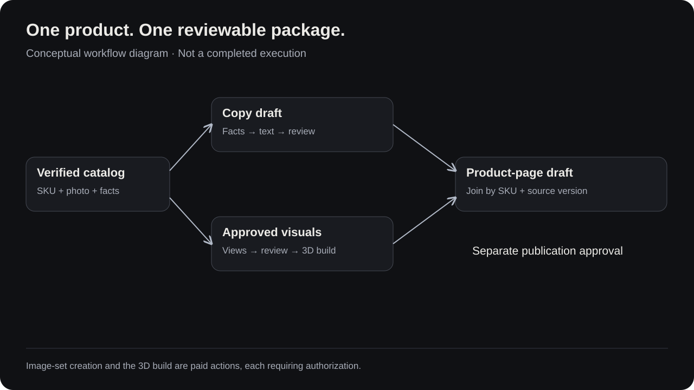

---

group: n8n-product-pages-images-3d
title: "Build product pages with n8n: images, copy and 3D"
description: "Build a product-page workflow in n8n: verified facts, image generation, a reviewed 3D model and a CMS draft, with approval before spending."
date: 2026-11-18
updated: 2026-11-17
keyword: n8n product pages images 3d
cta: Start with one product photo. Review the free preview before deciding whether to build its downloadable 3D model.
---

To build product pages with n8n, connect a verified product record to separate copy and visual workflows, then bring the results together by SKU. Generate images, review them, build the approved 3D model and save a CMS draft. Keep spending approval and publication as explicit steps, with a record of what was accepted.

<!-- ILLUSTRATION PENDING: /blog/illustrations/n8n-product-pages-images-3d/hero.webp; prompt in the research brief. -->

> **A finished listing needs more than a description.** Keep the product facts, image files, 3D model and publication state together. A successful generation is one step toward an approved product page.

## What should this workflow deliver?

For a ceramic desk lamp, the output is a reviewable package: accurate copy, selected product views, a GLB file and the identifier of a CMS draft. GLB is a binary container for a 3D model, described in the [Khronos glTF documentation](https://www.khronos.org/gltf/). A rotating video is a different deliverable.

| Deliverable           | Source of truth                     | Acceptance check                                   |
| --------------------- | ----------------------------------- | -------------------------------------------------- |
| Title and description | Supplier facts plus editorial rules | No invented material, dimensions or certification  |
| Product images        | Accepted visual set                 | Same product, finish and variant throughout        |
| Interactive 3D file   | Approved build                      | File opens, rotates and matches the accepted piece |
| CMS draft             | SKU-to-product mapping              | Correct product and variant, still unpublished     |
| Processing record     | Saved IDs and approval              | Another execution can resume the work              |

The [n8n image-to-Shopify template](https://n8n.io/workflows/11695-generate-product-descriptions-from-images-and-publish-to-shopify-using-ai/) illustrates the copy portion. Adding 3D requires its own job state, review and file delivery. The recipe here describes that architecture; it is not a report of an executed store deployment.

## Which information must come from your catalog?

Create an input record with `sku`, `source_version`, `name`, `material`, `dimensions`, `image_url` and `locale`. Keep unknown facts empty. Add separate approval fields for images, 3D spending and publication; a single `approved` flag is too vague once several actions can run.

| Field                | Example value              | Why it matters                                      |
| -------------------- | -------------------------- | --------------------------------------------------- |
| `sku`                | `LAMP-CERAMIC-01`          | Joins copy, images and model                        |
| `source_version`     | `photo-v2`                 | Distinguishes a new photo from a retry              |
| `material`           | Supplier-confirmed ceramic | Prevents visual guesses becoming claims             |
| `dimensions`         | Verified supplier record   | Keeps measurements independent of a generated model |
| `publication_status` | `draft`                    | Separates file creation from going live             |

For the text branch, ask your chosen language model to return title, description, bullets, image alt text and `missing_facts`. Tell it to use only the supplied factual fields for specifications. Route any missing mandatory facts to review instead of letting the model fill them in.

### What should the copy prompt and output contain?

Pass the validated record to your chosen text-generation node, with the instruction below. Keep its API credential separate from the visual service's credential. If the output cannot be parsed or does not match the required fields, route it to an editing step before it reaches the CMS.

> Write a product-page draft in the requested locale using only the supplied facts. Return title, description, bullets, alt_text and missing_facts. Do not infer material, measurements, compatibility or certifications from the photograph. Leave missing specifications out of the copy and list them in missing_facts. Do not publish anything.

| Output field    | Type                | Example from the lamp record                 |
| --------------- | ------------------- | -------------------------------------------- |
| `title`         | Text                | Ceramic desk lamp                            |
| `description`   | Text                | Ceramic desk lamp for a desk or side table.  |
| `bullets`       | List of text        | Ceramic body, only when supplier-confirmed   |
| `alt_text`      | Text                | Front view of the ceramic desk lamp          |
| `missing_facts` | List of field names | `dimensions`, `bulb_compatibility` if absent |

Treat this as a schema to validate, not a promise that the model will always comply. For this illustrative input, unknown bulb compatibility stays out of the draft. Require all five fields, arrays for the two lists and an unchanged source SKU before merging the text branch with visual results.

## How do you generate images and 3D from the same product?

Use n8n's built-in [HTTP Request node](https://docs.n8n.io/integrations/builtin/core-nodes/n8n-nodes-base.httprequest/) for the API calls. Store the key in a credential with header name `Authorization` and value `Bearer YOUR_API_KEY`. The placeholder is replaced inside the credential, never inside a shared workflow export or product record.

1. Read `GET https://easyrender.ai/api/credits`. Display the current image-set cost, account balance and requested product before approval. Image-set creation is paid; it is separate from the free preview route.
2. After approval, call `POST /api/product-views` with JSON containing `image_url`, `name` and an optional `prompt`. Save the returned `id` as `view_set_id` immediately.
3. Poll `GET /api/product-views/{id}` using that saved identifier. A starting configuration is a 15-second wait with a fixed deadline; respect rate-limit responses. Stop on `failed`, and inspect the individual views before accepting the set.
4. Download accepted images from `GET /api/product-views/{id}/views/{view}`, using each returned view identifier. Use the same API credential and save the responses as files.
5. Call `POST /api/product-views/{id}/render` only after the set is ready and accepted. Save its `renderId`. This creates or reuses a draft; it does not start the paid 3D build.
6. Read that render and approve its remaining charge, calculated as `max(0, renderCredits - credits)`. Submit `POST /api/renders/{id}/render` with the approved integer in `maxCredits`.
7. Poll until `status` is `ready` and `hasModel` is `true`, then download `GET /api/renders/{id}/model?download=1` as a file.

These paths and fields are in the [deployed API schema](https://easyrender.ai/api/openapi.json). The current REST image-set request does not expose the build endpoint's `maxCredits` field. Enforce its authorization in the workflow and use a dedicated key with a limited credit ceiling; do not assume an extra JSON field creates a server-side limit.

For an initial test without a paid image set, use the [preview-first n8n workflow](/learn/n8n-image-to-3d-workflow). It starts at `POST /api/renders`, pauses for review and keeps the later build separate. Choose this route when you only need to assess one product before planning the full listing package.

<!-- IMAGE PENDING: unique real screenshot of product-view review and generated files, captured without credentials or customer data. -->

## How do you keep the copy and visual branches aligned?

Carry the same `sku` and `source_version` through both branches. Save `view_set_id`, `render_id` and the text revision alongside them. Merge by those identifiers, not by position in a list: one slow image request must not attach a lamp's model to the next product's description.

| Copy state              | Visual state           | Next action                                |
| ----------------------- | ---------------------- | ------------------------------------------ |
| Ready                   | Still processing       | Save copy and wait for the existing job    |
| Missing supplier facts  | Ready                  | Ask for the facts; retain the files        |
| Approved                | Approved               | Assemble a CMS draft                       |
| Approved                | Rejected               | Keep the text; revise only the visual task |
| Previous source version | Current source version | Review the mismatch before combining       |

Do not describe generated views as additional photographs of the physical lamp. Keep original photography available to the reviewer and write captions appropriate to each asset. For preparing the source itself, follow the [photo-to-3D guide](/learn/how-to-make-a-3d-model-from-photos).

## How do the files reach Shopify or another CMS?

A private model endpoint is not a public media URL. Download the file through authenticated n8n, then upload it through the destination platform's supported media flow. Keep the easyrender credential on its own requests; it does not belong in the storefront, file name or Shopify request.

[Shopify's media guide](https://shopify.dev/docs/apps/build/product-merchandising/products-and-collections/manage-media) separates upload, processing and attachment to a product. Follow that sequence for the API version used by your store. Save the returned file and product identifiers, and confirm processing has finished before marking the package delivered.

Start with a draft product or an unpublished change. Check its images, model loading and variant mapping in the actual theme. A platform accepting a file does not prove that the product page presents it correctly; the [ecommerce 3D guide](/learn/3d-models-for-ecommerce) covers that storefront check.

## What usually breaks this automation?

| Symptom                         | Likely cause                                  | Fix                                                             |
| ------------------------------- | --------------------------------------------- | --------------------------------------------------------------- |
| Copy invents a material         | Vision output treated as supplier data        | Restrict specifications to verified fields                      |
| Image set starts twice          | Paid POST retried after a lost response       | Save the outcome as uncertain and reconcile before resubmitting |
| Wrong model on a product        | Branches joined by list position              | Join by SKU and source version                                  |
| Shopify cannot fetch the model  | Private endpoint supplied as public media     | Download with auth, then upload the file                        |
| Build never starts              | View-set draft mistaken for a completed build | Approve and call the separate build operation                   |
| Polling stops but job continues | Workflow deadline mistaken for job failure    | Save the ID and resume status checks later                      |
| Old image survives a rerun      | No media revision tracking                    | Store the destination media ID and source version               |

## How do you know the workflow is worth expanding?

Run one lamp through all branches and compare the final draft with its input record. Record the time spent reviewing, the number of manual fixes and the net credits used. Then process a small set of distinct products before letting a schedule feed the workflow unattended.

Our implementation separates the view-set ID, render ID and final model availability. That gives this recipe three checkpoints instead of one generic success flag. Count reviewed, delivered product packages as the outcome; a green HTTP node is only an intermediate signal.

For a broader production method, use the [3D creation guide](/learn/how-to-make-a-3d-model). For many SKUs, the [batch catalog workflow](/learn/n8n-batch-3d-catalog) adds recovery and budget accounting around the same single-product steps.

## FAQ

### Can n8n create a complete product page from one photo?

It can coordinate the work, but the photo is not enough to verify product specifications. Supply trusted catalog facts, choose your text and visual services, review their outputs and create a CMS draft. Keep measurements, materials and publication approval separate from whatever an image model infers about the object.

### Are the images and the 3D model free?

The free preview route and the paid image-set route are different. A product-view set consumes credits, and the subsequent 3D build has its own remaining charge. Read the account quote before approving each operation, and include any language-model or n8n hosting costs in your workflow budget.

### Do I need a native easyrender node in n8n?

No. The HTTP Request route uses built-in n8n nodes and the published REST contract. It does not depend on a community package being listed or verified. Start there for this recipe, then evaluate a dedicated node against the exact operations your workflow needs and its current installation availability.

### Will the workflow publish products automatically?

Only if you add and authorize that step. This recipe ends with a reviewed CMS draft and saved media identifiers. Keeping publication separate lets you check the product variant, text and files together before changing a live listing, and lets you retry delivery without regenerating the visual work.
