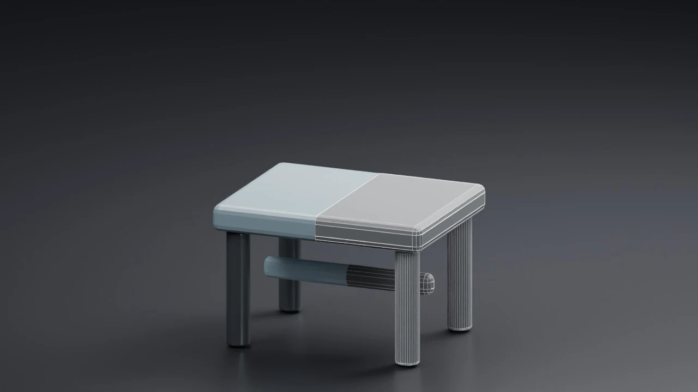

---

group: "obj-vs-fbx"
title: "OBJ vs FBX: geometry, materials and handoffs"
description: "Compare OBJ and FBX for static meshes, textures and animation, and test what arrives in the receiving app."
date: 2026-12-12
updated: 2026-12-12
keyword: "obj vs fbx"
cta: "Try an angle preview from a product photo."
---

Choose OBJ for a straightforward static mesh handoff when the receiving tool expects it. Choose FBX when both applications support the scene or animation data you need. Test materials, axes and any rig in the destination before delivery. The best choice is the one the recipient can open and use.

## What do you deliver with each format?

With OBJ, send the MTL file when used and the images it references. Keep relative paths intact. With FBX, define expected scene, rig and texture behaviour, then check import settings in the target app.

For one bedside-table mesh in Blender 5.2.3, our OBJ measured 7,638,334 bytes before its MTL and any texture files. The FBX was 2,835,228 bytes with the export options used. Size and resource packaging depend on settings.

Both bedside-table exports reopened in Blender with 69,910 triangles. The FBX reopened with its 1024 × 1024 image. The OBJ material file had no texture-map entry in this export. Before sending either file, reopen it away from your project and compare it with the same photographed finish.

## How do you inspect the received file?

Copy the delivery to a separate directory, open it in the target application and verify material files, orientation and units. If delivering animation, inspect a known clip and its expected start and end.

## What should you check before publishing?

| Requirement           | What to verify                     |
| --------------------- | ---------------------------------- |
| Static surfaces       | Normals, UVs and resource paths    |
| Skeleton or motion    | Rig and clips in the receiving app |
| Portable texture pack | Open from a fresh working folder   |

<!-- IMAGE PENDING: Photograph or capture the example described in the brief. -->

**Source** [Blender · Wavefront OBJ](https://docs.blender.org/manual/en/latest/files/import_export/obj.html), [Blender · FBX](https://docs.blender.org/manual/en/4.5/addons/import_export/scene_fbx.html), [Blender · glTF 2.0 import and export](https://docs.blender.org/manual/en/5.1/addons/import_export/scene_gltf2.html).

[Related guide](/learn/glb-file)

[How to make a 3D model](/learn/how-to-make-a-3d-model)

## FAQ

### Is FBX always smaller?

No. Results depend on data and export options. Measure the total package and count any textures needed alongside it. Include the actual texture files used by the recipient, then re-open both packages locally to check that they represent the same deliverable.

### Can I send just the OBJ?

Send only the OBJ if the recipient needs geometry and no materials. Export with the MTL and texture files in relative paths. Reopen in the target app and verify the material file has a texture-map entry or it will miss appearance.

### Why does imported orientation change?

Imported orientation changes due to differing forward and up-axis conventions. Set the target app's import settings to match the source's axis definition. Always reopen the file in a neutral environment to verify orientation and materials, as misaligned axes often cause visual mismatches.
