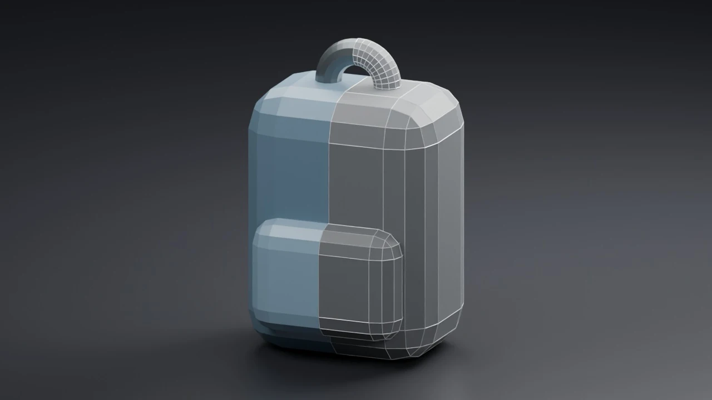

---

group: "product-photography-angles"
title: "Product photography angles for a useful gallery"
description: "Choose a main view and secondary views that answer questions about fit, construction and use."
date: 2026-11-21
updated: 2026-11-21
keyword: "product photography angles"
cta: "Try an angle preview from a product photo."
---

Choose each product photo to answer a question. Start with a view that explains the shape, then add the angles that show how the product fits together or works. A rear view, a close-up or a shot with the product open often answers more than another nearly identical front angle.

## Which angle should come first?

Start with three quarters for an object whose depth matters, such as a bag or a chair. Use the front when the face, shape or printed information identifies the item quickest. Check the crop at thumbnail size.

Leave enough room around the product for the site’s crop. Keep the lead angle and framing consistent across variants, and add detail images where materials or hardware actually differ.

## Which gaps should the next photos solve?

Write three questions a buyer might ask without holding the item. Give each a view. For a bag, show the back, opening and strap attachment. For a shoe, add the sole. For furniture, show the back or underside if construction matters.

Place the answers in order of importance. A close-up is more useful when a wider shot tells the reader where the detail sits.

## What should you check before publishing?

| View                    | Question it answers                                     |
| ----------------------- | ------------------------------------------------------- |
| Front or three-quarter  | What is this item and what shape is it?                 |
| Rear, side or underside | How is the part I cannot see constructed?               |
| Open or in use          | What can I do with it?                                  |
| Detail                  | What does the material or mechanism look like up close? |

<!-- IMAGE PENDING: Photograph or capture the example described in the brief. -->

**Source** [Shopify · product photography](https://help.shopify.com/en/manual/products/product-media/product-photography), [Google Merchant Center · image link](https://support.google.com/merchants/answer/6324350), [GS1 · product image specification](https://www.gs1.org/standards/gs1-product-image-specification-standard/current-standard).

[Related guide](/learn/product-photography-for-ecommerce)

[How to make a 3D model](/learn/how-to-make-a-3d-model)

## FAQ

### How many photos should I use?

Start with a lead view plus every useful answer the gallery still needs. Remove near duplicates. Check the requirements of the destinations where you publish the same item. For a chair, add the side, back and one detail only if each shows something the lead view leaves unanswered.

### When is a straight front view better?

Use a straight front view when the item’s face, shape, or printed details identify it most quickly. Take a front shot with clear label and consistent background for easy recognition. Check the thumbnail crop to ensure the product’s key features are visible and not cut off.

### Can a 3D model replace the back photo?

A 3D model cannot replace the back photo if it contains features the buyer needs to verify. Use both when the real photo confirms details and the model offers context. Check that the back photo shows all key features clearly and is taken under consistent lighting.
