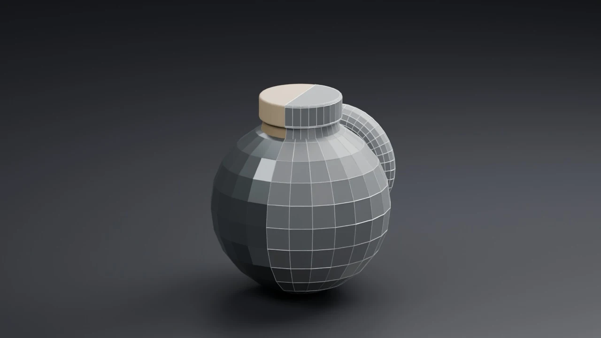

---

group: "product-photography-lighting"
title: "Product photography lighting: three setups"
description: "Use three repeatable lighting setups for matte products, reflective surfaces and textured details."
date: 2026-11-30
updated: 2026-11-30
keyword: "product photography lighting"
cta: "Try an angle preview from a product photo."
---

Choose your light based on the surface: use window light with a white reflector for matte products, enlarge the source for glossy items, and apply grazing light for relief, seams, and fabric. Keep camera position and exposure constant when comparing setups.

## How do you position the sources?

Place the window or softbox forward and to one side for the baseline. Add a white card opposite it and check whether the shadow still describes depth. Move it back if the shape looks flat.

For gloss, put diffusion close enough to show a broad continuous reflection. For texture, lower the light so it grazes the surface. In both cases review a highlight and a shadow at full size.

## How do you repeat the result?

Mark camera, light and item positions. Write down white balance and exposure. Save one frame with a neutral card if colour matters. Compare the image with the actual item under neutral light.

## What should you check before publishing?

| Surface          | Setup                          | Look for                            |
| ---------------- | ------------------------------ | ----------------------------------- |
| Matte            | Side light and reflector       | Readable shadow                     |
| Gloss            | Large diffusion and dark flags | Smooth reflection with a clear edge |
| Relief or fabric | Low lateral light              | Texture with intact highlights      |

<!-- IMAGE PENDING: Photograph or capture the example described in the brief. -->

**Source** [Shopify · product photography](https://help.shopify.com/en/manual/products/product-media/product-photography), [GIA · gem and jewelry photography](https://www.gia.edu/gem-photography), [GS1 · product image specification](https://www.gs1.org/standards/gs1-product-image-specification-standard/current-standard).

[Related guide](/learn/product-photography-for-ecommerce)

[How to make a 3D model](/learn/how-to-make-a-3d-model)

## FAQ

### How many lights do I need?

Start with one source and change its size or position. Add a reflector or another light only when you have identified a separate shadow or background problem. Move the light back slightly and reposition the camera to see if the shadow depth improves.

### Why do my products change colour?

Mixed lights and automatic white balance cause color shifts. Set a white card opposite the main light and compare the image to the actual product under neutral light. Forgetting to record white balance or using inconsistent lighting leads to inaccurate color reproduction.

### What should I photograph for a setup note?

Photograph a highlight and shadow at full size for each surface type. Place a white card opposite the main light and adjust its position until the shadow shows depth. Common mistake: using a flat light setup that erases texture and depth.
