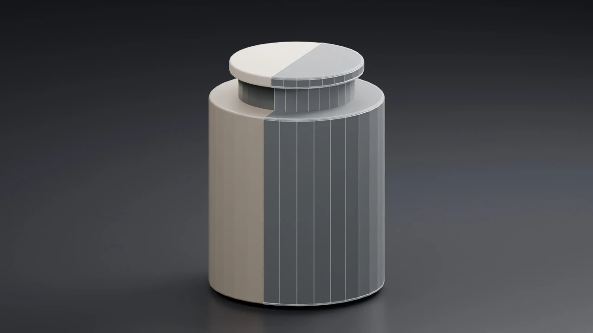

---

group: "white-background-product-photography"
title: "White background product photography"
description: "Light a white backdrop and keep the product’s edges, texture and contact shadow readable."
date: 2026-11-24
updated: 2026-11-24
keyword: "white background product photography"
cta: "Try an angle preview from a product photo."
---

Set the camera, product, and lights fixed for consistent results. Place a large diffused light on one side and a white reflector on the opposite to soften shadows. Common mistake: forgetting to check pale handles with a dark card out of frame.

## How do you set up the white background?

Curve white paper up behind the item so there is no horizon line. Place a large diffused light to one side and use a white reflector to soften the opposite shadow. For a pale item, use a dark card just out of frame to make its edge readable.

Keep the camera, product and lights fixed for your first comparison. Adjust one control at a time. In the final file, zoom in on the lightest product detail and the base.

## How much should you retouch?

Correct colour and dust before adjusting the white point. If you mask, inspect the edge on grey to see halos. Preserve believable contact unless the destination’s image guidelines require a different treatment.

Export a proof at the size the site uses and check it against neighbouring products. Retain an original with the lighting and framing unchanged for repeat orders.

## What should you check before publishing?

| Symptom                | Change                                         |
| ---------------------- | ---------------------------------------------- |
| Pale handle disappears | Use negative fill and check highlight clipping |
| Grey background        | Brighten the backdrop independently            |
| Product floats         | Restore edge detail or a soft contact shadow   |

<!-- IMAGE PENDING: Photograph or capture the example described in the brief. -->

**Source** [Shopify · product photography](https://help.shopify.com/en/manual/products/product-media/product-photography), [Google Merchant Center · image link](https://support.google.com/merchants/answer/6324350), [GS1 · product image specification](https://www.gs1.org/standards/gs1-product-image-specification-standard/current-standard).

[Related guide](/learn/product-photography-for-ecommerce)

[How to make a 3D model](/learn/how-to-make-a-3d-model)

## FAQ

### Can I work with one light?

Yes, you can work with one light. Use a diffused light or window with a reflector, separate the product from the backdrop, and correct the background locally. Next, check your lighting angle and distance to ensure consistent product placement and shadow control.

### Is pure white always required?

Pure white is not always required a dark card out of frame can enhance edge visibility. Use a dark card just out of frame for pale items to prevent edge loss. Common mistake: omitting the dark card causes pale product details to vanish.

### How do I avoid a white fringe?

Review the mask on a darker canvas at full image size. Undo excess edge brightening, then tune the mask narrowly around the affected area. Toggle between white and dark backgrounds to find which pixels belong to the object. Zoom in again after resizing the final export.
