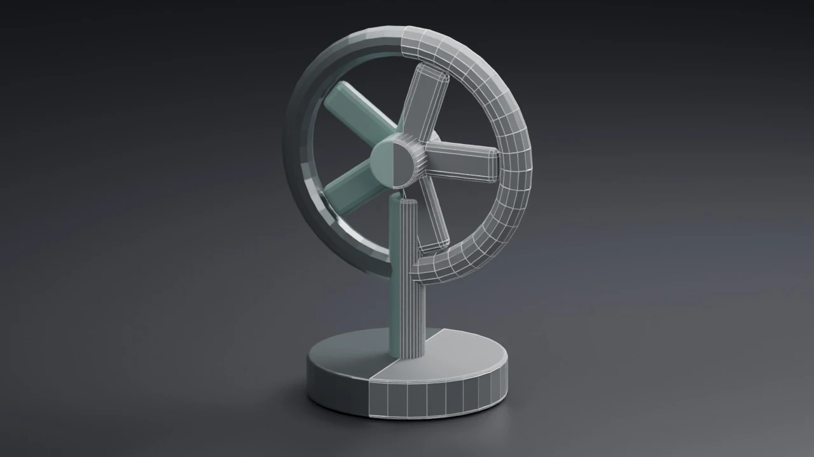

---

group: "sketchfab"
title: "Alternativas a Sketchfab para publicar modelos 3D"
description: "Elige entre visores alojados y un GLB en tu web según acceso, inserción y mantenimiento."
date: 2026-12-06
updated: 2026-12-06
keyword: "alternativa a sketchfab"
cta: "Prueba la vista previa de ángulos con una foto de producto."
publishAt: "2026-12-06"
---

Elige una alternativa a Sketchfab según el tipo de acceso que quieras: visores alojados para compartir por enlace o visor propio para controlar integración y alojamiento. Comprueba acceso, inserción y entrega con un archivo representativo antes de publicar una colección.

## ¿Qué opción encaja con cada uso?

| Necesidad                               | Punto de partida | Qué revisar                                     |
| --------------------------------------- | ---------------- | ----------------------------------------------- |
| Compartir un enlace alojado             | p3d.in           | Acceso sin cuenta y permisos                    |
| Presentar una escena con sus controles  | Vectary          | Acceso, inserción y límites                     |
| Controlar la página y alojar el archivo | model-viewer     | Alojamiento, imagen alternativa y mantenimiento |

## ¿Cómo haces una comparación con el mismo archivo?

Sube el mismo GLB con una textura conocida y abre cada enlace sin sesión. Comprueba el giro, el móvil y si queda accesible el original. Prueba la inserción en una página en borrador con la configuración de privacidad de tu web.

## ¿Qué deberías revisar antes de publicar?

| Pregunta                              | Prueba                                               |
| ------------------------------------- | ---------------------------------------------------- |
| ¿Puede abrirlo un revisor?            | Navegación privada y otro dispositivo                |
| ¿Encaja dentro de la ficha?           | Inserción real en una página de prueba               |
| ¿Puedo cambiar de plataforma después? | Conservar la fuente y comprobar opciones de descarga |

<!-- IMAGE PENDING: Fotografiar o capturar el ejemplo descrito en el brief. -->

**Fuente** [Sketchfab · viewer API](https://sketchfab.com/developers/viewer), [Vectary · sharing](https://help.vectary.com/documentation/sharing-exporting-embedding/sharing), [p3d.in · account FAQ](https://p3d.in/faq/account), [model-viewer · documentation](https://modelviewer.dev/docs/).

[Guía relacionada](/es/modelos)

[Cómo crear un modelo 3D](/es/guias/como-hacer-un-modelo-3d)

## Preguntas frecuentes

### ¿Cuándo basta con compartir un enlace?

Cuando compartes un enlace, basta para feedback interno. Integra el visor para que el usuario gire el modelo y vea el contexto. Revisa que el enlace funcione en dispositivos móviles y que el modelo cargue en menos de 10 segundos.

### ¿Puedo usar el mismo GLB en todas?

Puedes usar el mismo GLB en todas las plataformas, pero comprueba el formato, peso y tratamiento de texturas de cada destino. Usa el archivo idéntico durante el ensayo para aislar diferencias. Verifica que el GLB no supere los límites de tamaño permitidos por cada servicio.

### ¿Cómo elijo dónde alojarlo?

Elige un servicio como p3d.in para compartir enlaces sin necesidad de cuenta. Sube el mismo GLB y abre cada enlace sin sesión para ver el giro, el móvil y el acceso al modelo. Muchos fallan al no tener una imagen alternativa si el modelo no carga.
