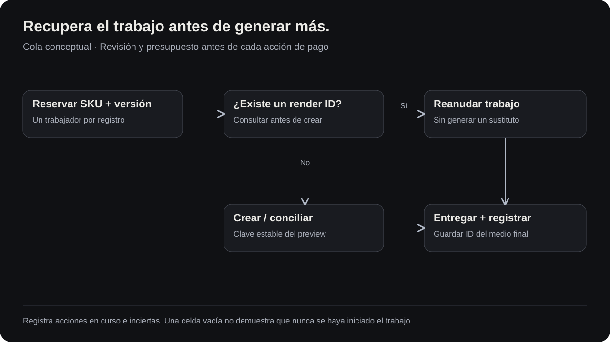

---

group: n8n-batch-3d-catalog
title: "Automatiza tu catálogo 3D con n8n sin duplicar trabajos"
description: "Convierte filas de catálogo en modelos 3D con n8n. Guarda versiones e identificadores, recupera trabajos y controla el gasto antes de entregar archivos."
date: 2026-11-21
updated: 2026-11-17
keyword: automatizar catalogo 3d n8n
cta: Valida una foto del catálogo con la previsualización gratis antes de autorizar los productos que quieres construir en 3D.
---

Para automatizar un catálogo 3D con n8n, procesa cada producto mediante estados guardados en vez de generar siempre que una celda esté vacía. Registra SKU, revisión de la foto, clave de creación, ID del render y aprobación. Recupera los trabajos pendientes, limita la concurrencia y entrega únicamente modelos revisados al producto que corresponde.

<!-- ILLUSTRATION PENDING: /blog/illustrations/n8n-batch-3d-catalog/hero.webp; prompt en el brief de investigación. -->

> **Un resultado vacío no significa que el trabajo no haya empezado.** Puede estar procesándose, esperando revisión o pendiente de una respuesta perdida. Recupera ese estado antes de lanzar otra petición de pago.

## ¿Te conviene un bucle de filas o la API de catálogo?

Utiliza un proceso por producto cuando quieras revisar cada previsualización antes de construir. Elige la API de catálogo cuando el propietario haya aprobado un lote definido, su gasto total y la visibilidad necesaria para usar los modelos en la tienda. Las dos rutas tienen puntos de revisión y permisos distintos.

| Ruta                                    | Cuándo elegirla                                   | Aprobación que debes guardar                    |
| --------------------------------------- | ------------------------------------------------- | ----------------------------------------------- |
| Previsualización y construcción por SKU | Una persona revisa cada producto                  | Revisión de origen, ID y techo de construcción  |
| Envío a la API de catálogo              | El lote puede avanzar tras una aprobación inicial | Lista exacta, tienda, techo total y visibilidad |
| Entrega de modelos existentes           | Solo falta trasladar archivos ya creados          | Destino y decisión de publicación               |

La [guía de n8n para un producto](/es/guias/integrar-3d-flujo-n8n) es el punto de partida de la primera ruta. El [contrato de la API de catálogo](https://github.com/easyrenderai/easyrender.ai/blob/main/docs/api.md) documenta la segunda. No envíes un lote esperando que se detenga en el mismo punto de revisión manual de las previsualizaciones individuales.

## ¿Qué debería contener cada fila de origen?

Para una colección de jarrones de cerámica, separa la identidad del producto del estado de automatización. Una foto nueva de un jarrón existente es otra revisión de origen, no necesariamente otro producto. Conserva el ID del render anterior hasta decidir expresamente que vas a sustituir los archivos aprobados.

| Campo                  | Función                                       | Ejemplo o regla                                   |
| ---------------------- | --------------------------------------------- | ------------------------------------------------- |
| `sku`                  | Identidad del producto                        | `VASE-ROUND-01`                                   |
| `source_version`       | Entrada exacta que se quiere procesar         | `photo-v3`                                        |
| `image_url`            | Fuente estable                                | Imagen pública HTTPS si utilizas URL              |
| `creation_key`         | Identidad para reintentar la previsualización | Estable por SKU y revisión                        |
| `render_id`            | Trabajo en el servicio                        | Guardar al recibir la creación                    |
| `workflow_state`       | Estado de tu cola                             | Nuevo, en revisión, enviado, incierto o entregado |
| `approved_credits`     | Techo autorizado de construcción              | Entero no negativo verificado                     |
| `destination_media_id` | Recuperación de la entrega                    | Guardar cuando la tienda acepte el archivo        |

Estos campos de cola pertenecen a tu sistema. No son campos adicionales que debas enviar a `/api/renders`. Guarda por separado el estado del servicio: `preview_ready` y «revisión rechazada» describen aspectos diferentes del mismo trabajo.

## ¿Cómo procesas filas sin duplicar trabajos?

1. Selecciona registros aptos y reserva un SKU con su revisión antes de crear trabajo. Si hay varios procesos simultáneos, utiliza una restricción de unicidad en base de datos; una celda de estado en una hoja no es un bloqueo atómico.
2. Si existe `render_id`, consulta ese render y continúa según su estado. No lo vuelvas a crear porque `destination_media_id` esté vacío.
3. Si falta el ID pero ya se intentó crear, repite la previsualización con el mismo `Idempotency-Key` guardado y la misma entrada. Guarda el identificador devuelto antes de avanzar.
4. Espera a la previsualización y registra la revisión. Solo la rama aprobada puede iniciar la construcción de pago con el `maxCredits` autorizado.
5. Consulta el mismo trabajo hasta que termine, falle o se alcance el plazo del flujo. El vencimiento conserva el registro para comprobarlo después; no crea automáticamente otro intento.
6. Descarga y entrega el modelo. Guarda el identificador multimedia de destino antes de marcar la fila como entregada.

Empieza con un único proceso y un elemento cada vez. [Loop Over Items de n8n](https://docs.n8n.io/integrations/builtin/core-nodes/n8n-nodes-base.splitinbatches/) permite controlar los lotes. Evita programaciones solapadas y aumenta la concurrencia solo cuando hayas medido los límites del servicio y probado la recuperación.

## ¿Cómo controlas el gasto de todo el lote?

Un techo por llamada no limita por sí solo el presupuesto de una campaña con varios procesos. Reserva los créditos de cada operación pendiente de forma atómica e incluye los envíos sin resultado confirmado en el importe comprometido. De lo contrario, dos procesos pueden interpretar que disponen del mismo presupuesto restante.

| Parte del presupuesto | Cuándo contabilizarla                 | Cuándo liberarla o conciliarla                    |
| --------------------- | ------------------------------------- | ------------------------------------------------- |
| Total aprobado        | El propietario autoriza el lote       | Cambia expresamente el alcance o presupuesto      |
| Créditos reservados   | Un proceso prepara una acción de pago | Se confirma y concilia el resultado               |
| Gasto confirmado      | El servicio registra el cargo         | Un reembolso verificado se anota por separado     |
| Resultado desconocido | Se pierde la respuesta tras enviar    | El trabajo existente o soporte aclara qué ocurrió |

Consulta el presupuesto vigente y el cargo pendiente del render antes de construir. Detente si falta saldo o se supera el techo de la clave. Un reembolso de la cuenta y el límite de cargos acumulados de una clave funcionan de forma distinta: no presupongas que ambos se han restaurado.

Sigue la [gestión de límites de n8n](https://docs.n8n.io/integrations/builtin/handle-rate-limits.md) para espaciar consultas. Ante un 429, respeta `Retry-After`. Si una operación de pago pierde la respuesta, comprueba el recurso antes de repetirla: esperar más tiempo no convierte una petición duplicada en un reintento seguro.

## ¿Qué cambia al utilizar la API de catálogo?

Solicita `GET /api/catalog/quote?items=N` con el número exacto de productos propuesto. Muestra la lista, el presupuesto, la tienda de destino y las implicaciones de compartir los modelos. El envío requiere `write`, `spend` y `share`, no solo los permisos de lectura y escritura del flujo de previsualización.

| Campo del envío | Valor necesario                                            |
| --------------- | ---------------------------------------------------------- |
| `platform`      | `shopify`, `woocommerce`, `prestashop` u `other`           |
| `store`         | Identificador estable de la tienda de destino              |
| `maxCredits`    | Techo total autorizado para ese envío                      |
| `items`         | Hasta 100 elementos por petición en el esquema actual      |
| Cada elemento   | `externalId`, `title`, `imageUrl` y, opcionalmente, `note` |

Envía una vez a `POST /api/catalog`. Después, utiliza `GET /api/catalog?platform=...&store=...` para consultar y hacer avanzar la cola autorizada. Trata `needs_credits`, `needs_info` y `failed` de forma explícita, y conserva los mismos valores de plataforma y tienda al recuperar el lote.

El flujo de catálogo comparte enlaces de modelos para su uso en tiendas. Elige la ruta por producto si eso no está autorizado. Distingue también generar los modelos de escribir fichas en el CMS: el conector de la tienda sigue necesitando un paso de entrega probado.

<!-- IMAGE PENDING: captura real y exclusiva de filas con ID guardados y una ejecución recuperada; SKU ficticios, sin datos de clientes. -->

## ¿Cómo confirmas que el producto se ha entregado bien?

Comprueba que revisión de origen, ID del render, producto de destino y archivo multimedia coinciden. Descarga el GLB privado con la credencial de API y súbelo mediante el flujo de la tienda. Que el modelo esté disponible en el generador no significa que ya aparezca en la ficha.

Para Shopify, sigue la [documentación de procesamiento y asociación de archivos](https://shopify.dev/docs/apps/build/product-merchandising/products-and-collections/manage-media). Revisa la tienda real después de procesarlos. Si solo falla la entrega, repite ese paso con el archivo existente en vez de generar otro modelo.

El GLB entregado debe abrirse en un visor compatible; [Khronos describe el formato](https://www.khronos.org/gltf/). Registra tamaño del archivo y estado de destino para los resultados que aceptes. El número de trabajos terminados no demuestra una mejora de velocidad, ventas o conversión.

## ¿Qué errores de lote necesitan su propia recuperación?

| Síntoma                                     | Causa probable                                             | Solución                                           |
| ------------------------------------------- | ---------------------------------------------------------- | -------------------------------------------------- |
| El mismo SKU se procesa dos veces           | Programaciones solapadas o falta de reserva                | Serializar el trabajo o reservar de forma atómica  |
| Se sustituye una previsualización existente | Se selecciona trabajo por una celda final vacía            | Consultar primero ID y estado guardados            |
| Se actualiza otro producto                  | Ha cambiado el orden de las filas                          | Relacionar identificadores externos estables       |
| El gasto total supera lo previsto           | Se ignoran reservas concurrentes                           | Sumar gasto comprometido y resultados desconocidos |
| Cada ejecución repite el mismo error        | Un estado que requiere intervención se trata como temporal | Resolver créditos, fuente o permisos               |
| El modelo está listo pero la ficha vacía    | Ha fallado la subida o asociación                          | Recuperar la entrega y conservar el render         |
| Una foto nueva reutiliza otra aprobación    | La revisión no forma parte de la decisión                  | Aprobar la versión actual de la fuente             |

## ¿Qué debería cubrir la primera prueba de aceptación?

Utiliza una muestra pequeña: un producto válido, una imagen deliberadamente inválida y un registro con un render existente. Comprueba que la fila inválida se detiene, el trabajo anterior se recupera y el producto válido llega a revisión. Así pruebas el comportamiento de la cola antes de aprobar un lote de pago.

Después simula una respuesta de creación perdida y una interrupción de entrega. Haz una ejecución completa autorizada antes de activar la programación sin supervisión. Para esta guía se revisaron el esquema público y el contrato del repositorio; no se afirma un resultado de lote real ni un ahorro medido.

Mide modelos revisados y entregados por SKU y revisión únicos, intervenciones manuales, trabajos sin resolver y créditos netos por modelo aceptado. Para el proceso visual, consulta [cómo hacer un modelo 3D](/es/guias/como-hacer-un-modelo-3d) y la [guía de fichas con imágenes, texto y 3D](/es/guias/fichas-producto-n8n-imagenes-3d).

## Preguntas frecuentes

### ¿Basta una celda vacía para seleccionar trabajo nuevo?

No. El modelo puede seguir procesándose, esperar una revisión o tener pendiente la entrega después de generarse. Guarda el ID y el estado del flujo antes de iniciar más trabajo. Solo un registro sin intentos existentes ni inciertos debe entrar en una creación nueva, con su revisión y clave estables.

### ¿Puedo procesar todo el catálogo en paralelo?

Empieza con concurrencia limitada y presupuesto aprobado. Los procesos paralelos necesitan reservas atómicas y una contabilidad de créditos compartida, incluyendo envíos con resultado desconocido. Añadir procesos sin esos controles puede duplicar trabajos o superar el total previsto, aunque cada petición individual lleve su propio techo de gasto autorizado.

### ¿La API de catálogo exige compartir los modelos?

Requiere el permiso share porque prepara enlaces de modelos para usarlos en la tienda. Eso debe autorizarse junto con la lista de productos y el techo de gasto. Utiliza previsualizaciones privadas por producto cuando quieras revisar cada pieza antes de decidir qué recursos se pueden construir, entregar o compartir.

### ¿Debo regenerar el modelo si falla la subida a la tienda?

Normalmente la generación ya ha terminado. Conserva el ID del render y recupera la descarga o la subida al destino. Guarda el identificador multimedia y su estado de procesamiento para distinguir una transferencia fallida, una asociación pendiente y un modelo ausente, sin pagar innecesariamente otra generación del mismo producto.
