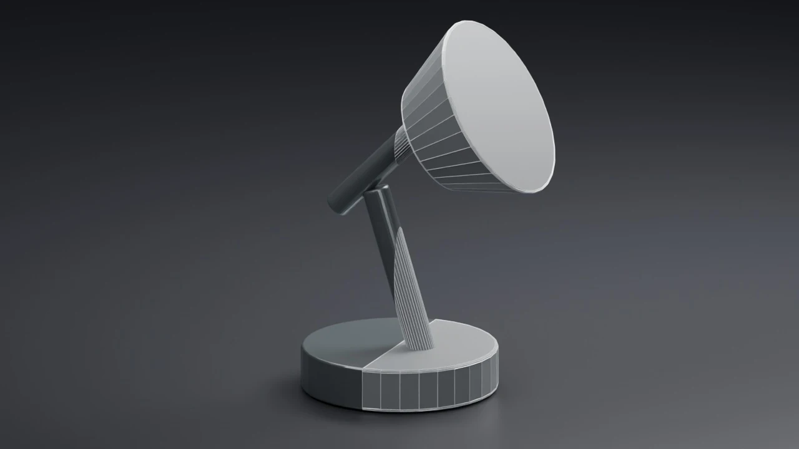

---

group: "blender-mcp-product-workflow"
title: "De una foto a una escena con Claude y Blender MCP"
description: "Integra un GLB de producto en Blender y usa Claude con MCP para editar una copia de la escena."
date: 2026-12-13
updated: 2026-12-13
keyword: "blender mcp"
cta: "Prueba la vista previa de ángulos con una foto de producto."
---

Primero crea y revisa el modelo del producto. Intégralo en Blender y pide a Claude una tarea acotada mediante un conector MCP compatible. Comprueba el resultado en Blender y guarda una copia para revisar por separado la geometría y los cambios de cámara, luz o escena.

## ¿Cómo preparas una prueba pequeña?

Abre una copia de la escena e importa un GLB conocido. Comprueba nombre, materiales y orientación. Sigue la configuración del conector que elijas y verifica que Claude puede enumerar los objetos antes de pedir cambios.

## ¿Qué incluyes en la primera instrucción?

Pide que conserve malla y materiales, coloque el producto con su nombre en la plataforma existente y lo encuadre en tres cuartos. Examina objeto, cámara y luz en Blender. Guarda una nueva versión.

## ¿Qué deberías revisar antes de publicar?

| Paso       | Evidencia                       |
| ---------- | ------------------------------- |
| Inspección | Objeto con nombre y referencia  |
| Edición    | Movimiento o cámara en la copia |
| Aprobación | Comprobación en visor y render  |

<!-- IMAGE PENDING: Fotografiar o capturar el ejemplo descrito en el brief. -->

**Fuente** [BlenderMCP · project documentation](https://github.com/ahujasid/mcp-for-blender), [Anthropic · Claude Code MCP](https://code.claude.com/docs/en/mcp), [Blender · glTF 2.0 import and export](https://docs.blender.org/manual/en/5.1/addons/import_export/scene_gltf2.html).

[Guía relacionada](/es/mcp)

[Cómo crear un modelo 3D](/es/guias/como-hacer-un-modelo-3d)

## Preguntas frecuentes

### ¿Qué MCP genera el modelo?

En este flujo, easyrender crea el modelo a partir de la foto y el conector de Blender ayuda a editar la escena tras importarlo. Algunos conectores también pueden llamar a un generador externo. Comprueba las herramientas disponibles y qué servicio requiere sus propias credenciales.

### ¿Puedo probarlo con un GLB que ya tengo?

Sí. Importa un GLB conocido en una escena de prueba con el importador glTF de Blender. Revisa cómo se ven los materiales y comprueba la orientación y las dimensiones del objeto. Pide después a Claude que enumere los objetos para confirmar que identifica el modelo correcto.

### ¿Empiezo con el proyecto final?

Trabaja en una copia del proyecto con un único objeto identificado por nombre. Pide a Claude un solo cambio, como encuadrar el producto con la cámara activa. Revisa la malla, los materiales y la cámara tras el cambio y guarda el resultado con otro nombre.
