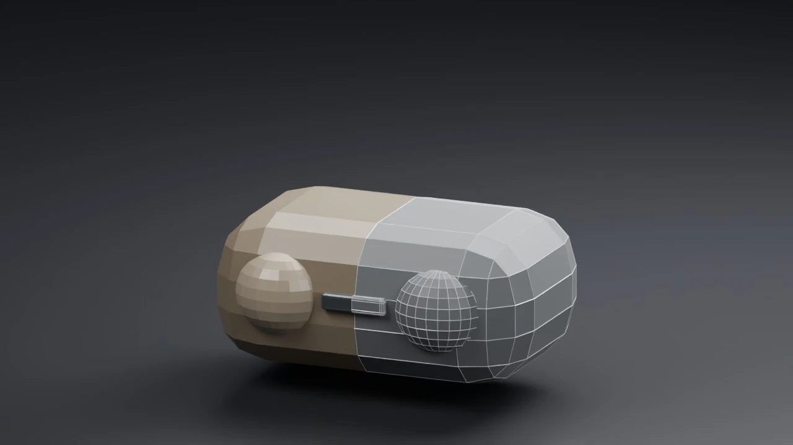

---

group: "3d-modeling-cost"
title: "Cuánto cuesta crear un modelo 3D de producto"
description: "Calcula el coste por modelo 3D aprobado con captura, intentos, revisiones y exportación final."
date: 2026-12-03
updated: 2026-12-03
keyword: "cuanto cuesta un modelo 3d"
cta: "Prueba la vista previa de ángulos con una foto de producto."
---

El coste de crear un modelo 3D de producto depende de captura, modelado, correcciones y exportación. Revisa el precio por modelo aprobado, evalúa si un intento inicial barato se repite y falla, y considera el tiempo y errores en cada fase.

## ¿Qué incluyes al pedir presupuesto?

Indica la aplicación de destino, formato, materiales, variantes y si hace falta animación o proyecto editable. Comparte fotos y una referencia clara de cada rasgo que revisarás. Pregunta qué revisiones y derechos incluye el presupuesto.

## ¿Cómo comparas dos presupuestos?

Divide el gasto del piloto por los modelos que puedas usar. Si un piloto hipotético de cuatro artículos cuesta 120 € de producción y 40 € de revisión y retoques y pasan tres modelos, salen a unos 53,33 € por activo aprobado. Es un ejemplo de cálculo.

## ¿Qué deberías revisar antes de publicar?

| Método                | Partidas que contar              |
| --------------------- | -------------------------------- |
| Generación desde foto | Intentos, revisión y retoques    |
| Modelado por encargo  | Brief, tarifa, rondas y entrega  |
| Archivo del proveedor | Derechos, limpieza y exportación |

<!-- IMAGE PENDING: Fotografiar o capturar el ejemplo descrito en el brief. -->

**Fuente** [Upwork · 3D modeler rates](https://www.upwork.com/hire/3d-modelers/cost/), [Shopify · creating 3D models](https://help.shopify.com/en/partners/manage-clients-stores/creating-media/3d-models/creating-3d-models), [Khronos · glTF 2.0 specification](https://registry.khronos.org/glTF/specs/2.0/glTF-2.0.html).

[Guía relacionada](/es/comparativas/modelador-3d-o-ia)

[Cómo crear un modelo 3D](/es/guias/como-hacer-un-modelo-3d)

## Preguntas frecuentes

### ¿Debo presupuestar revisiones?

Sí, debes presupuestar revisiones: acordad cuántas rondas incluye el trabajo y qué contiene cada una, y no olvidéis las horas de revisión de tu equipo. Revisa el presupuesto detallado antes de firmar y comprueba que el número de rondas coincida con los cambios esperados en el modelo 3D.

### ¿Puedo extrapolar una prueba a todo el catálogo?

Incluye piezas sencillas y difíciles en el piloto. Estima por grupos cuando sepas cuántas pasan y cuáles son los ajustes más frecuentes. Agrega al presupuesto el tiempo estimado de revisión por cada ronda y asegúrate de que coincida con los cambios esperados en el modelo 3D.

### ¿Qué cambia si ya tengo CAD?

Si ya tienes CAD, verifica los derechos de uso y elige qué detalles conservar. El modelo puede necesitar limpieza, materiales y exportación previa para usarlo en la web. Revisa el formato de salida y la compatibilidad con el sistema de venta.
