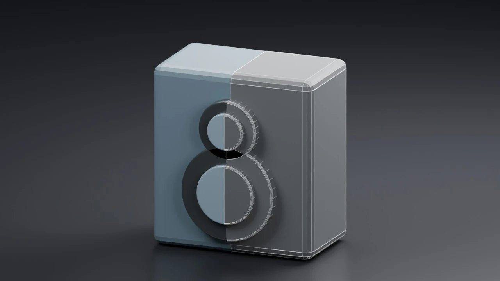

---

group: "blender-export-glb"
title: "Cómo exportar GLB desde Blender con texturas"
description: "Prepara los materiales en Blender, exporta el GLB y comprueba texturas en un visor independiente."
date: 2026-12-04
updated: 2026-12-04
keyword: "exportar glb blender"
cta: "Prueba la vista previa de ángulos con una foto de producto."
---

Prepara los materiales con las texturas conectadas a un sombreador compatible. Exporta glTF 2.0 en formato binario GLB desde Blender. Mueve el resultado a una carpeta nueva y ábrelo en el visor de destino. Comprueba que se conservan el color, las normales y la colocación de la textura.

## ¿Qué preparas antes de exportar?

Abre los materiales principales en el editor de sombreado. Usa Principled BSDF cuando corresponda y revisa las imágenes conectadas. Hornea los efectos procedurales que necesites conservar como mapas. Selecciona los objetos que quieres entregar y revisa orientación y transformaciones.

## ¿Cómo exportas y verificas?

Ve a Archivo, Exportar, glTF 2.0 y elige glTF binario. Exporta solo lo seleccionado si quieres dejar fuera elementos auxiliares. Valida el archivo, impórtalo en un visor nuevo y coteja el frontal y la base con tu escena.

## ¿Qué deberías revisar antes de publicar?

| Problema          | Qué revisar primero                         |
| ----------------- | ------------------------------------------- |
| Falta textura     | Conexión de la imagen y recursos exportados |
| Rugosidad extraña | Canales del mapa y espacio de color         |
| Pieza tumbada     | Transformación y orientación de destino     |

<!-- IMAGE PENDING: Fotografiar o capturar el ejemplo descrito en el brief. -->

**Fuente** [Blender · glTF 2.0 import and export](https://docs.blender.org/manual/en/5.1/addons/import_export/scene_gltf2.html), [Khronos · glTF 2.0 specification](https://registry.khronos.org/glTF/specs/2.0/glTF-2.0.html), [Khronos · glTF Validator](https://github.com/KhronosGroup/glTF-Validator).

[Guía relacionada](/es/guias/como-hacer-un-modelo-3d)

## Preguntas frecuentes

### ¿Se exportan todos los materiales?

Sí, se exportan los materiales si usan combinaciones de nodos compatibles. Se hornean efectos procedurales cuando corresponda y se comprueban materiales sencillos antes de aplicarlos en escenas complejas. Revisa que el exportador soporte texturas y que los nodos estén correctamente conectados.

### ¿Cómo sé que es autocontenido?

Mueve el GLB a una carpeta vacía y ábrelo en el visor de destino. Revisa el material con luz neutra para comprobar que las texturas estén integradas dentro del archivo, no en una carpeta aparte. Verifica que el archivo sea autocontenido y que no requiera referencias externas.

### ¿Guardo el BLEND?

Sí. Es la fuente editable. Haz ahí los cambios y vuelve a exportar la copia de distribución. Conserva también los archivos de textura y anota los ajustes de exportación. Si necesitas cambiar el encuadre, los materiales o la geometría más adelante, podrás generar un nuevo GLB a partir del mismo proyecto.
