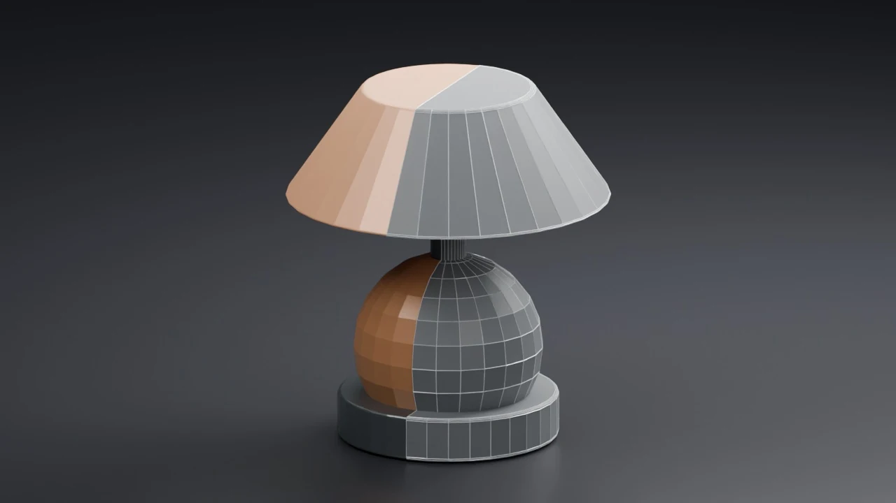
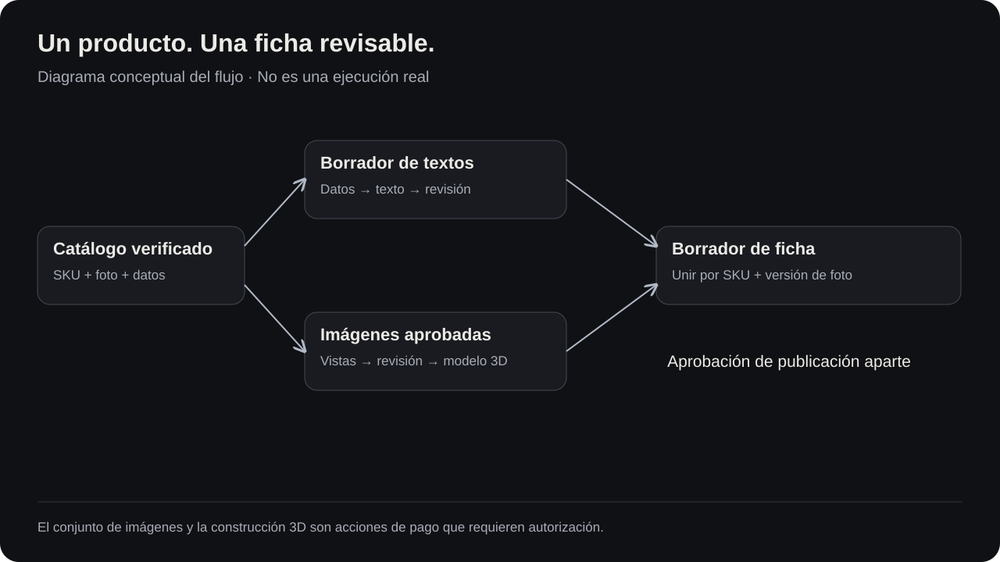
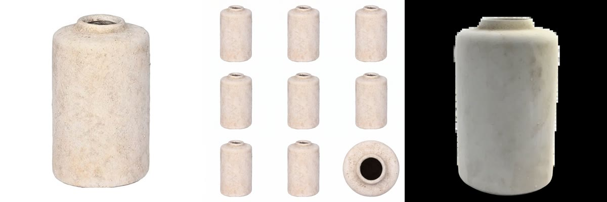

---

group: "n8n-product-pages-images-3d"
title: "Fichas de producto con n8n: imágenes, texto y 3D"
description: "Prepara fichas de producto con n8n: datos verificados, imágenes, un modelo 3D revisado y un borrador en tu tienda, con aprobación antes de gastar."
date: 2026-11-18
updated: 2026-11-18
keyword: "n8n fichas de producto"
cta: "Empieza con la foto de un producto. Revisa la previsualización gratis antes de decidir si quieres generar su modelo 3D descargable."
---

Para crear fichas de producto con n8n, conecta los datos verificados del catálogo con dos ramas: texto y contenido visual. Genera las imágenes, revísalas, construye el modelo 3D aprobado y reúne todo por SKU en un borrador de tu tienda. Conserva por separado las autorizaciones de gasto y publicación para saber qué se ha aceptado.

> **Una ficha completa necesita más que una descripción.** Guarda juntos los datos del producto, las imágenes, el modelo 3D y el estado de publicación. Una generación terminada es un paso hacia una ficha aprobada.

## ¿Qué debe entregar este flujo?

Para una lámpara de sobremesa de cerámica, el resultado es un conjunto revisable: texto correcto, vistas seleccionadas, un archivo GLB y el identificador de un borrador en la tienda. GLB es un contenedor binario de modelos 3D, como explica [Khronos](https://www.khronos.org/gltf/). Un vídeo del producto girando es otro tipo de archivo.

| Entrega                | De dónde sale                            | Qué debes comprobar                                   |
| ---------------------- | ---------------------------------------- | ----------------------------------------------------- |
| Título y descripción   | Datos del proveedor y reglas editoriales | Sin materiales, medidas ni certificaciones inventados |
| Imágenes del producto  | Conjunto de vistas aceptado              | Mismo producto, acabado y variante                    |
| Archivo 3D interactivo | Construcción aprobada                    | Se abre, gira y corresponde a la pieza aceptada       |
| Borrador de la ficha   | Relación entre SKU y producto            | Producto y variante correctos, aún sin publicar       |
| Registro del proceso   | Identificadores y aprobaciones guardados | Otra ejecución puede retomar el trabajo               |

La [plantilla de n8n para crear fichas en Shopify](https://n8n.io/workflows/11695-generate-product-descriptions-from-images-and-publish-to-shopify-using-ai/) sirve como referencia para la rama de texto. El 3D necesita su propio estado, revisión y entrega de archivos. Esta guía describe cómo conectarlos. No presenta resultados de una ejecución real en una tienda.

## Así queda una ficha antes de pasar por n8n

Usa un producto conocido para revisar la salida que quieres obtener. En este ejemplo, la foto y el GLB públicos del jarrón permiten comprobar el tipo de archivo que llegará a la ficha. Lo que sigue es una muestra de revisión de medios, con una hoja de ángulos y un modelo existentes de easyrender.

| Campo a revisar           | Muestra                                               |
| ------------------------- | ----------------------------------------------------- |
| Identificador del ejemplo | `VASE-DEMO-01`                                        |
| Foto de referencia        | [Abrir la foto original](/showcase/vase.jpg)          |
| Vistas para revisar       | [Abrir la hoja de ángulos](/showcase/vase-angles.jpg) |
| Archivo para el visor     | [Abrir el GLB de ejemplo](/showcase/vase.glb)         |
| Estado de la ficha        | Borrador de muestra                                   |

**La comprobación en este punto es enlazar los tres recursos al mismo SKU.** Abre el GLB por separado y mantén la foto original disponible para cotejar la forma y el acabado. Este material parte de activos existentes y sirve de referencia para configurar el flujo.

## ¿Qué comprobamos en n8n?

En n8n 2.48.5 cambiamos a propósito el orden de los archivos de tres SKU de ejemplo. El flujo unió los registros por SKU y versión de origen, descargó los dos GLB públicos aprobados y comprobó sus cabeceras binarias y tamaños declarados. El sillón quedó pendiente de revisión porque su modelo era de una versión anterior.

| SKU           | Versión de origen | Resultado                         |
| ------------- | ----------------- | --------------------------------- |
| VASE-DEMO-01  | v2                | Borrador con GLB de 400.792 bytes |
| TABLE-DEMO-01 | v3                | Borrador con GLB de 326.872 bytes |
| CHAIR-DEMO-01 | v3 con modelo v2  | Pendiente de revisión             |

La ejecución cubre la unión y validación de archivos existentes. La generación de imágenes, la construcción 3D de pago y la publicación en tienda requieren su propia prueba. [Importar el flujo de ejemplo](../evidence/n8n-local-draft-workflow.json), [ver el resultado de la ejecución](../evidence/n8n-local-draft-result.json).

## ¿Qué información debe venir del catálogo?

Prepara un registro con `sku`, `source_version`, `name`, `material`, `dimensions`, `image_url` y `locale`. Deja vacíos los datos desconocidos. Añade campos distintos para aprobar imágenes, gasto en 3D y publicación: un único `approved` resulta ambiguo cuando el flujo puede realizar varias acciones.

| Campo                | Ejemplo                              | Para qué sirve                                          |
| -------------------- | ------------------------------------ | ------------------------------------------------------- |
| `sku`                | `LAMP-CERAMIC-01`                    | Une texto, imágenes y modelo                            |
| `source_version`     | `photo-v2`                           | Distingue una foto nueva de un reintento                |
| `material`           | Cerámica confirmada por el proveedor | Evita convertir una suposición visual en una afirmación |
| `dimensions`         | Ficha técnica verificada             | Mantiene las medidas independientes del modelo generado |
| `publication_status` | `draft`                              | Separa crear archivos de publicarlos                    |

En la rama de texto, pide al modelo de lenguaje que devuelva título, descripción, puntos principales, texto alternativo y `missing_facts`. Las especificaciones deben salir únicamente de los campos verificados. Si falta un dato obligatorio, envía la ficha a revisión en vez de pedir a la IA que lo complete.

### ¿Qué deben contener el prompt y la respuesta de texto?

Envía el registro validado al nodo de generación de texto que hayas elegido, con la siguiente instrucción. Mantén su credencial separada de la del servicio visual. Si no puedes interpretar la respuesta o faltan campos obligatorios, desvía el resultado a edición antes de que llegue a la tienda.

> Redacta un borrador de ficha en el idioma solicitado usando solo los datos proporcionados. Devuelve title, description, bullets, alt_text y missing_facts. No deduzcas materiales, medidas, compatibilidades ni certificaciones a partir de la foto. Omite las especificaciones desconocidas y enuméralas en missing_facts. No publiques nada.

| Campo de salida | Tipo                       | Ejemplo con la lámpara                                     |
| --------------- | -------------------------- | ---------------------------------------------------------- |
| `title`         | Texto                      | Lámpara de sobremesa de cerámica                           |
| `description`   | Texto                      | Lámpara de cerámica para escritorio o mesa auxiliar.       |
| `bullets`       | Lista de textos            | Cuerpo de cerámica, solo si lo confirma el proveedor       |
| `alt_text`      | Texto                      | Vista frontal de la lámpara de sobremesa de cerámica       |
| `missing_facts` | Lista de nombres de campos | `dimensions`, `bulb_compatibility` si no están disponibles |

Es un esquema que debes validar, no una garantía de que el modelo siempre lo respete. En este ejemplo, la compatibilidad con bombillas queda fuera del texto porque se desconoce. Exige los cinco campos, listas para los dos campos correspondientes y el SKU original antes de unir texto e imágenes.

## ¿Cómo generas imágenes y 3D del mismo producto?

Utiliza el nodo [HTTP Request de n8n](https://docs.n8n.io/integrations/builtin/core-nodes/n8n-nodes-base.httprequest/) para llamar a la API. Guarda la clave en una credencial con cabecera `Authorization` y valor `Bearer YOUR_API_KEY`. Sustituye el marcador dentro de la credencial, nunca en una exportación compartida del flujo ni en la ficha del producto.

1. Consulta `GET https://easyrender.ai/api/credits`. Antes de aprobar, muestra el coste vigente del conjunto de imágenes, el saldo y el producto solicitado. Crear ese conjunto es una operación de pago, distinta de la previsualización gratuita.
2. Tras la aprobación, llama a `POST /api/product-views` con un JSON que contenga `image_url`, `name` y, si hace falta, `prompt`. Guarda inmediatamente el `id` devuelto como `view_set_id`.
3. Consulta `GET /api/product-views/{id}` con ese identificador. Puedes empezar con una espera de 15 segundos y un plazo máximo fijo, respetando los límites de peticiones. Detén la rama si recibes `failed` y revisa las vistas antes de aceptarlas.
4. Descarga las imágenes aceptadas desde `GET /api/product-views/{id}/views/{view}`, utilizando cada identificador de vista devuelto. Usa la misma credencial de API y guarda las respuestas como archivos.
5. Llama a `POST /api/product-views/{id}/render` cuando el conjunto esté listo y aceptado. Guarda su `renderId`. Esta llamada crea o recupera un borrador, pero no inicia la construcción 3D de pago.
6. Consulta ese render y aprueba el cargo pendiente, calculado como `max(0, renderCredits - credits)`. Envía `POST /api/renders/{id}/render` con el entero autorizado en `maxCredits`.
7. Espera hasta que `status` sea `ready` y `hasModel` sea `true`. Después descarga `GET /api/renders/{id}/model?download=1` como archivo.

Los campos y rutas están en el [esquema de la API desplegada](https://easyrender.ai/api/openapi.json). La petición REST de imágenes no ofrece el campo `maxCredits` de la construcción 3D. Controla su autorización en el flujo y utiliza una clave dedicada con techo de créditos. Añadir un campo al JSON no crea un límite en el servidor.

Si quieres empezar sin pagar un conjunto de imágenes, sigue el [flujo de previsualización con n8n](/es/guias/integrar-3d-flujo-n8n). Arranca en `POST /api/renders`, se detiene para revisar y mantiene separada la construcción posterior. Es la ruta adecuada para evaluar una pieza antes de preparar la ficha completa.

<!-- IMAGE PENDING: captura real y exclusiva de revisión de vistas y archivos generados, sin credenciales ni datos de clientes. -->

## ¿Cómo mantienes unidos el texto y las imágenes correctos?

Conserva el mismo `sku` y `source_version` en ambas ramas. Guarda junto a ellos `view_set_id`, `render_id` y la revisión del texto. Une los resultados por esos identificadores: una imagen que tarda más no debe hacer que el modelo de una lámpara termine en la ficha del producto siguiente.

| Estado del texto              | Estado visual  | Siguiente acción                                 |
| ----------------------------- | -------------- | ------------------------------------------------ |
| Listo                         | Procesando     | Guardar el texto y esperar al trabajo existente  |
| Faltan datos del proveedor    | Listo          | Pedir los datos y conservar los archivos         |
| Aprobado                      | Aprobado       | Preparar el borrador en la tienda                |
| Aprobado                      | Rechazado      | Mantener el texto y revisar solo la parte visual |
| Versión anterior de la fuente | Versión actual | Revisar la discrepancia antes de unir            |

No presentes las vistas generadas como nuevas fotografías de la lámpara física. Mantén la foto original disponible durante la revisión y escribe pies adecuados para cada recurso. Para preparar la imagen de entrada, consulta la [guía de foto a 3D](/es/guias/como-crear-un-modelo-3d-a-partir-de-fotos).

## ¿Cómo llegan los archivos a Shopify u otra tienda?

Un endpoint privado del modelo no es una URL pública de contenido multimedia. Descarga el archivo desde n8n con autenticación y súbelo después mediante el flujo admitido por la plataforma. La credencial de easyrender debe quedarse en sus propias peticiones, nunca en el escaparate, el nombre del archivo o una petición a Shopify.

La [documentación multimedia de Shopify](https://shopify.dev/docs/apps/build/product-merchandising/products-and-collections/manage-media) separa subida, procesamiento y asociación al producto. Sigue esa secuencia para la versión de API de tu tienda. Guarda los identificadores devueltos y confirma que el procesamiento ha terminado antes de marcar la entrega como completada.

Empieza con un producto en borrador o un cambio sin publicar. Comprueba sus imágenes, la carga del modelo y la variante en el tema real. Que la plataforma acepte un archivo no demuestra que la ficha lo muestre correctamente. La [guía de 3D para ecommerce](/es/guias/modelos-3d-para-ecommerce) explica esa revisión.

## ¿Qué suele fallar en esta automatización?

| Síntoma                                   | Causa probable                                        | Solución                                                             |
| ----------------------------------------- | ----------------------------------------------------- | -------------------------------------------------------------------- |
| El texto inventa un material              | La interpretación visual sustituye al proveedor       | Limitar las especificaciones a datos verificados                     |
| Se generan dos conjuntos de imágenes      | Reintento de un POST de pago tras perder la respuesta | Registrar el resultado como incierto y comprobarlo antes de reenviar |
| Un producto recibe otro modelo            | Unión por posición en la lista                        | Unir por SKU y versión de la fuente                                  |
| Shopify no puede descargar el modelo      | Se ha enviado un endpoint privado                     | Descargar con autenticación y subir el archivo                       |
| La construcción no empieza                | Se confunde el borrador con el modelo terminado       | Aprobar y llamar a la operación de construcción                      |
| El flujo se detiene y el trabajo continúa | El plazo local se interpreta como fallo               | Guardar el ID y consultar de nuevo más tarde                         |
| Persiste una imagen antigua               | No se controla la revisión del recurso                | Guardar ID multimedia de destino y versión de origen                 |

## ¿Cómo decides si merece la pena ampliar el flujo?

Pasa una lámpara por todas las ramas y compara el borrador final con sus datos de entrada. Registra tiempo de revisión, correcciones manuales y créditos netos utilizados. Después prueba un pequeño grupo de productos distintos antes de alimentar el flujo con una programación automática.

La implementación distingue el ID del conjunto de vistas, el ID del render y la disponibilidad del modelo final. Esa separación ofrece tres comprobaciones en vez de una señal genérica de éxito. Cuenta fichas revisadas y entregadas: un nodo HTTP en verde solo confirma una etapa.

Para elegir el método de creación, consulta [cómo hacer un modelo 3D](/es/guias/como-hacer-un-modelo-3d). Si vas a procesar muchos SKU, el [flujo de catálogo por lotes](/es/guias/automatizar-catalogo-3d-n8n) añade recuperación y control del presupuesto a estos mismos pasos.

## Preguntas frecuentes

### ¿Puede n8n crear una ficha completa desde una sola foto?

Puede coordinar el trabajo, pero una foto no verifica las especificaciones del producto. Aporta datos fiables del catálogo, elige los servicios de texto e imagen, revisa los resultados y prepara un borrador. Mantén medidas, materiales y permiso de publicación separados de lo que un modelo visual deduzca sobre la pieza.

### ¿Las imágenes y el modelo 3D son gratis?

La previsualización gratuita y el conjunto de imágenes de pago son rutas distintas. Las vistas de producto consumen créditos y la construcción 3D posterior tiene su propio cargo pendiente. Consulta el presupuesto de la cuenta antes de cada operación e incluye los costes del modelo de lenguaje y del alojamiento de n8n.

### ¿Necesito un nodo nativo de easyrender en n8n?

No. Esta guía utiliza nodos HTTP Request incluidos en n8n y el contrato REST publicado. No depende de que un paquete comunitario esté listado o verificado. Empieza por esta ruta y valora después un nodo específico según las operaciones que necesites y su disponibilidad de instalación en tu entorno.

### ¿El flujo publicará los productos automáticamente?

Solo si añades y autorizas ese paso. Esta receta termina con un borrador revisado y los identificadores de los archivos guardados. Separar la publicación permite comprobar juntos variante, texto e imágenes antes de modificar una ficha visible, y también repetir la entrega sin volver a generar todo el contenido visual.
