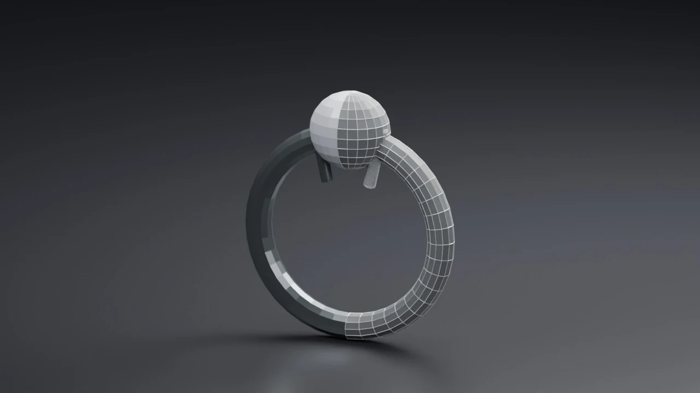

---

group: "jewelry-photography"
title: "Fotografía de joyas: cómo controlar los reflejos"
description: "Fotografía joyas con contornos claros, reflejos controlados y detalles repetibles entre variantes."
date: 2026-12-07
updated: 2026-12-07
keyword: "fotografia de joyas"
cta: "Prueba la vista previa de ángulos con una foto de producto."
---

Para fotografiar joyas pulidas, controla qué refleja el metal. Coloca material difusor entre la luz y la pieza para crear un reflejo amplio y acerca una cartulina oscura para dibujar los bordes. Amplía piedras, garras y grabados antes de desmontar la escena o pasar a otra pieza.

## ¿Cómo consigues un reflejo uniforme?

Empieza con una superficie neutra. Agranda la fuente con un difusor y muévelo hasta que el reflejo describa el metal. Acerca una cartulina oscura si se confunden dos bordes pulidos.

Fija el trípode y enfoca la piedra o el cierre más cercano. Si cambias el diafragma para ampliar la profundidad, comprueba los grabados antes de fotografiar todas las variantes.

## ¿Qué detalles merecen su propia foto?

Haz una vista principal, otra del cierre y un detalle del engaste o marca. Mantén color y encuadre para las variantes y revisa los archivos juntos.

## ¿Qué deberías revisar antes de publicar?

| Síntoma                               | Ajuste                                      |
| ------------------------------------- | ------------------------------------------- |
| Un brillo tapa el grabado             | Mueve el difusor o reduce exposición        |
| La plata queda como una mancha blanca | Añade un reflejo oscuro en el borde         |
| Engaste fuera de foco                 | Ajusta el plano de enfoque o la profundidad |

<!-- IMAGE PENDING: Fotografiar o capturar el ejemplo descrito en el brief. -->

**Fuente** [GIA · gem and jewelry photography](https://www.gia.edu/gem-photography), [Shopify · product photography](https://help.shopify.com/en/manual/products/product-media/product-photography), [GS1 · product image specification](https://www.gs1.org/standards/gs1-product-image-specification-standard/current-standard).

[Guía relacionada](/es/guias/fotografia-de-producto-para-ecommerce)

[Cómo crear un modelo 3D](/es/guias/como-hacer-un-modelo-3d)

## Preguntas frecuentes

### ¿Uso una caja de luz?

Sí, usa una caja de luz para controlar los reflejos. Si borras el contorno, añade una cartulina oscura o mueve parte del difusor hasta que se distinga la forma. Revisa que la luz no cause destellos en el metal y que el fondo no refleje demasiado.

### ¿Cómo compruebo el color de una piedra?

Mantén la iluminación y el balance de blancos estables y compara con la pieza real. El color puede variar entre pantallas, así que revisa el ajuste de color en el software antes de publicar la imagen. Verifica que el contraste y el tono no distorsionen el verdadero color de la piedra.

### ¿Qué ángulo elijo de principal?

El que mejor enseña la forma y el elemento protagonista. Añade una toma separada para el cierre o la parte posterior. Añade una cartulina oscura detrás de la joya para que los bordes pulidos se distingan claramente en la imagen principal.
