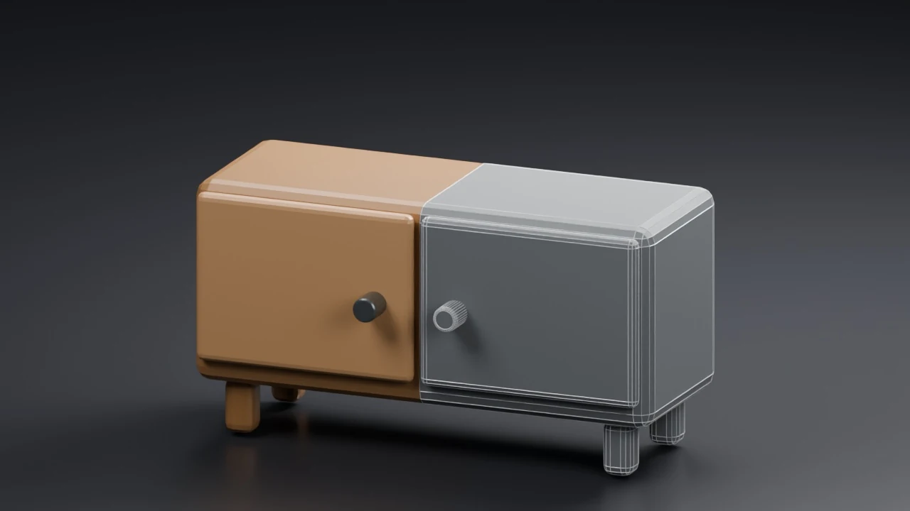

---

group: "furniture-photography"
title: "Cómo fotografiar muebles para venderlos online"
description: "Organiza la luz y las vistas de un mueble para que se entiendan su forma, acabado y construcción."
date: 2026-11-19
updated: 2026-11-19
keyword: "fotografia de muebles"
cta: "Prueba la vista previa de ángulos con una foto de producto."
---

Empieza con una foto en tres cuartos que enseñe el frente y la profundidad del mueble. Completa la galería con una vista frontal, un lateral o la trasera y detalles del acabado. Repite el encuadre en las variantes para que el comprador pueda comparar la madera, la tapicería o las patas.

## ¿Cómo iluminas un mueble grande?

Coloca una ventana o una fuente difusa amplia a un lado, ligeramente por delante de la pieza. Apaga las luces de la habitación si tienen otro color. Usa un panel blanco en el lado opuesto para recuperar detalle en las sombras.

Aléjate hasta encuadrar el mueble con la cámara nivelada. Si las verticales se inclinan, corrige la altura antes de editar. Marca en el suelo la posición del trípode y del mueble para repetirla con cada acabado.

## ¿Qué vistas conviene hacer antes de desmontar?

Usa la primera para mostrar la silueta. El frontal explica la distribución y el perfil muestra la profundidad, los brazos o las patas. Abre cajones y puertas cuando cambien el uso de la pieza.

Haz los primeros planos al terminar las vistas generales. Enseña una unión o costura además de la veta o el tejido. Reserva las medidas verificadas para las especificaciones o un diagrama rotulado.

## ¿Qué deberías revisar antes de publicar?

| Problema                            | Ajuste                                             |
| ----------------------------------- | -------------------------------------------------- |
| La parte superior parece más ancha  | Aléjate y nivela la cámara                         |
| El roble amarillea en el lateral    | Apaga la luz mezclada y fija el balance de blancos |
| Solo se ve la trasera en una escena | Añade una foto de la trasera despejada             |

<!-- IMAGE PENDING: Fotografiar o capturar el ejemplo descrito en el brief. -->

**Fuente** [Shopify · product photography](https://help.shopify.com/en/manual/products/product-media/product-photography), [Google Merchant Center · image link](https://support.google.com/merchants/answer/6324350), [GS1 · product image specification](https://www.gs1.org/standards/gs1-product-image-specification-standard/current-standard).

[Guía relacionada](/es/guias/fotografia-de-producto-para-ecommerce)

[Cómo crear un modelo 3D](/es/guias/como-hacer-un-modelo-3d)

## Preguntas frecuentes

### ¿Puedo hacer las fotos con el móvil?

Sí, usa el objetivo principal con buena luz y apoya el móvil para repetir el encuadre. Alejate antes de cambiar al ultra gran angular, amplía la primera foto y revisa esquinas y detalle. Checa que la iluminación no cause sombras excesivas.

### ¿Conviene enseñar la habitación?

Sí, enseña la habitación para dar contexto, pero añade una foto separada con el mueble completo, destacando contorno, base y acabado. Asegúrate de incluir las medidas en las especificaciones. Verifica que la iluminación sea natural y que el fondo no distraiga.

### ¿Cada variante necesita su galería?

Cada variante necesita su galería si cambia el acabado o la construcción. Reutiliza un detalle solo cuando la pieza sea idéntica y indica claramente qué variante se muestra. Revisa que todas las imágenes tengan el mismo fondo y escala para evitar confusiones.
