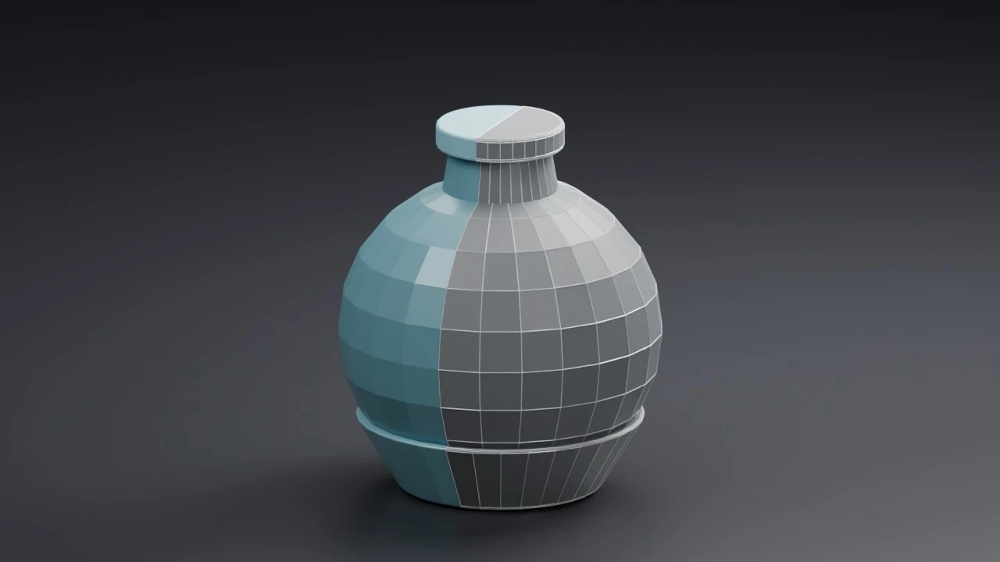

---

group: "glb-vs-gltf"
title: "GLB frente a glTF: cuándo elegir cada uno"
description: "Compara el mismo modelo en GLB y glTF separado para decidir cómo entregar geometría y texturas."
date: 2026-11-25
updated: 2026-11-25
keyword: "glb vs gltf"
cta: "Prueba la vista previa de ángulos con una foto de producto."
---

Elige GLB si vas a entregar el modelo como un solo archivo. Elige glTF separado cuando necesites inspeccionar o gestionar los recursos por separado. Ambos pueden describir la misma escena. La diferencia práctica es cómo entregas el JSON, los datos de geometría y las imágenes que componen el material.

## ¿Qué cambió al exportar el mismo jarrón?

Exportamos el mismo jarrón dos veces en Blender 5.2.3. El GLB pesó 1.732.772 bytes. El glTF separado se repartió entre JSON de 2.124 bytes, BIN de 1.702.680 y WebP de 28.466.

En esta configuración el peso total fue casi idéntico. El JSON pequeño era solo una parte. Otras opciones de exportación pueden cambiar las cifras.

Quitamos una dependencia cada vez de copias de la exportación separada. Sin el WebP, Blender abrió la geometría, pero la imagen quedó sin píxeles. Al quitar el BIN falló la importación. Prueba ambos casos en una carpeta aislada antes de entregar un paquete separado.

## ¿Cómo pruebas la entrega?

Copia solo el GLB a una carpeta nueva y ábrelo. Para un glTF separado, mueve la carpeta completa. Si falta una textura, coteja la URI declarada en el JSON con la ruta y el nombre que sirven en producción.

## ¿Qué deberías revisar antes de publicar?

| Destino                       | Paquete adecuado                                           |
| ----------------------------- | ---------------------------------------------------------- |
| Correo o CMS de catálogo      | GLB autocontenido comprobado por separado                  |
| Diagnóstico de una textura    | glTF con su imagen y búfer                                 |
| Recursos con cachés distintas | Probar los archivos separados y las solicitudes necesarias |

<!-- IMAGE PENDING: Fotografiar o capturar el ejemplo descrito en el brief. -->

**Fuente** [Khronos · glTF 2.0 specification](https://registry.khronos.org/glTF/specs/2.0/glTF-2.0.html), [Khronos · glTF Validator](https://github.com/KhronosGroup/glTF-Validator), [Blender · glTF 2.0 import and export](https://docs.blender.org/manual/en/5.1/addons/import_export/scene_gltf2.html).

[Guía relacionada](/es/guias/como-hacer-un-modelo-3d)

## Preguntas frecuentes

### ¿Uno siempre pesa menos?

No, un GLB no siempre pesa menos que un glTF. Exporta el jarrón con Blender usando la opción de glTF separado. Verifica que el JSON y los archivos BIN/WebP estén completos, ya que la falta de un componente puede romper la carga.

### ¿Puede un GLB referenciar archivos externos?

Sí, un GLB puede referenciar archivos externos. Copia solo el GLB en una carpeta vacía y abre el archivo para verificar que conserva sus materiales. Revisa que los enlaces externos estén correctamente definidos y que el archivo se cargue sin errores.

### ¿Por qué cambia de aspecto entre visores?

Si cambia de aspecto entre visores, es porque el glTF separado faltan archivos como la textura. Copia el GLB o el conjunto glTF en una carpeta nueva y abre el paquete. Si la textura no carga, verifica que la URI en el JSON coincida con la ruta de producción.
