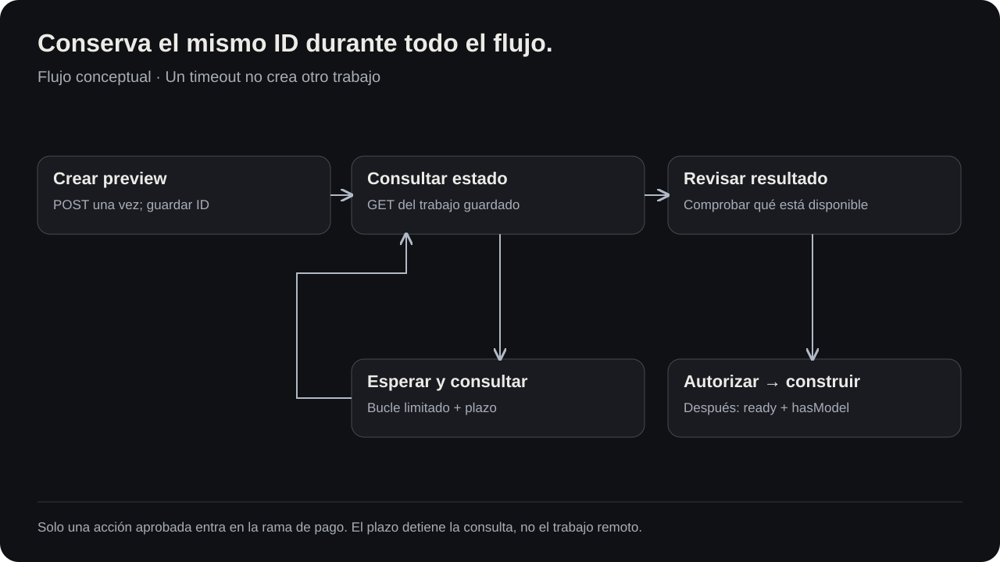

---

group: n8n-image-to-3d-workflow
title: "Cómo integrar 3D en n8n con una API de imagen a 3D"
description: "Conecta n8n a una API de imagen a 3D: crea la previsualización, guarda el ID, aprueba el modelo y descarga el GLB sin duplicar peticiones de pago."
date: 2026-11-19
updated: 2026-11-17
keyword: integrar 3d en n8n
cta: Prueba una foto de producto con la previsualización gratis y conecta después el resultado revisado a tu flujo de n8n.
---

Para integrar la generación 3D en n8n, crea una previsualización con un nodo HTTP Request, guarda su identificador y consulta ese mismo trabajo hasta que esté disponible. Tras revisarlo, autoriza la construcción de pago y descarga el GLB. Separar creación, espera, aprobación y entrega evita reiniciar el proceso cuando una respuesta tarda o se pierde.

<!-- ILLUSTRATION PENDING: /blog/illustrations/n8n-image-to-3d-workflow/hero.webp; prompt en el brief de investigación. -->

> **Guarda el identificador antes de automatizar más pasos.** Si sabes qué trabajo corresponde a la foto, puedes retomarlo. Una celda de resultado vacía no basta para decidir si debes empezar otra generación.

## ¿Qué conexión te conviene usar?

Utiliza REST cuando la secuencia esté definida. Añade un agente cuando necesites interpretar una petición o elegir entre herramientas. Un nodo comunitario puede reducir la configuración, pero conviene comprobar que cubre todas las operaciones que requiere tu flujo.

| Método                            | Cuándo elegirlo                                     | Qué comprobar                                                     |
| --------------------------------- | --------------------------------------------------- | ----------------------------------------------------------------- |
| HTTP Request integrado            | Secuencia explícita con entradas y salidas visibles | Credencial, formato del cuerpo y ramas por estado                 |
| Nodo comunitario                  | Operaciones admitidas con menos configuración       | Disponibilidad de instalación y acciones incluidas                |
| Cliente MCP conectado a un agente | Peticiones que requieren elegir herramientas        | Transporte compatible, herramientas permitidas y control de gasto |

Esta guía utiliza [HTTP Request](https://docs.n8n.io/integrations/builtin/core-nodes/n8n-nodes-base.httprequest/) y el [contrato REST de easyrender](/es/api-imagen-a-3d). No necesita una publicación en el marketplace. Para peticiones conversacionales, consulta la [guía de agentes n8n con MCP](/es/guias/agente-ia-n8n-modelos-3d-mcp).

## ¿Qué necesitas antes de añadir el primer nodo?

Elige una foto clara de un ventilador de sobremesa. La API acepta JPEG, PNG o WebP de hasta 4 MiB. Para una imagen pública por HTTPS, utiliza `image_url`; para un archivo local o privado, súbelo mediante el endpoint autenticado y utiliza el `upload_id` devuelto.

Crea una clave de API en Conectores. El flujo de previsualización necesita `write` para crear y `read` para consultar. Reserva `spend` para la credencial de la operación de pago aprobada y guarda la clave como Header Auth: cabecera `Authorization`, valor `Bearer YOUR_API_KEY`.

| Valor que debes guardar | Ejemplo                      | De dónde sale                                  |
| ----------------------- | ---------------------------- | ---------------------------------------------- |
| Registro de origen      | `FAN-DESK-01`                | Tu catálogo                                    |
| Revisión de la foto     | `front-v1`                   | Tu control de versiones de imágenes            |
| Clave de creación       | `FAN-DESK-01-front-v1`       | Identidad estable de esta entrada concreta     |
| `render_id`             | El `id` real de la respuesta | Creación de la previsualización                |
| Techo aprobado          | Un entero autorizado         | Presupuesto vigente y decisión del responsable |

La URL de la foto debe seguir devolviendo el mismo archivo durante un reintento. Si cambias la fuente, crea una revisión nueva de forma deliberada. Antes de probar la conexión, revisa la [preparación de fotos para 3D](/es/guias/como-crear-un-modelo-3d-a-partir-de-fotos) para evitar problemas de entrada.

## Paso 1: ¿cómo creas la previsualización?

Añade Manual Trigger y un nodo Edit Fields con los datos de origen. Configura después el primer HTTP Request con los valores de la tabla. Mapea tu propia imagen accesible desde el registro; no envíes una URL de ejemplo como si fuera una foto real.

| Ajuste de HTTP Request | Valor                                               |
| ---------------------- | --------------------------------------------------- |
| Método                 | `POST`                                              |
| URL                    | `https://easyrender.ai/api/renders`                 |
| Autenticación          | Tu credencial Header Auth                           |
| Cabecera               | `Idempotency-Key` con la clave de creación guardada |
| Tipo de cuerpo         | JSON                                                |
| Campo del cuerpo       | `image_url` desde el registro de origen             |
| Campo del cuerpo       | `name` desde el nombre del producto                 |
| Campo del cuerpo       | `isPublic` como booleano `false`                    |
| Formato de respuesta   | JSON, solo el cuerpo para los campos indicados aquí |

Guarda el `id` devuelto antes de continuar. Si la respuesta no incluye cabeceras ni estado HTTP, lo encontrarás en `id`. Si activas la respuesta completa, adapta los campos a `body.id`; mezclar ambas formas entre nodos hace que el siguiente paso pierda el identificador.

La clave de creación admite entre 1 y 128 caracteres ASCII imprimibles, sin espacios. Reutilizarla con la misma entrada recupera el mismo render; cambiar la entrada produce un conflicto. Esta garantía corresponde a la creación de previsualizaciones, no a todos los POST: conserva la clave original si se pierde la respuesta.

## Paso 2: ¿cómo esperas sin empezar de nuevo?

Añade un nodo [Wait](https://docs.n8n.io/integrations/builtin/core-nodes/n8n-nodes-base.wait/) por intervalo y, después, `GET https://easyrender.ai/api/renders/{saved_render_id}`. Puedes probar con 15 segundos entre consultas y un plazo máximo de 20 minutos. Son ajustes iniciales del flujo, no tiempos de generación prometidos; guarda el plazo antes de entrar en el bucle.

| Estado recibido                    | Rama del flujo                                            |
| ---------------------------------- | --------------------------------------------------------- |
| `drafting`                         | Esperar y consultar el mismo ID                           |
| `preview_ready`                    | Salir del bucle de previsualización y pedir revisión      |
| `rendering`                        | Seguir consultando la construcción autorizada, con límite |
| `ready` y `hasModel=true`          | Descargar el modelo                                       |
| `failed`                           | Guardar el error y detener este intento                   |
| Plazo agotado o estado desconocido | Guardar ID y estado para comprobarlos después             |

Consulta el render individual, no solo el listado. El [contrato de la API](https://github.com/easyrenderai/easyrender.ai/blob/main/docs/api.md) indica que listar trabajos no los hace avanzar. Tampoco basta con que aparezca una URL en la respuesta: el archivo correspondiente puede no estar disponible todavía.

## Paso 3: ¿qué debe aprobar la persona que revisa?

Abre el visor del propietario en `https://easyrender.ai/r/{saved_render_id}`. Comprueba `hasSheet` antes de presentar una imagen como hoja de ángulos: el recurso de previsualización puede seguir siendo la foto original. Si solicitas una hoja o revisión de pago, autorízala por separado y registra su coste para ese producto.

Actualiza el render y consulta `GET /api/credits`. Vincula la aprobación al ID del render, la revisión de origen y los créditos permitidos. El cargo pendiente de construcción es `max(0, renderCredits - credits)`, no un precio fijo copiado en la configuración.

Tras la aprobación, envía `POST https://easyrender.ai/api/renders/{saved_render_id}/render` con el campo JSON `maxCredits` establecido al entero autorizado. El rechazo y el vencimiento deben terminar la rama. No conectes esas salidas a la acción de pago como continuación por defecto.

<!-- IMAGE PENDING: captura exclusiva de ajustes de HTTP Request y respuesta de estado de una ejecución real de n8n, sin credenciales. -->

## Paso 4: ¿cómo descargas el GLB?

Cuando recibas `ready` y `hasModel=true`, solicita `/api/renders/{saved_render_id}/model?download=1` con la credencial del propietario. Elige respuesta de archivo y un campo de salida como `model`. Envía ese binario al almacenamiento o al proceso de subida de tu plataforma de comercio.

La [referencia de Khronos](https://www.khronos.org/gltf/) explica el uso de GLB para entregar modelos. Distingue tres destinos: la página del visor, el endpoint autenticado de descarga y el archivo subido a tu tienda. No son enlaces intercambiables.

Las URL de modelos privados requieren autenticación. En Shopify, utiliza su [secuencia de subida y procesamiento multimedia](https://shopify.dev/docs/apps/build/product-merchandising/products-and-collections/manage-media) después de descargar el archivo. No añadas una clave de API a la URL para intentar hacerla accesible desde la tienda.

## ¿Qué errores debes tratar expresamente?

| Síntoma                          | Qué revisar                                 | Recuperación                                               |
| -------------------------------- | ------------------------------------------- | ---------------------------------------------------------- |
| HTTP 401                         | Clave incorrecta, caducada o revocada       | Corregir credencial y conservar el ID                      |
| HTTP 403                         | Permiso ausente o techo de la clave agotado | Consultar el código de error y los límites autorizados     |
| HTTP 402                         | Saldo insuficiente                          | Detener el gasto y pedir una decisión de presupuesto       |
| HTTP 409 al crear                | Misma clave con entrada distinta            | Recuperar la petición anterior o versionar la nueva fuente |
| HTTP 429                         | Límite de peticiones o concurrencia         | Leer `Retry-After` y retrasar la consulta                  |
| El POST de pago agota el tiempo  | Resultado desconocido                       | Consultar el trabajo guardado antes de repetir             |
| El supuesto modelo contiene JSON | Error guardado como archivo                 | Comprobar estado HTTP y tipo de contenido                  |

n8n documenta cómo [gestionar límites de peticiones](https://docs.n8n.io/integrations/builtin/handle-rate-limits.md). Evita activar Retry On Fail de forma indiscriminada en nodos de pago. Una lectura repetible y una operación cuyo resultado desconoces necesitan recuperaciones distintas, aunque ambas aparezcan en rojo.

## ¿Cómo pruebas el flujo antes de usar un catálogo?

Empieza por consultar la cuenta y crear una previsualización con una foto. Comprueba que el registro guarda el ID y que repetir la misma clave de creación no genera otro render. Detente en la revisión hasta disponer de una autorización concreta para la construcción.

Después prueba las ramas con respuestas simuladas de `drafting`, `preview_ready`, `ready`, `failed` y un error de límite de peticiones. Eso valida las decisiones del flujo, no el servicio de generación. Para confirmar la integración completa sigue haciendo falta una ejecución autenticada con tu configuración de n8n.

Los campos de esta guía se contrastaron con el esquema desplegado; no se ha utilizado una generación de pago para afirmar tiempos ni tasas de éxito. Para elegir el método de partida, consulta [cómo hacer un modelo 3D](/es/guias/como-hacer-un-modelo-3d). Amplía a lotes cuando un modelo aceptado llegue a su destino.

## Preguntas frecuentes

### ¿Crear un render también inicia el modelo de pago?

No. La creación devuelve un identificador e inicia la previsualización. Construir el modelo 3D es una acción posterior con su propia autorización. Guarda el ID, revisa el resultado disponible y actualiza el coste antes de continuar, de modo que puedas pausar el flujo sin perder lo que ya has creado.

### ¿Puedo utilizar una foto que no esté publicada?

Sí. Envía el archivo al endpoint de subida autenticada y utiliza su identificador como fuente de la previsualización. La referencia pertenece a la cuenta y caduca después de una hora. Crea el render dentro de ese plazo y guarda su ID independiente para consultarlo o recuperar el proceso más adelante.

### ¿n8n recibe el modelo terminado inmediatamente?

No. La creación y la construcción devuelven información del trabajo mientras sigue procesándose. Consulta su ID y exige estado listo y disponibilidad del modelo antes de descargar. Si alcanzas el plazo máximo del flujo, conserva el trabajo para volver a comprobarlo; ese plazo no demuestra que la generación haya fallado.

### ¿Puedo descargar USDZ automáticamente desde el mismo endpoint?

El endpoint de esta receta devuelve GLB. El contrato REST no define una conversión a USDZ, así que cambiar la extensión de la URL no la crea. Utiliza la exportación admitida por el visor o un paso de conversión probado por separado cuando tu destino necesite específicamente ese formato.
