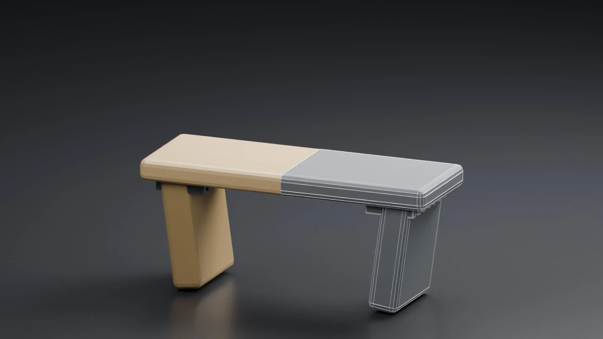
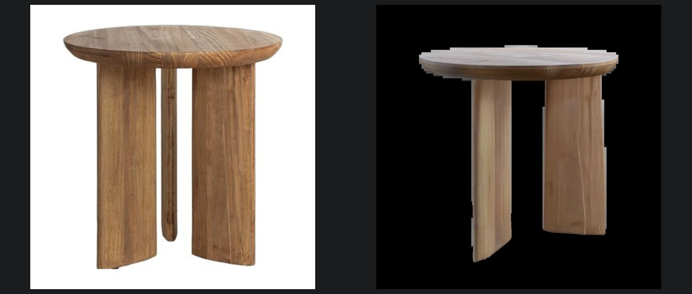

---

group: "furniture-model-from-photo"
title: "Cómo crear un modelo 3D de un mueble desde una foto"
description: "Prepara la foto, revisa las vistas generadas y comprueba el modelo 3D antes de añadirlo al catálogo."
date: 2026-11-27
updated: 2026-11-27
keyword: "modelo 3d de mueble desde foto"
cta: "Prueba la vista previa de ángulos con una foto de producto."
---

Empieza por una foto nítida que enseñe el frente, un lateral y las patas del mueble. Revisa los ángulos generados antes de construir el modelo. Tras exportar, abre el GLB en otro visor y comprueba la silueta, las superficies y los detalles al tamaño en que lo verá el comprador.

## ¿Qué foto funciona como punto de partida?

Usa una vista en tres cuartos con el mueble aislado. Deja espacio bajo las patas y aparta los objetos que corten el contorno. Ajusta la exposición para conservar tanto el tablero claro como los tiradores oscuros. Guarda otras fotos reales como referencia.

## ¿Cuándo das por bueno el modelo?

Compara las vistas previstas con la foto y sus referencias. Cuenta patas, tiradores y huecos. Después abre el modelo, gíralo y examina uniones y base. El GLB público de nuestra mesa de centro tiene 16.228 triángulos y pesa 322.876 bytes. Mide tu exportación en el entorno de destino.

## ¿Qué deberías revisar antes de publicar?

| Comprobación | Criterio                                         |
| ------------ | ------------------------------------------------ |
| Piezas       | Coinciden con la referencia visible              |
| Acabado      | La pieza sigue siendo reconocible con luz neutra |
| Archivo      | Abre en el visor elegido                         |

**Fuente** [Khronos · glTF 2.0 specification](https://registry.khronos.org/glTF/specs/2.0/glTF-2.0.html), [Khronos · glTF Validator](https://github.com/KhronosGroup/glTF-Validator), [Shopify · creating 3D models](https://help.shopify.com/en/partners/manage-clients-stores/creating-media/3d-models/creating-3d-models).

[Guía relacionada](/es/guias/como-crear-un-modelo-3d-a-partir-de-fotos)

[Cómo crear un modelo 3D](/es/guias/como-hacer-un-modelo-3d)

## Preguntas frecuentes

### ¿Fotografío también la trasera?

Guarda una imagen de referencia si detrás hay un detalle importante. Un ángulo generado es una predicción. Utiliza fotos reales para verificar detalles concretos. Incluye en esa toma las costuras, puntos de unión y herrajes que se deban conservar. Así podrás compararlos al girar el modelo.

### ¿Qué hago si desaparece una pata fina?

Si desaparece una pata fina, cambia el fondo o la luz para que su borde esté más definido. Asegúrate de que la pata esté completamente visible y que el entorno no oculte detalles. Revisa que el modelo 3D se genere con toda la estructura del mueble.

### ¿Qué archivo envío a la tienda?

Envía una foto en formato JPG o PNG al menos de 1920x1080 píxeles. Abre el archivo en el entorno de la tienda y conserva las fotos de referencia junto con el original editable. Verifica que el modelo se genere sin pérdida de detalle.
