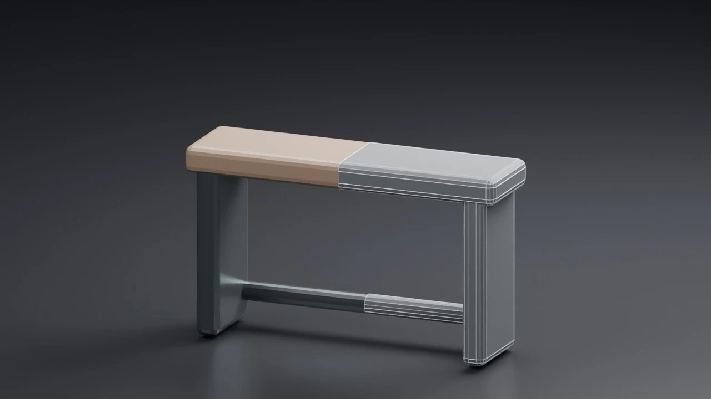
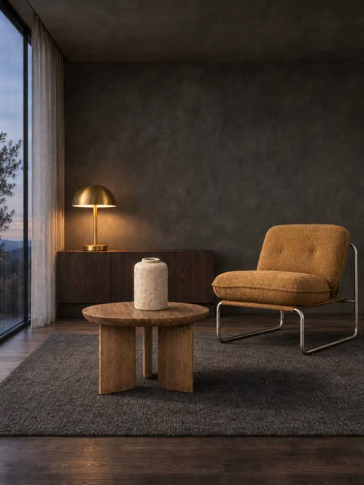

---

group: "3d-furniture-models-home-staging"
title: "Cómo usar modelos 3D de muebles en home staging"
description: "Coloca un mueble 3D en una escena existente y revisa proporción visual, apoyo e iluminación."
date: 2026-12-08
updated: 2026-12-08
keyword: "modelos 3d de muebles para home staging"
cta: "Prueba la vista previa de ángulos con una foto de producto."
---

Coloca el mueble 3D con la base hacia abajo y sombra de contacto activa. Asegúrate de que el origen del objeto esté alineado con el eje X del proyecto. El error más común es que el mueble flote porque no se ha verificado la base ni la sombra de contacto.

## ¿Cómo preparas el objeto?

Abre una copia en el editor. Comprueba qué lado mira al frente y si el origen facilita colocarlo. Ajusta las unidades del proyecto y usa especificaciones de producto verificadas cuando hagan falta medidas precisas.

## ¿Cómo revisas la colocación?

Añade una referencia visual neutra para valorar la proporción. Iguala la dirección de luz y revisa la sombra de contacto. Gira la vista y verifica paredes y mobiliario cercano. Guarda la pieza aislada como activo reutilizable si habrá más variantes.

## ¿Qué deberías revisar antes de publicar?

| Problema                     | Ajuste                                 |
| ---------------------------- | -------------------------------------- |
| Parece que el mueble flota   | Revisa la base y la sombra de contacto |
| El mueble atraviesa la pared | Comprueba una vista superior           |
| El accesorio tapa la pieza   | Desplázalo antes de cambiar la cámara  |

<!-- IMAGE PENDING: Fotografiar o capturar el ejemplo descrito en el brief. -->

**Fuente** [Blender · Asset Browser](https://docs.blender.org/manual/en/latest/editors/asset_browser.html), [Blender · units](https://docs.blender.org/manual/en/latest/scene_layout/scene/properties.html#units), [Khronos · glTF 2.0 specification](https://registry.khronos.org/glTF/specs/2.0/glTF-2.0.html).

[Guía relacionada](/es/modelos)

[Cómo crear un modelo 3D](/es/guias/como-hacer-un-modelo-3d)

## Preguntas frecuentes

### ¿Puedo usar un modelo de biblioteca?

Sí, puedes usar un modelo de biblioteca si el formato y los permisos lo permiten. Revisa el modelo concreto para la distancia de la cámara, la orientación y el detalle que necesitas. Añade un modelo de biblioteca en la escena y verifica que esté alineado con la iluminación y el espacio real.

### ¿Necesito medidas del objeto real?

No necesitas medidas del objeto real si solo buscas referencia visual. Usa modelos 3D con dimensiones verificadas para garantizar exactitud en el diseño. Revisa que el modelo coincida con el espacio real antes de integrarlo y comprueba que la escala sea coherente con el ambiente.

### ¿Cómo enseño opciones al cliente?

Muestra las propuestas con la misma cámara e iluminación para que el cliente compare fácilmente las opciones. Cambia solo el mueble o la distribución deseada y revisa siempre que los modelos 3D estén alineados con el espacio real. Asegúrate de que la escala y la orientación sean idénticas al entorno físico.
