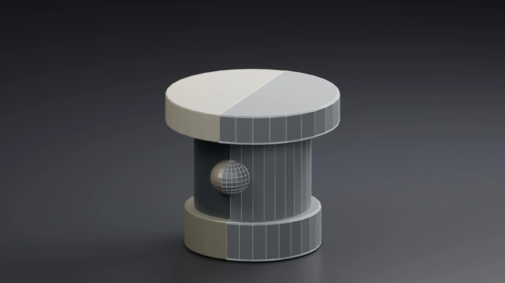

---

group: "woocommerce-3d-models"
title: "Cómo añadir un visor 3D a WooCommerce"
description: "Configura una ficha WooCommerce con un GLB, una foto alternativa y una comprobación en móvil."
date: 2026-11-29
updated: 2026-11-29
keyword: "visor 3d woocommerce"
cta: "Prueba la vista previa de ángulos con una foto de producto."
---

Añade el visor 3D a un único producto de WooCommerce en una tienda de pruebas. Usa una extensión si quieres gestionarlo desde el administrador o integra un visor web si controlas la plantilla. Conserva una foto y comprueba la galería con tu tema y con los dispositivos habituales de tus clientes.

## ¿Cómo eliges la integración?

Confirma que la extensión admite tu archivo y su ubicación en la ficha. Una plantilla propia puede usar un componente como model-viewer con un GLB y un póster alojados. Comprueba que sigues pudiendo seleccionar variante y añadir al carrito.

## ¿Qué pruebas en la primera ficha?

Sube un modelo ligero. Abre la ficha en incógnito, revisa el póster, gira el modelo y añade la variante correcta al carrito. Prueba desde un móvil con conexión lenta para verificar que la foto y los datos siguen disponibles.

## ¿Qué deberías revisar antes de publicar?

| Problema                  | Revisión                            |
| ------------------------- | ----------------------------------- |
| El modelo devuelve 403    | URL pública o permisos              |
| Desaparece la galería     | Ubicación de la extensión y tema    |
| La página salta al cargar | Proporción fija para póster y visor |

<!-- IMAGE PENDING: Fotografiar o capturar el ejemplo descrito en el brief. -->

**Fuente** [WooCommerce · Arty 3D Viewer](https://woocommerce.com/document/arty-3dmodelviewer/), [WooCommerce · adding products](https://woocommerce.com/document/managing-products/add-product/), [model-viewer · documentation](https://modelviewer.dev/docs/).

[Guía relacionada](/es/guias/modelos-3d-para-ecommerce)

[Cómo crear un modelo 3D](/es/guias/como-hacer-un-modelo-3d)

## Preguntas frecuentes

### ¿Necesito un plugin?

Una extensión permite gestionar el visor desde el administrador de WooCommerce. Si controlas la plantilla y el alojamiento, también puedes integrar un visor web. En ambos casos, abre la ficha en móvil y comprueba que puedes elegir una variante y usar el carrito.

### ¿GLB sirve para todos los modos de RA?

GLB no es compatible con todos los modos de realidad aumentada. Sube un modelo ligero y abre la ficha en incógnito para probar el visor. Comunica que el modelo no muestra en RA por falta de soporte en la extensión.

### ¿Dónde debo colocar el 3D?

Coloca el visor 3D junto a las fotos en la página de producto. En pantallas estrechas, muestra la imagen principal y el botón de compra, y deja el giro como acción opcional. Verifica que el visor se cargue correctamente en los navegadores y dispositivos que vayas a soportar.
