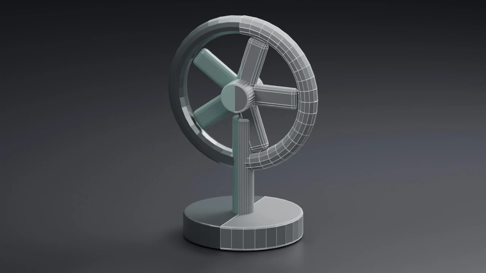

---

group: "sketchfab"
title: "Alternatives à Sketchfab pour publier des modèles 3D"
description: "Choisissez une page de modèle hébergée ou un lecteur GLB auto-hébergé en fonction de l'accès, de l'intégration et du maintien."
date: 2026-12-06
updated: 2026-12-06
keyword: "alternatives à Sketchfab"
cta: "Vérifiez les angles de votre produit dans l’aperçu gratuit."
publishAt: "2026-12-06"
---

Utilisez p3d.in pour un partage simple avec accès anonyme. Insérez le code embed de Vectary dans votre page pour contrôler les paramètres de partage. Les utilisateurs peuvent ne pas voir le modèle si l’embed n’est pas testé dans un navigateur privé.

## Quelle option convient à chaque tâche de publication ?

| Tâche                                                   | Point de départ | Vérification                                    |
| ------------------------------------------------------- | --------------- | ----------------------------------------------- |
| Partagez une page de modèle hébergée                    | p3d.in          | Accès anonyme et paramètres de permissions      |
| Présentez une scène avec ses propres options de partage | Vectary         | Accès, paramètres d’embed et limites            |
| Propriété de la page et hébergement du fichier          | model-viewer    | Hébergement des assets, fallback et maintenance |

## Comment les comparer sur le même modèle ?

Chargez un seul GLB avec une texture connue et ouvrez chaque lien dans un navigateur non connecté. Vérifiez la rotation, la performance sur mobile et l’accessibilité de l’original. Testez l’embed dans un brouillon de la page cible, y compris les paramètres de consentement de vos visiteurs.

## Qu’est-ce qu’il faut vérifier avant de publier ?

| Question                                             | Tester                                                                                |
| ---------------------------------------------------- | ------------------------------------------------------------------------------------- |
| Peuvent les revus l’ouvrir ?                         | Navigateur privé et un appareil secondaire                                            |
| Peut le lecteur s’afficher sur une page de produit ? | Intégration directe dans une page de brouillon                                        |
| Pouvez-vous vous déplacer plus tard ?                | Conservez la source locale et prévoyez des options de téléchargement ou d'exportation |

<!-- IMAGE PENDING: Photograph or capture the example described in the brief. -->

**Source** [Sketchfab · viewer API](https://sketchfab.com/developers/viewer), [Vectary · sharing](https://help.vectary.com/documentation/sharing-exporting-embedding/sharing), [p3d.in · account FAQ](https://p3d.in/faq/account), [model-viewer · documentation](https://modelviewer.dev/docs/).

[Bibliothèque de modèles (EN)](/models)

[Comment créer un modèle 3D](/learn/how-to-make-a-3d-model)

## Questions fréquentes

### Quand un lecteur intégré devient trop lourd ?

Utilisez un lecteur intégré uniquement lorsque les utilisateurs doivent tourner ou examiner le modèle 3D dans un contexte. Vérifiez si votre public a besoin d'interactions au-delà de la simple visualisation, et assurez-vous que l'intégration conserve une performance cohérente. Étape suivante : testez l'intégration auprès d'un petit groupe d'utilisateurs avant le déploiement général.

### Peux-je utiliser le même GLB partout ?

Vous pouvez utiliser le même GLB partout, à condition que la destination le supporte et que le fichier reste en dessous des limites de taille. Vérifiez avant de publier les gestion des textures et les plages de taille des fichiers sur chaque plateforme. Testez avec un seul GLB dans votre essai pour confirmer la compatibilité.

### Comment décider entre un modèle hébergé et un modèle auto-hébergé ?

Comparez qui gère le lecteur, l'URL de l'asset et les droits d'accès. Testez la gestion d'une charge échouée 3D qui redirige vers l'image de fond. Testez l’intégration avec un seul GLB sur la page cible avant de la déployer au public.
