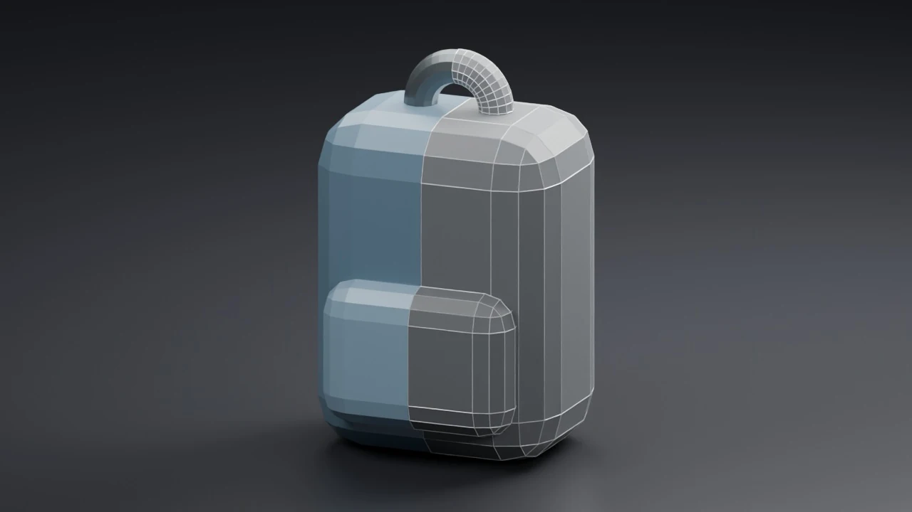

---

group: "product-photography-angles"
title: "Quels angles choisir pour vos photos produit ?"
description: "Choisissez une vue principale et des vues secondaires qui répondent aux questions sur l'ajustement, la construction et l'utilisation."
date: 2026-11-21
updated: 2026-11-21
keyword: "angles photo produit"
cta: "Vérifiez les angles de votre produit dans l’aperçu gratuit."
---

Choisissez chaque photo de produit pour répondre à une question. Commencez par un point de vue qui explique la forme, puis ajoutez les angles qui montrent comment le produit s'assemble ou fonctionne. Un plan derrière, un zoom ou une image avec le produit ouvert répond souvent mieux qu'un angle frontal presque identique.

## Quel angle doit venir en premier ?

Commencez par trois quarts pour un objet dont la profondeur compte, comme un sac ou une chaise. Utilisez le plan frontal lorsque le visage, la forme ou l’information imprimée identifie le produit le plus rapidement. Vérifiez le crop à l’échelle du miniature.

Laissez de la marge autour du produit pour le crop du site. Gardez le point de vue principal et le cadre cohérents entre les variants, et ajoutez des images détaillées lorsque les matériaux ou les composants varient.

## Quels espaces doivent être comblés par les prochaines photos ?

Écrivez trois questions que le client pourrait se poser sans tenir l’objet. Donnez un point de vue à chacune. Pour un sac, montrez l’arrière, l’ouverture et l’attache du tissu. Pour une chaussure, ajoutez la semelle. Pour meubles, montrez l’arrière ou le dessous si la construction en compte.

Placer les réponses dans l’ordre d’importance. Un zoom est plus utile lorsque le plan général indique où se situe le détail.

## Qu’est-ce que vous devez vérifier avant de publier ?

| Vue                      | Question qu’elle répond                                      |
| ------------------------ | ------------------------------------------------------------ |
| Front ou trois-quarts    | Quel est cet objet et quelle est sa forme ?                  |
| Arrière, côté ou dessous | Comment est construit la partie que je ne peux pas voir ?    |
| Ouverte ou en usage      | Que peux-je faire avec ça ?                                  |
| Détail                   | Quel aspect le matériau ou le mécanisme présente en détail ? |

<!-- IMAGE PENDING: Photograph or capture the example described in the brief. -->

**Source** [Shopify · photographie produit](https://help.shopify.com/en/manual/products/product-media/product-photography), [Google Merchant Center · lien image](https://support.google.com/merchants/answer/6324350), [GS1 · spécification image produit](https://www.gs1.org/standards/gs1-product-image-specification-standard/current-standard).

[Guide complémentaire](/fr/guides/photographie-produit-e-commerce)

[Comment créer un modèle 3D](/learn/how-to-make-a-3d-model)

## Questions fréquentes

### Combien de photos dois-je utiliser ?

Utilisez au moins trois photos : vue principale, côté et détail. Ajoutez une image de l’arrière pour un sac ou d’une semelle pour une chaussure. Vérifiez que le crop respecte la marge et que les angles répondent aux questions du client.

### Quand une vue frontale droite est-elle préférable ?

Utilisez une vue frontale droite lorsque cela permet de comparer des contours, des visages ou des coloris. Un coffret peu profond avec une étiquette lisible peut bénéficier davantage d'une vue frontale claire plutôt qu'une angle dramatique. Pour un sac, ajoutez l’image de l’arrière pour montrer la construction et les détails de l’attache.

### Peut un modèle 3D remplacer la photo d'arrière ?

Un modèle 3D ne peut pas remplacer la photo d'arrière s'il contient des caractéristiques que l'acheteur doit vérifier. Utilisez les deux lorsque la photo réelle confirme des détails et que le modèle apporte du contexte. Vérifiez que la photo d'arrière montre clairement toutes les fonctionnalités clés et est prise sous une lumière cohérente.
