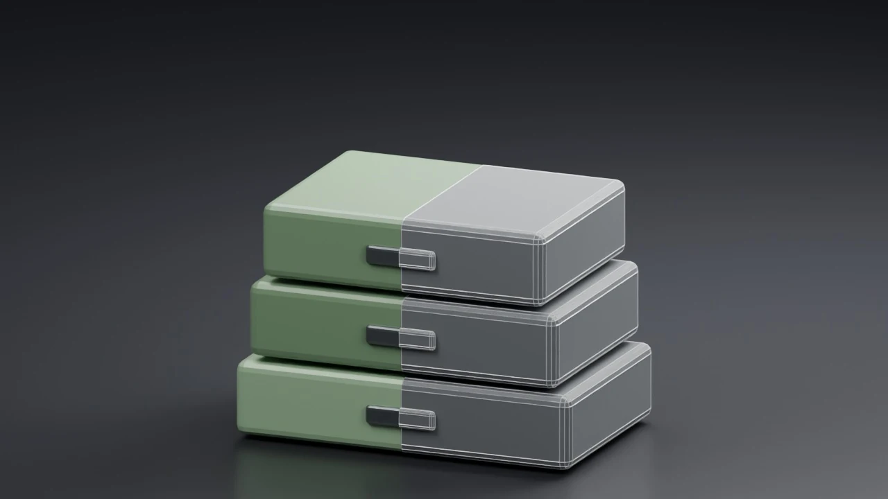
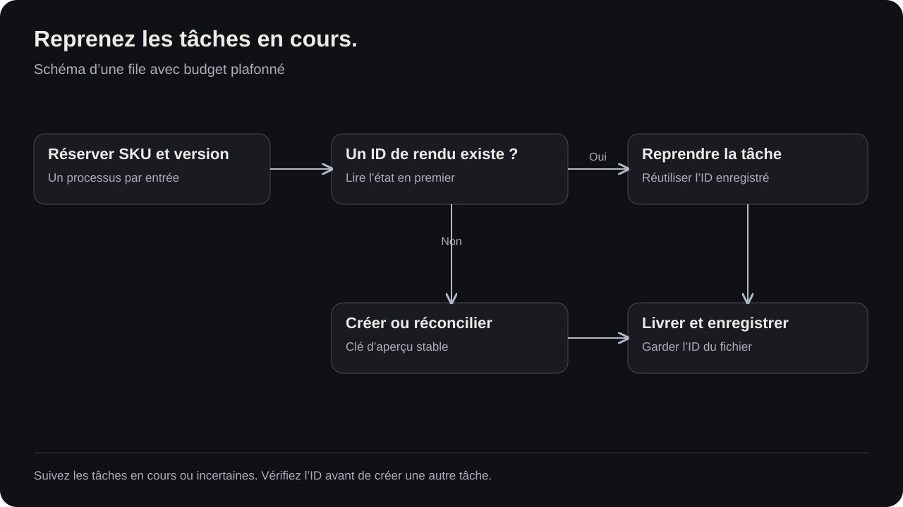

---

group: "n8n-batch-3d-catalog"
title: "Automatiser un catalogue de modèles 3D avec n8n"
description: "Transformez les lignes du catalogue en modèles 3D revus avec n8n. Suivez les versions SKU, reprenez les tâches, contrôlez les dépenses et livrez les…"
date: 2026-12-09
updated: 2026-12-09
keyword: "automatiser un catalogue produit n8n"
cta: "Vérifiez les angles de votre produit dans l’aperçu gratuit."
---

Pour automatiser un catalogue 3D avec n8n, attribuez un état à chaque produit et conservez le SKU, la version de la photo, la clé de création, l’identifiant et la validation. Reprenez les tâches en cours, limitez leur nombre et associez chaque modèle vérifié à la bonne fiche.

> **Un résultat vide ne signifie pas que rien n'a commencé.** La tâche peut toujours être en cours, en attente de revue ou manquer sa dernière réponse. Recouvrez cet état avant de faire une nouvelle demande payante.

## Utilisez-vous une boucle de feuille ou l'endpoint catalogue ?

Utilisez le traitement par produit lorsqu'un aperçu individuel est nécessaire. Utilisez l'API catalogue lorsque l'owner a validé un batch défini, son budget total et les conditions de partage pour les médias de boutique. Ces choix créent des frontières différentes en matière de revue et de confidentialité.

| Route                          | Choisissez-la lorsque                                           | Approbation de conservation                                   |
| ------------------------------ | --------------------------------------------------------------- | ------------------------------------------------------------- |
| Aperçu et construction par SKU | Une personne revient sur chaque produit en premier              | Révision de source, ID de rendu et plafond de construction    |
| Soumission via l'API catalogue | Un batch défini peut s'exécuter après une approbation préalable | Liste exacte des articles, boutique, plafond total et partage |
| Livraison de modèles existants | Les modèles existent déjà et n'ont qu'à être transférés         | Décision de destination et de publication                     |

Le [guide n8n pour produit unique](/fr/guides/image-vers-3d-n8n) est le point de départ pour la première route. Le [contrat de l'API catalogue](https://github.com/easyrenderai/easyrender.ai/blob/main/docs/api.md) décrit la seconde. Ne appelez pas l'endpoint de batch et attendez qu'il s'arrête au même point de revue manuel.

## Quels éléments doit contenir chaque ligne de source ?

Pour une série de vases en céramique, gardez l'identité du produit séparée de l'état de l'automatisation. Une nouvelle photo d'un vase existant correspond à une nouvelle révision de source, sans que cela implique nécessairement un nouveau produit. Conservez l'ID de rendu ancien jusqu'à ce que vous décidez de remplacer média approuvé.

| Champ                  | Rôle                             | Exemple ou règle                                       |
| ---------------------- | -------------------------------- | ------------------------------------------------------ |
| `sku`                  | Identité du produit              | `VASE-ROUND-01`                                        |
| `source_version`       | Entrée exacte attendue           | `photo-v3`                                             |
| `image_url`            | Source stable                    | Image publique via HTTPS, lorsqu'un URL est fourni     |
| `creation_key`         | Identité de prévisualisation     | Stable par SKU et révision de source                   |
| `render_id`            | Tâche de service                 | Persiste immédiatement après création                  |
| `workflow_state`       | Votre état de file d'attente     | Nouveau, en attente de revue, soumis, incertain, livré |
| `approved_credits`     | Plafond de construction autorisé | Entier non négatif vérifié                             |
| `destination_media_id` | Rétablissement de livraison      | Enregistré après que le magasin ait accepté le fichier |

Ces champs de file appartiennent à votre système. Ils ne sont pas des champs supplémentaires à envoyer à `/api/renders`. Conservez l'état du service séparément, car `preview_ready` et l'état de votre entreprise « rejeté » décrivent des choses différentes.

## Comment traitez-vous les lignes sans déclencher des doublons ?

1. Sélectionnez les enregistrements sources éligibles, puis réservez un SKU/révision avant de créer la tâche. Une règle de unicité dans une base de données est préférable lorsque plusieurs workers peuvent s'exécuter . Une simple cellule de statut dans un tableau n'est pas un verrou atomique.
2. Si `render_id` existe, lisez le rendu correspondant et reprenez à partir de son état. Ne le recréez pas car `destination_media_id` est vide.
3. Si aucun ID n'existe mais que la création a été tentée, réessayez la création de prévisualisation avec le même `Idempotency-Key` enregistré et les entrées inchangées. Enregistrez l'ID retourné avant de continuer.
4. Attendez la prévisualisation et enregistrez la décision de revue. Seulement le branchement approuvé peut démarrer la création payante, en utilisant son `maxCredits` autorisé.
5. Poller la même tâche jusqu'à son achèvement, à l'échec ou à l'expiration du délai. Un délai permet de sauvegarder l'enregistrement pour la réconciliation . Il ne crée pas automatiquement une nouvelle tentative.
6. Téléchargez et livrez le modèle. Enregistrez l'identifiant média de destination avant de marquer la ligne source comme livrée.

Pour la première déploiement, utilisez un seul worker et traitez un élément à la fois. Le [Loop Over Items](https://docs.n8n.io/integrations/builtin/core-nodes/n8n-nodes-base.splitinbatches/) de n8n permet un batch explicite. Gardez les plans de traitement sans chevauchement, puis augmentez la concurrence uniquement après avoir mesuré les limites du service et votre propre comportement de récupération.

## Comment devez-vous contrôler les dépenses dans le batch ?

Un plafond d'appel approuvé ne par lui-même impose un budget total sur plusieurs workers. Gardez une réservation atomique pour chaque opération payante en cours, et incluez les soumissions non résolues dans le montant déjà engagé. Sinon, deux workers pourraient voir le même allouage restant.

| Composante de budget | Comptez-la quand                       | Libérez ou réconciliez-la quand                            |
| -------------------- | -------------------------------------- | ---------------------------------------------------------- |
| Total approuvé       | L'owner approuve le batch              | La portée ou le budget est explicitement modifié           |
| Crédits réservés     | Un worker prétend à une action payante | L'issue définitive est réconciliée                         |
| Dépense confirmée    | Le service enregistre le débit         | Un remboursement vérifié est enregistré séparément         |
| Résultat inconnu     | La réponse est perdue après soumission | Un travail existant ou des preuves de support le résolvent |

Lisez la quote en direct et le solde restant de la génération avant de construire. Arrêtez-vous en cas de fonds insuffisants ou de dépassement du seuil clé. Un remboursement de wallet et la limite brute de débit de la clé ont des comportements différents . Ne réinitialisez pas vos hypothèses sur le budget clé simplement parce que le solde a augmenté.

Utilisez [la guidance sur les limites de vitesse de n8n](https://docs.n8n.io/integrations/builtin/handle-rate-limits.md) pour régler des lectures sûres. Pour un 429,, respectez la valeur `Retry-After` du réponse. Pour une mutation payante timeout, réconciliez la ressource avant de réessayer . Un backoff seul ne rend pas une soumission dupliquée sûre.

## Quels sont les changements lors de l'utilisation de l'API catalogue ?

Demandez `GET /api/catalog/quote?items=N` pour le nombre exact d'éléments proposés. Affichez à l'utilisateur la liste des éléments, la quote, le magasin de destination et les implications de partage. La soumission nécessite `write`, `spend` et `share`, plutôt que seulement les scopes lecture/écriture utilisés pour le travail de prévisualisation.

| Champ de soumission | Valeur requise                                         |
| ------------------- | ------------------------------------------------------ |
| `platform`          | `shopify`, `woocommerce`, `prestashop` ou `other`      |
| `store`             | Identifiant stable pour le magasin de destination      |
| `maxCredits`        | Plafond total autorisé pour cette soumission           |
| `items`             | Au plus 100 éléments par requête dans le schéma actuel |
| Chaque élément      | `externalId`, `title`, `imageUrl` . Optionnel `note`   |

Soumettez une fois à `POST /api/catalog`, puis utilisez `GET /api/catalog?platform=...&store=...` pour inspecter et avancer la file d'attente déjà autorisée. Gérez explicitement `needs_credits`, `needs_info` et `failed`. Garantissez que les valeurs de plateforme et de magasin restent identiques lors du récupération du même lot.

La soumission du catalogue partage les liens des modèles pour l'usage du magasin. Choisissez le mode par produit si ce n'est pas autorisé. Distinction aussi entre la génération des modèles du catalogue et l'écriture des pages produits dans un CMS du vendeur : le connecteur magasin a toujours besoin d'une étape de livraison testée.

<!-- IMAGE PENDING: unique real screenshot of catalog rows with saved job IDs and a recovered execution. Use synthetic SKUs and no customer data. -->

## Comment savez-vous qu'un produit a été livré correctement ?

Il faut que la révision source, l'ID de rendu, l'ID de produit de destination et l'ID de média soient en accord. Téléchargez le GLB privé avec les credentials de l'API, puis le téléchargez via le flux supporté par le magasin. La disponibilité d'un modèle dans le générateur n'est pas la même que sa disponibilité sur la page produit.

Pour Shopify, suivez la [documentation sur le traitement et l'attache des médias](https://shopify.dev/docs/apps/build/product-merchandising/products-and-collections/manage-media). Vérifiez le point de vente après traitement. Si seulement la livraison échoue, réessayez cette étape avec le fichier existant au lieu de générer un nouveau modèle.

Le GLB livré doit s'ouvrir dans un lecteur compatible ; [Khronos décrit le format](https://www.khronos.org/gltf/). Enregistrez la taille du fichier et l'état de destination pour vos sorties acceptées. Ne déduisez pas un avantage en vitesse ou en conversion à partir du nombre de tâches complétées.

## Quels échecs de batch nécessitent un chemin de récupération spécifique ?

| Symptôme                                                 | Cause probable                                                      | Solution                                                     |
| -------------------------------------------------------- | ------------------------------------------------------------------- | ------------------------------------------------------------ |
| Le même SKU est exécuté deux fois                        | Programmatiques superposés ou absence de revendication              | Sérialisez le travail ou utilisez une revendication atomique |
| Le prévisualisation existante est remplacée              | Une cellule vide finale est utilisée comme règle unique de validité | Vérifiez d'abord l'ID enregistré et l'état du workflow       |
| Le bon produit est mis à jour                            | L'ordre des lignes a changé                                         | Utilisez des identifiants externes stables                   |
| Le montant total dépensé dépasse l'attente               | Les réservations simultanées sont ignorées                          | Suivez les dépenses engagées et inconnues ensemble           |
| Chaque tick réessaie une erreur                          | L'état actionnable est traité comme transitoire                     | Arrêtez et résolvez les crédits, l'entrée ou les permissions |
| Modèle prêt mais page vide                               | Échec du traitement ou de la livraison du média                     | Rétablir l'upload/le fichier joint, conserver le rendu       |
| Une nouvelle source réutilise une approbation antérieure | La révision n'est pas partie de la décision                         | Une approbation est requise pour la version source actuelle  |

## Quel doit être le contenu du premier test d'acceptation ?

Utilisez un petit échantillon : un produit valide, une image intentionnellement invalide et un enregistrement avec un ID de rendu existant. Vérifiez que la ligne invalide s'arrête, que la tâche existante est reprise et que le record valide passe en revue. Cela teste le comportement de la file d'attente avant d'autoriser un batch payant.

Ensuite, simulez une réponse de création perdue et une interruption de livraison avec des fixtures. Ensuite, effectuez un run complet autorisé avant d'activer un planification sans surveillance. Le schéma public et le contrat de repository ont été vérifiés pour ce guide . Aucun résultat de batch en direct ni économie de coûts n'est affirmé.

Mesurez le nombre de modèles revus livrés par SKU/révision unique, les interventions manuelles, les tâches non résolues et les crédits nets par modèle accepté. Pour le workflow des actifs, utilisez [comment créer un modèle 3D](/learn/how-to-make-a-3d-model) et le [guide du package produit-page](/fr/guides/fiche-produit-n8n).

## Questions fréquentes

### Un champ de lien modèle vide est-il suffisant pour sélectionner du travail ?

Un champ de lien modèle vide n’est pas suffisant pour valider le travail. Insérez l’ID de tâche et l’état du workflow avant de lancer une nouvelle requête. Un résultat vide peut signifier une tâche en cours ou en attente, pas une fin de traitement.

### Puis-je traiter l'ensemble du catalogue en parallèle ?

Oui, vous pouvez traiter l’ensemble du catalogue en parallèle. Utilisez l’API catalogue avec un batch validé et un budget total défini. Vérifiez qu’aucune tâche n’est en attente ou sans réponse, car un résultat vide ne signifie pas qu’aucune opération n’a commencé.

### L'API du catalogue nécessite-t-il un partage public ?

Elle nécessite l'ensemble du champ de partage car le workflow du catalogue rend les liens de modèles accessibles à l'usage du magasin. Cela demande une autorisation explicite, ainsi que la liste des articles et un plafond de dépenses. Utilisez des aperçus privés par produit lorsque vous souhaitez une revue individuelle avant de décider quels actifs peuvent être construits, livrés ou partagés.

### Dois-je régénérer un modèle après un échec de téléversement dans le magasin ?

En général, la étape de génération est déjà terminée. Conservez l'ID de rendu et récupérez la téléchargement ou l'envoi vers la destination. Enregistrez l'identifiant média retourné par le magasin ainsi que l'état de traitement afin de distinguer un transfert échoué, un attachment en attente ou un modèle manquant, sans payer une nouvelle génération inutilement.
