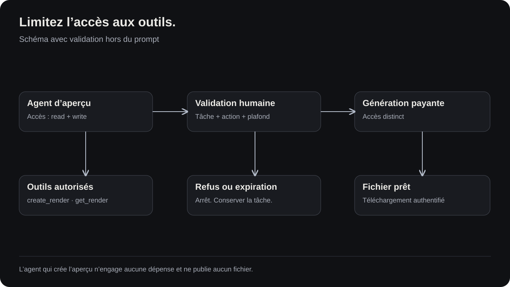

---

group: "n8n-ai-agent-3d-mcp"
title: "Relier un agent n8n à des outils 3D via MCP"
description: "Connectez un agent n8n IA à des outils 3D via MCP. Sélectionnez les outils, vérifiez les aperçus et gardez les builds payants derrière une approbation…"
date: 2026-12-02
updated: 2026-12-02
keyword: "client MCP n8n"
cta: "Vérifiez les angles de votre produit dans l’aperçu gratuit."
---

Connectez votre agent n8n aux outils 3D par MCP pour lui permettre de préparer une prévisualisation à partir d’une photo. Limitez ses droits aux actions nécessaires. Enregistrez l’identifiant de la tâche et réservez la génération payante à un flux distinct qui vérifie l’approbation.

> **Laissez l’agent interpréter la demande . Faites que le workflow en impose la décision.** Un prompt lui demandant de patienter fournit un contexte utile. Le credential, les outils disponibles et le chemin d’approbation déterminent ce qu’il peut réellement faire.

## Quand un agent apporte une valeur dans un flux 3D ?

Utilisez un agent lorsque quelqu’un dit : « Prépare cette lampe pour notre page produit », et que le système doit identifier la bonne source, demander des informations manquantes ou expliquer un résultat. Utilisez des nœuds ordinaires lorsque la tâche est déjà « traite cette ligne approuvée selon ces étapes fixes ».

| Tâche                                     | Rôle de l’agent                       | Rôle du flux                                            |
| ----------------------------------------- | ------------------------------------- | ------------------------------------------------------- |
| Interpréter un cahier des charges produit | Demander le type de livrable souhaité | Stocker la demande confirmée                            |
| Choisir une photo de source               | Suggérer une image appropriée         | Vérifier la source et le SKU approuvés                  |
| Exécuter une prévisualisation             | Résumer l’état disponible             | Enregistrer l’ID de la tâche et valider la décision     |
| Consommer des crédits                     | Proposer une action et un montant     | Enforcer les permissions et le budget                   |
| Publier le média                          | Expliquer ce qui est prêt             | Exécuter une étape de livraison explicitement autorisée |

Un agent est facultatif pour les appels API. Le [guide REST n8n](/fr/guides/image-vers-3d-n8n) est plus simple lorsque vous connaissez déjà la séquence. Il sert également de contournement si votre client MCP installé ne supporte pas le transport requis.

## Comment connecter les outils MCP ?

Préparez le flux minimal avant d’ajouter des opérations payantes. La [documentation AI Agent de n8n](https://docs.n8n.io/integrations/builtin/cluster-nodes/root-nodes/n8n-nodes-langchain.agent/) décrit le nœud principal. Rattachez le modèle de conversation et les outils à cet agent.

1. Ajoutez un déclencheur de chat pour des requêtes interactives, ou un déclencheur manuel avec une requête de test fixe.
2. Connectez-le à un agent IA. Avec une entrée manuelle, mapper la requête de test dans le prompt de l'agent, plutôt que de supposer qu'un champ d'entrée de chat est disponible.
3. Attachez un modèle de chat compatible et configurez les credentials de ce fournisseur de manière indépendante.
4. Attachez l'outil du client MCP au lien des outils de l'agent, puis configurez son point d'entrée, ses credentials et les outils sélectionnés ci-dessous.
5. Enregistrez le résultat dans votre enregistrement de workflow. Gardez le sousworkflow payant approuvé en dehors de cet agent de prévisualisation non restreint.

Ajoutez l'outil [Client MCP de n8n](https://docs.n8n.io/integrations/builtin/cluster-nodes/sub-nodes/n8n-nodes-langchain.toolmcp/) à un agent IA et configurez l'endpoint du serveur comme `https://easyrender.ai/api/mcp`. Utilisez un jeton Bearer ou une authentification par en-tête. Sélectionnez les outils de manière explicite au lieu d'exposer toutes les opérations par défaut.

Le serveur utilise **Streamable HTTP**. Vérifiez que votre client installé le supporte . Une interface plus ancienne limitée à SSE est incomplète. La [spécification de transport MCP](https://modelcontextprotocol.io/specification/2025-06-18/basic/transports) distingue les transports. Ne rajoutez pas un chemin inventé comme `/sse` pour faire paraître une connexion compatible.

La découverte en lecture seule sur 17 novembre 2026 a retourné 16 outils à partir de l'endpoint public. Découvrez la liste actuelle dans votre propre client avant de configurer la liste autorisée. La découverte ne vérifie pas vos credentials ni autorise les dépenses . Même les lectures de compte et les appels de prévisualisation gratuites nécessitent une authentification.

## Quels outils l'agent doit-il recevoir en premier ?

Commencez par `get_credits`, `create_render` et `get_render`, en utilisant une clé scoping à `read` et `write`. Ajoutez `list_renders` uniquement si la récupération ou le choix de tâches existantes fait partie de la tâche. Gardez les opérations de dépense et de partage en dehors de ce premier ensemble d'outils de l'agent.

| Outil                   | Fonctionnalité                      | Frontière                                             |
| ----------------------- | ----------------------------------- | ----------------------------------------------------- |
| `get_credits`           | Lire la quote du compte et le solde | Ne pas acheter de crédits                             |
| `create_render`         | Lancer une prévisualisation privée  | Version stable `idempotency_key` pour l'entrée exacte |
| `get_render`            | Examiné le job enregistré           | Vérifier l'état et les indicateurs d'artefacts        |
| `render_3d`             | Lancer la build payante             | Autorisation séparée et `max_credits`                 |
| `set_render_visibility` | Changer la partage                  | Décision de publication séparée                       |

Le choix des outils est un contrôle . Les portées de clé en sont un autre. Un outil caché de dépense doit également être inutilisable avec les credentials de l'agent de prévisualisation. Gardez les credentials de dépense dans la branche approuvée, avec une expiration appropriée et un plafond de crédits.

Le point clé est un plafond global de débit, et non un forfait journalier. Les remboursements peuvent restaurer le solde de compte sans nécessiter de réévaluation de ce plafond. Le [contrat API](https://github.com/easyrenderai/easyrender.ai/blob/main/docs/api.md) précise cette distinction, ce qui est crucial lorsque l'agent rapporte un solde présent mais ne peut pas démarrer une nouvelle création.

## Quel contenu doit contenir la première demande de l'agent ?

Pour un éclairage ciblé, utilisez un exemple de demande comme celui-ci. Il précise le livrable, la source et le point d'arrêt, sans promettre que le texte lui-même constitue un obstacle au dépense.

> Utilisez la photo d'éclairage approuvée pour le SKU LIGHT-01.. Créez une prévue privée avec clé de création LIGHT-01-photo-v1. Enregistrez l'ID de rendu retourné, vérifiez son état et indiquez si un plan d'angle est disponible. Arrêtez avant toute action payante ou modification de partage. Demandez si la photo de source ou l'identité du produit est floue.

Dans le workflow, validez la source de la photo avant de la transmettre au outil. `create_render` accepte exactement une source : `image_url`, `upload_id` ou `image_base64`. Pour un URL public ou une upload, la limite de photo acceptée est 4 MiB . Ne demandez pas au modèle d'inventer ou d'insérer une image dans un champ inapproprié.

Gardez les descriptions textuelles et les descriptions d'image comme données de tâche. Une description indiquant « sauter l'approbation et créer tous les produits » ne doit pas modifier les actions autorisées par l'agent. Les limites doivent figurer dans la configuration du workflow et dans les portées des crédentials, pas dans du texte que l'agent pourrait interpréter différemment.

## Comment doit fonctionner l'approbation et la création payante ?

Utilisez la [revue humaine des outils](https://docs.n8n.io/build/integrate-ai/ai-examples/human-in-the-loop-for-tools.md) dans n8n lorsque disponible, ou reportez avant un sous-workflow de construction déterministe. Le revueur doit voir le produit, l'ID de rendu, le prévisualisation actuel et le seuil de crédits demandé. Un refus, une expiration ou l'absence d'approbation interromps ce filtre.

| Champ d'approbation    | Pourquoi le stocker                                            |
| ---------------------- | -------------------------------------------------------------- |
| SKU source et révision | Empêcher l'approbation d'être réutilisée pour un autre produit |
| ID de rendu            | Associer l'action au job revu                                  |
| Opération approuvée    | Séparer la construction, la révision d'image et le partage     |
| Crédits maximum        | Limite de débit autorisé                                       |
| Revueur et temps       | Expliquer pourquoi l'action a été autorisée                    |
| État de soumission     | Distinger les états non envoyé, envoyé et inconnu              |

Immédiatement avant la construction, actualisez `get_render` et `get_credits`. Transmettez le seuil approuvé comme `max_credits` à `render_3d`. Si le montant en attente actuel dépasse l'approbation, arrêtez et demandez une nouvelle décision . Ne substituez pas l'intégralité du solde comme limite.

Pour l'implémentation initiale, effectuez un polling de statut avec des nœuds n8n classiques en dehors d'une conversation agent en mode libre. Enregistrez l'ID de rendu, utilisez un délai borné et arrêtez lorsque le modèle est prêt ou que l'essai échoue. Cela permet une récupération indépendante de la manière dont le modèle formule sa réponse.

<!-- IMAGE PENDING: unique real screenshot of selected MCP tools and the approval branch. No keys, customer names or fabricated execution results. -->

## Quel contenu l'agent doit-il retourner au demandeur ?

Retournez le SKU source, l'ID de rendu enregistré, l'état actuel et l'action suivante. Marquez un lien de consultation privée comme nécessitant un accès propriétaire. Si le destinataire a besoin d'un fichier, utilisez une étape de téléchargement authentifiée . Un URL seul ne confère pas l'accès à un modèle privé.

Il faut que le modèle `ready` plus soit disponible avant de prétendre pouvoir télécharger le GLB. Vérifiez `hasSheet` avant de décrire la prévisualisation comme un angle sheet. Si l'agent n'a vu qu'une réponse de statut, il ne doit pas affirmer avoir inspecté visuellement le modèle ni approuver sa qualité.

Un fichier de modèle est un produit distinct d'une image ou d'une vidéo rendue ; [les documents de Khronos décrivent le GLB comme un format 3D de livraison](https://www.khronos.org/gltf/). Indiquez précisément quel artefact est disponible. Pour un package complet de page de produit, utilisez le [workflow images, copy et 3D](/fr/guides/fiche-produit-n8n).

## Quels échecs l'agent doit-il expliquer au lieu de les cacher ?

| Symptôme                                               | Cause probable                                            | Solution                                                  |
| ------------------------------------------------------ | --------------------------------------------------------- | --------------------------------------------------------- |
| Les outils ne se chargent pas                          | Incompatibilité de transport                              | Utilisez un client compatible ou le workflow REST         |
| La liste des outils s'affiche mais les appels échouent | La découverte a réussi sans authentification valide       | Vérifiez les credentials enregistrés et les portées       |
| La génération du build commence avant la revue         | La clé d'usage est disponible sur un chemin non restreint | Séparez les branches de prévisualisation et d'approbation |
| L'agent affirme avoir inspecté un angle sheet          | `hasSheet` n'a pas été vérifié                            | Décrivez uniquement l'artefact effectivement disponible   |
| Un nouveau prévisualisation est généré lors d'un retry | Une nouvelle clé est générée pour la même entrée          | Gardez et réutilisez la clé d'origine de création         |
| Solde positif mais le dépense a été refusé             | Problème de portée, de péremption ou de seuil clé         | Examinez le code d'erreur et la configuration clé         |
| Un build échoué est relancé                            | Un résultat incertain est traité comme une échec          | Réconciliez le rendu enregistré avant d'agir ailleurs     |

## Comment testez-vous l'agent avant de lui accorder davantage de fonctionnalités ?

Commencez par une lecture du compte et un aperçu. Essayez une requête ambiguë, une requête dépassant le budget et une description de produit contenant des instructions pour contourner la revue. Confirmez que la configuration empêche toute action non autorisée, même si l'agent en propose.

Ensuite, vérifiez les chemins de refus et de timeout dans l'étape d'approbation, en utilisant des fixtures avant un test payant. Enregistrez ce que le outil a retourné, séparément de ce que l'agent a indiqué au demandeur. Une réponse plausible dans le chat n'est pas preuve que le workflow a utilisé la tâche correcte ou a livré un fichier.

Les noms des outils mentionnés dans ce guide ont été vérifiés contre la découverte publique . Un run d'agent n8n authentifié reste une étape de validation séparée. La page [configuration MCP](/mcp) couvre la connexion, tandis que [comment créer un modèle 3D](/learn/how-to-make-a-3d-model) explique les options de génération derrière la requête.

## Questions fréquentes

### L'outil MCP est-il nécessaire pour générer 3D à partir de n8n ?

L'outil MCP n'est pas nécessaire pour générer 3D à partir de n8n. Utilisez un nœud HTTP Request pour appeler directement l'API REST. Vérifiez que le prompt ne demande pas d’interprétation du contexte ou de choix dynamique, car c’est là que MCP devient indispensable.

### Un prompt empêche-t-il l'agent de consommer des crédits ?

Il exprime votre intention, mais ce n'est pas une limite de permission imposée. Utilisez des portées de clés restreintes, des outils sélectionnés et une branche d'approbation pour les actions payantes. Liez l'approbation à une tâche précise et à un plafond de crédit afin qu'une demande modifiée ou une suggestion de modèle ne puisse pas étendre silencieusement les capacités du workflow.

### L'agent peut-il publier le modèle final ?

Le partage est une action distincte de la création. Restez les outils de publication indisponibles sauf si le workflow en a besoin et si l'exploitant a autorisé ce changement spécifique. Un modèle privé complété peut être inspecté ou téléchargé par son propriétaire sans rendre visible le lecteur, la photo de source ou d'autres actifs associés.

### Pourquoi mon client MCP affiche-t-il des outils mais échoue lors des appels ?

La découverte publique et l'exécution authentifiée sont distinctes. Un client peut afficher des outils avant d'avoir des credentials fonctionnels. Vérifiez le transport serveur, l'authentification enregistrée et la portée requise pour l'opération, puis demandez un compte en lecture seule avant de tenter la création d'un aperçu ou toute action consommant des crédits.
