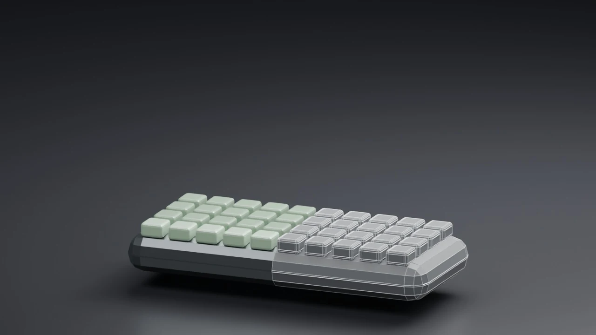

---

group: "compress-glb"
title: "Compresser un GLB en préservant les détails utiles"
description: "Identifiez ce qui rend votre GLB volumineux, réduisez la géométrie ou les textures, puis comparez le résultat dans le même lecteur."
date: 2026-11-28
updated: 2026-11-28
keyword: "compresser GLB"
cta: "Vérifiez les angles de votre produit dans l’aperçu gratuit."
---

Pour compresser un GLB, repérez d’abord ce qui occupe le plus d’espace. Réduisez les textures si les images dominent ou simplifiez le maillage si la géométrie pèse davantage. Comparez les deux fichiers dans le même visualiseur en vérifiant les contours et les détails visibles sur la fiche.

## Quel changement a provoqué la simplification d’un modèle ?

Nous avons importé notre table de café dans Blender 5.2.3 et l’exporté deux fois avec les mêmes paramètres GLB. L’application d’un ratio Decimate de 0.5 a réduit 16,228 triangles à 8,114.. Les deux exports sont passés de 1,687,180 à 863,068 bytes, soit environ 49% de moins.

Ces sont les tailles des deux exports Blender. L’export original du site utilise un encodage préparé séparément, donc il s’agit d’un autre point de départ.

## Comment choisir la prochaine optimisation ?

Pour un modèle avec une géométrie dominante, essayez une modification de géométrie et vérifiez les coins et les intersections. Pour un modèle avec des textures dominantes, essayez une carte plus petite et inspectez les détails fins. Testez les extensions de textures compressées dans le lecteur de destination avant de les intégrer à un catalogue.

## Qu’est-ce qu’il faut vérifier avant de publier ?

| Symptôme                           | Action suivante                                                      |
| ---------------------------------- | -------------------------------------------------------------------- |
| Les étiquettes se floutent         | Restaurer la résolution de la texture avant de modifier la géométrie |
| Les arêtes changent près des pieds | Réduire la puissance du décalage                                     |
| Le nouveau fichier ne s’ouvre pas  | Vérifier les extensions requises et le résultat du validateur        |

<!-- IMAGE PENDING: Photograph or capture the example described in the brief. -->

**Source** [Khronos · spécification glTF 2.0](https://registry.khronos.org/glTF/specs/2.0/glTF-2.0.html), [Khronos · KHR_texture_basisu](https://github.com/KhronosGroup/glTF/tree/main/extensions/2.0/Khronos/KHR_texture_basisu), [Blender · modificateur Decimate](https://docs.blender.org/manual/en/latest/modeling/modifiers/generate/decimate.html), [Khronos · validateur glTF](https://github.com/KhronosGroup/glTF-Validator).

[Guide complémentaire](/fr/guides/fichier-glb)

[Comment créer un modèle 3D](/learn/how-to-make-a-3d-model)

## Questions fréquentes

### Quelle taille doit avoir un GLB ?

Faites le GLB aussi petit que possible sans perdre de détails visibles ou de performance. Testez sur le dispositif et la page réels, en vérifiant le nombre d’octets transférés, le temps de chargement et la clarté des fonctionnalités essentielles. Ensuite, vérifiez la taille du fichier et la performance du lecteur avant déploiement.

### Le nombre de triangles réduit signifie-t-il toujours une réduction des octets ?

Moins de triangles n’implique pas toujours moins d’octets, car les textures, l’encodage des buffers et les attributs influencent la taille du fichier. Optimisez d’abord la géométrie, puis vérifiez la taille du fichier GLB et le nombre de triangles dans un lecteur. Comparez les exports complets avec les mêmes paramètres pour valider l’efficacité de la compression.

### Dois-je surécrire la source ?

Conservez la source ainsi qu’un registre des paramètres d’exportation. Testez un fichier de livraison séparé afin de pouvoir restaurer les détails sans répéter le travail de modélisation initial. Vérifiez que les textures compressées fonctionnent correctement dans le lecteur cible avant de les intégrer au catalogue.
