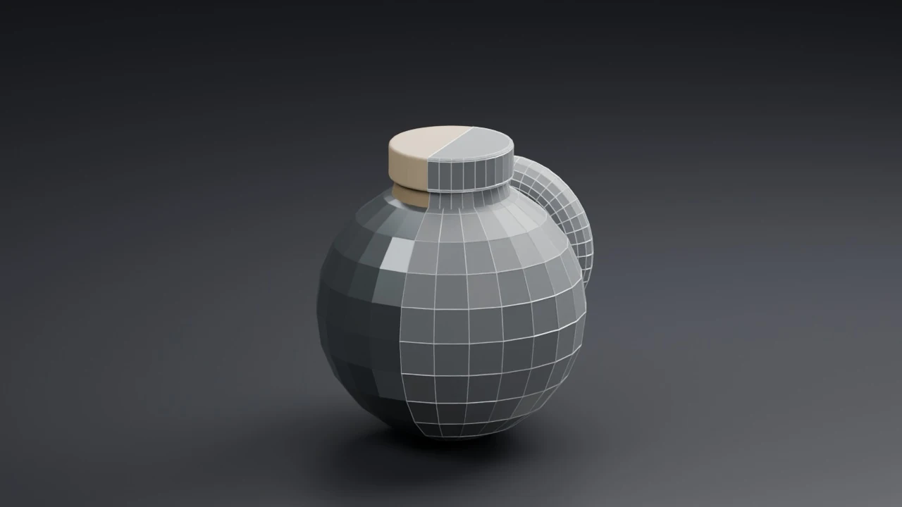

---

group: "product-photography-lighting"
title: "Trois éclairages pour vos photos produit"
description: "Utilisez trois setups de lumière répétables pour des produits mat, des surfaces réfléchissantes et des détails texturés."
date: 2026-11-30
updated: 2026-11-30
keyword: "éclairage photo produit"
cta: "Vérifiez les angles de votre produit dans l’aperçu gratuit."
---

Choisissez votre lumière en fonction de la surface : utilisez une lumière de fenêtre avec un réflecteur blanc pour les produits matés, agrandissez la source pour les produits brillants, et appliquez une lumière de grattage pour les reliefs, les coutures et les textiles. Gardez la position de la caméra et l'exposition constantes lors de la comparaison des setups.

## Comment positionnez-vous les sources ?

Placer la lumière de fenêtre ou le softbox en avant et à un côté pour la configuration de base. Ajoutez une carte blanche en sens opposé et vérifiez si l'ombre conserve encore de la profondeur. Déplacez-la en arrière si la forme semble plane.

Pour les produits brillants, placez la diffusion assez proche pour montrer une réflexion continue étendue. Pour la texture, baissez la lumière pour qu'elle grattage la surface. Dans les deux cas, examinez un point de lumière et un point d'ombre à l'échelle pleine.

## Comment répétez-vous le résultat ?

Marquez la position de la caméra, de la lumière et de l'objet. Notez la température de blanc et l'exposition. Enregistrez une image avec une carte neutre si la couleur compte. Comparez l'image à l'objet réel sous lumière neutre.

## Qu'est-ce que vous devez vérifier avant la publication ?

| Surface         | Setup                              | Rechercher                             |
| --------------- | ---------------------------------- | -------------------------------------- |
| Maté            | Lumière latérale et réflecteur     | Ombre lisible                          |
| Brillance       | Grande diffusion et bâches sombres | Réflexion lisse avec une limite claire |
| Relief ou tissu | Lumière latérale faible            | Texture avec des highlights intacts    |

<!-- IMAGE PENDING: Photograph or capture the example described in the brief. -->

**Source** [Shopify · product photography](https://help.shopify.com/en/manual/products/product-media/product-photography), [GIA · gem and jewelry photography](https://www.gia.edu/gem-photography), [GS1 · product image specification](https://www.gs1.org/standards/gs1-product-image-specification-standard/current-standard).

[Guide associé](/fr/guides/photographie-produit-e-commerce)

[Comment créer un modèle 3D](/learn/how-to-make-a-3d-model)

## Questions fréquentes

### Combien de lumières ai-je besoin ?

Commencez par une seule source et modifiez sa taille ou sa position. Ajoutez un réflecteur ou une autre lumière uniquement lorsque vous avez identifié un ombre ou un problème de fond séparé. Marquez la position de la caméra, de la lumière et de l’objet avant de modifier la configuration de votre éclairage.

### Pourquoi mes produits changent-ils de couleur ?

L’association de lumières et le mode blanc automatique peuvent modifier le résultat. Éteignez les sources inutiles, enregistrez une référence et gardez les paramètres stables. Placez une carte blanche en sens opposé pour vérifier que l'ombre conserve de la profondeur et que la couleur du produit reste fidèle.

### Qu’est-ce que je dois photographier pour un cahier de setup ?

Prenez un cadre large incluant l’objet et les positions des lumières. Conservez-le avec les fichiers finaux afin que la prochaine prise puisse reproduire l’arrangement. Commencez par une seule source de lumière et modifiez sa taille ou sa position pour évaluer l’impact sur l’ombre et le fond.
