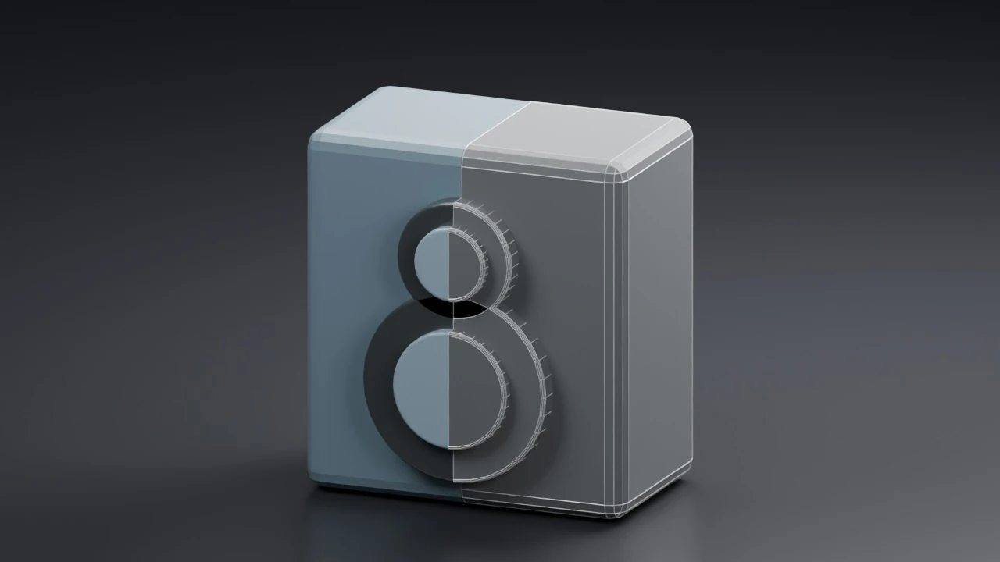

---

group: "blender-export-glb"
title: "Exporter un GLB depuis Blender avec ses textures"
description: "Préparez les matériaux et textures dans Blender, exportez un GLB et vérifiez-le dans une session de lecture propre."
date: 2026-12-04
updated: 2026-12-04
keyword: "exporter GLB Blender"
cta: "Vérifiez les angles de votre produit dans l’aperçu gratuit."
---

Préparez vos matériaux avec des textures d’image connectées à un shader pris en charge, puis exportez glTF 2.0 au format binaire GLB de Blender. Déplacez le résultat dans un dossier propre et ouvrez-le dans le lecteur de destination. Vérifiez que la couleur, les normales et l’alignement des textures sont préservés par le transfert.

## Qu'est-ce que vous préparez avant l'exportation ?

Ouvrez chaque matériau important dans l'éditeur de shader. Utilisez un Principled BSDF lorsque c’est pertinent et vérifiez les nœuds d’image. Bakez les apparence procédurales non supportées en cartes si nécessaire. Sélectionnez les objets qui font partie de la livraison et vérifiez leurs transformations et leur orientation.

## Comment exportez-vous et vérifiez-vous ?

Choisissez Fichier, Exporter, glTF 2.0,, puis glTF Binaire. Utilisez un export sur objets sélectionnés lorsque vous souhaitez exclure des helpers de scène. Validez le fichier, chargez-le dans un lecteur propre et comparez la face avant et l’inverse avec votre scène.

## Qu'est-ce qu'il faut vérifier avant la publication ?

| Problème                                 | Vérifiez d'abord                               |
| ---------------------------------------- | ---------------------------------------------- |
| Texture absente                          | Connexions d’image et ressources exportées     |
| La rugosité de surface semble incorrecte | Canaux de carte et espace de couleur           |
| Le modèle est tourné de côté             | Transformation de l’objet et orientation cible |

<!-- IMAGE PENDING: Photograph or capture the example described in the brief. -->

**Source** [Blender · glTF 2.0 import and export](https://docs.blender.org/manual/en/5.1/addons/import_export/scene_gltf2.html), [Khronos · glTF 2.0 specification](https://registry.khronos.org/glTF/specs/2.0/glTF-2.0.html), [Khronos · glTF Validator](https://github.com/KhronosGroup/glTF-Validator).

[Guide associé](/fr/guides/fichier-glb)

[Comment créer un modèle 3D](/learn/how-to-make-a-3d-model)

## Questions fréquentes

### Tous les matériaux de Blender sont-ils exportables ?

Oui, tous les matériaux de Blender sont exportables avec des nœuds de shader supportés. Utilisez un Principled BSDF et vérifiez les connexions d’image avant l’exportation. Vérifiez la rugosité et l’orientation du modèle dans le lecteur cible pour éviter les erreurs de canal ou de rotation.

### Comment puis-je confirmer qu’il est autonome ?

Déplacez uniquement le GLB exporté dans un dossier vide puis ouvrez-le dans le lecteur cible. Vérifiez les matériaux sous une lumière neutre pour s'assurer que les textures s'affichent correctement. Ensuite, vérifiez que le GLB contient toutes les textures en consultant les ressources intégrées de l'asset dans le panneau de métadonnées du lecteur.

### Le fichier BLEND compte-t-il après l'exportation ?

Gardez-le comme source éditable. Mettez à jour ce fichier pour les révisions et réexécuter l'exportation au lieu de considérer le fichier distribué comme le maître. Déplacez uniquement le fichier GLB dans un dossier vide puis ouvrez-le dans le lecteur cible pour vérifier les matériaux et la qualité de l’exportation.
